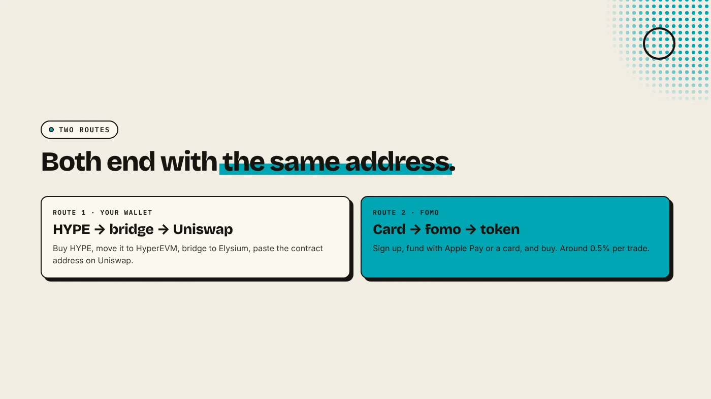
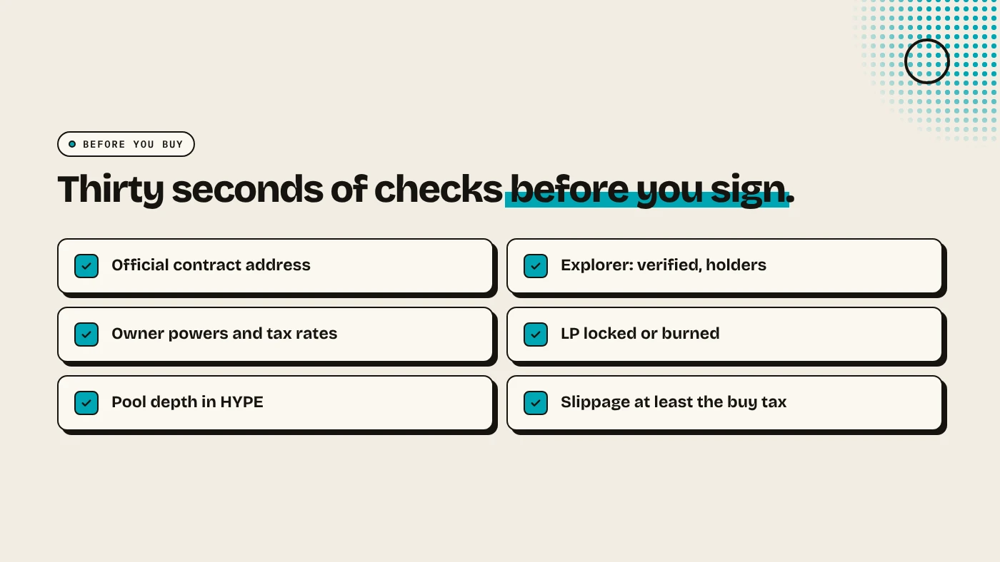

To buy a token on Elysium, you need HYPE on Elysium. Buy HYPE, move it to HyperEVM, bridge it to Elysium, then swap it for the token on Uniswap by pasting the token's contract address. The simpler route is the fomo app, which supports Elysium and lets you pay by card. Either way, check the contract address and the token itself before you buy.

:::note Key facts
- **You pay in HYPE** on Elysium, chain ID **99901**.
- **Uniswap** v2, v3 and v4 are live on Elysium (Coinranking).
- **fomo** supports Elysium and lets you fund with Apple Pay or a card (Datawallet).
- **Exits are slow:** bridging HYPE back to HyperEVM takes about **5.5 days** (TokenPost).
:::

:::note Not affiliated
DegenKit is not affiliated with Kinetiq, Hyperliquid, Uniswap or fomo.
:::

## Route 1: How do you buy with your own wallet and Uniswap?

1. **Get HYPE.** Buy it on Hyperliquid spot or on an exchange that lists it. See [what the HYPE token is](/blog/what-is-hype-token/).
2. **Move it to HyperEVM** with Hyperliquid's "Transfer to/from EVM", or withdraw from an exchange that supports HyperEVM.
3. **Bridge to Elysium** at Kinetiq's bridge. Send a small test amount first. See [how to bridge HYPE to Elysium](/blog/bridge-hype-to-elysium/).
4. **Add Elysium to your wallet** with chain ID 99901. See [Elysium chain ID and RPC](/blog/elysium-chain-id-rpc-metamask/).
5. **Open Uniswap**, switch to Elysium, paste the token's **contract address** into the token search and swap HYPE for it.
6. **Import the token** into your wallet with the same contract address so the balance shows.

## Route 2: How do you buy with fomo?

fomo is a trading app and Elysium's exclusive trading partner. You sign up with an email or Apple ID, fund with Apple Pay, Google Pay, a card or crypto, and buy without bridging yourself. Datawallet reports a spot fee of around 0.5% per trade and sponsored gas. See [what is the fomo app](/blog/what-is-fomo-app/).

Whether a specific new token is available in fomo depends on fomo. If you cannot find it, use Route 1.

## What should you check before you buy?

- **The contract address.** Copy it from the project's official X account or site. Never pick a token by name. Copies with the same name appear within minutes on a new chain.
- **The explorer page.** Is the contract verified? How many holders? Does one wallet hold most of the supply? See [the Elysium explorer guide](/blog/elysium-explorer/).
- **Owner powers.** A tax token's owner can change rates until ownership is renounced. See [the Elysium tax token guide](/blog/elysium-tax-token/).
- **The liquidity.** Is the LP locked or burned, and how much HYPE is in the pool? See [Elysium liquidity lock](/blog/elysium-liquidity-lock/).

Our guide to [checking a new Elysium token](/blog/check-new-elysium-token/) covers each step.

## What slippage should you use?

For a plain token in a reasonable pool, 0.5% to 1% is usually enough. A **tax token** needs slippage at least as high as its buy tax, or the swap fails. A thin pool also needs more, but higher slippage means you accept a worse price. See [slippage vs price impact](/blog/slippage-vs-price-impact/).

## What are the risks?

- **Copycat tokens** with the same name and logo.
- **Thin pools** where one trade moves the price a lot.
- **A days-old chain** with a single sequencer at launch.
- **Slow exits** of about 5.5 days back to HyperEVM.
- **Most new tokens lose value.**

You can lose money in crypto. This is not financial advice.

## FAQ

### What do I need to buy a token on Elysium?

HYPE on Elysium, either in your own wallet after bridging, or in the fomo app.

### Can I buy Elysium tokens with a card?

Yes, through fomo, which supports Apple Pay, Google Pay and cards. A direct Uniswap swap needs HYPE you already hold.

### Why can't I find the token on Uniswap?

Paste its contract address into the token search. New tokens may not appear by name.

## Sources

- [Coinranking: Elysium mainnet goes live with trading apps](https://coinranking.com/news/elysium-layer-2-mainnet-launches-november-9-trading-apps)
- [Datawallet: fomo app explained](https://www.datawallet.com/crypto/fomo-app-explained)
- [TokenPost: Elysium launch](https://www.tokenpost.com/news/technology/52986)
- [Chainstack: Elysium tooling](https://docs.chainstack.com/docs/elysium-tooling)

Launching instead of buying? Use the [DegenKit Elysium token creator](/launch/elysium/).
