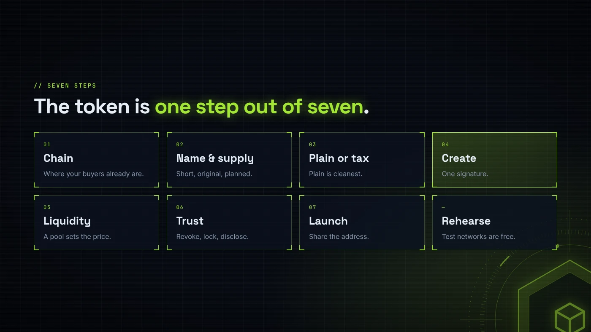
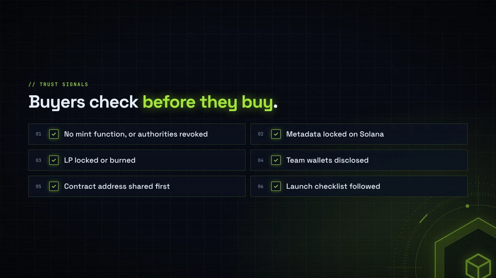

To create a crypto token, choose a blockchain, decide the name, symbol and supply, create the token with a token generator or your own smart contract, then add liquidity on a DEX so people can trade it. With a no-code generator, the token itself takes one transaction. The planning before it and the liquidity after it decide whether the launch works.

:::note Key facts
- **Token vs coin:** a token lives on an existing blockchain. A coin, like ETH or SOL, runs its own blockchain.
- **Standards:** SPL on Solana. ERC-20 on Ethereum, Base, Robinhood Chain and Elysium. BEP-20 on BNB Chain.
- **No-code route:** a token generator such as DegenKit's, on six networks.
- **Code route:** a simple ERC-20 contract costs about **$500 to $5,000** to develop (DEV Community, April 2026), plus an audit.
:::

## Step 1: Which blockchain should you use?

Pick the chain your buyers already use and can afford:

- **Solana:** cheap and fast, with the biggest meme coin market.
- **Ethereum:** the most credible and the most expensive.
- **BNB Chain and Base:** low fees on EVM chains.
- **Robinhood Chain and Elysium:** newer chains with early-mover attention.

Our comparison of [which blockchain to launch a token on](/blog/which-blockchain-to-launch-token/) goes deeper.

## Step 2: What should the name, symbol and supply be?

- **Name and symbol:** short, memorable and not a copy of another project. Search DEX screeners first. The [meme coin name generator](/tools/meme-coin-name-generator/) can help.
- **Supply:** a presentation choice. One billion is common for meme coins. What matters is the share each holder owns.
- **Allocation:** decide how much goes to the pool, the team and airdrops before you create anything. See [token supply and allocation](/blog/token-supply-and-allocation/).

## Step 3: Plain token or tax token?

A **plain token** has fixed supply and no owner powers. It is the cleanest choice for most launches. A **tax token** takes a percentage of each buy and sell and sends it to a wallet you choose, which only makes sense if the tax pays for something clear. See [how buy and sell tax works](/blog/how-token-buy-sell-tax-works/).

## Step 4: How do you create the token?

**With a token generator** (no code):

1. Open the [DegenKit launcher](/launch/) and pick the network.
2. Connect your wallet.
3. Enter name, symbol and supply, and on Solana a logo.
4. Review the fee and sign.

The [token generator guide](/blog/token-generator/) explains what happens behind the form.

**With your own contract** (code): write or adapt an ERC-20 or SPL program, test it, deploy it and verify the source. This gives full flexibility but costs time and money. See [token generator vs custom smart contract](/blog/token-generator-vs-custom-smart-contract/).

## Step 5: How do people buy it?

A token cannot be traded until it has a **liquidity pool**. You deposit your token plus SOL, ETH or BNB on a DEX, and the ratio sets the starting price. See [creating a token vs adding liquidity](/blog/creating-a-token-vs-adding-liquidity/). The free [liquidity calculator](/tools/liquidity-calculator/) shows the starting price before you deposit.

## Step 6: How do you earn buyers' trust?

- **Revoke authorities** on Solana, or use a token with no mint function on EVM chains.
- **Lock or burn the LP** so the pool cannot be pulled.
- **Disclose team wallets** and the allocation.

These are the checks buyers run. See [how to spot rug pull risk](/blog/how-to-spot-rug-pull-risk/).

## Step 7: How do you launch it?

Share the **contract address** on your official channels, explain the supply and liquidity, and follow a [token launch checklist](/blog/token-launch-checklist/). Expect bots in the first minutes and plan your pool depth for them.

## What are the risks?

- **Wrong network or wrong address** when sending funds.
- **Thin liquidity** that makes the price swing.
- **Copycats** using your name with a different contract.
- **Most new tokens lose value.**

You can lose money in crypto. This is not financial advice.

## FAQ

### How much does it cost to create a crypto token?

With DegenKit, 0.28 SOL on Solana, or the fee read from the contract on EVM chains, plus gas. A custom contract can cost thousands of dollars to develop and audit.

### Can I create a crypto token for free?

Not on mainnet. Every chain charges gas. Test networks are free but have no real value.

### How long does it take to create a token?

With a token generator, about a minute. Planning, liquidity and launch take longer.

### Do I need to know how to code?

No. A token generator handles the code. You only sign the transaction.

## Sources

- [DEV Community: How much does smart contract development cost in 2026](https://dev.to/john_dusty_6e163a86b84/how-much-does-smart-contract-development-cost-in-2026-a-practical-breakdown-4do3)
- [DegenKit docs: Supported networks](https://degenkit.app/docs/networks/)
- [DegenKit docs: Tax Token](https://degenkit.app/docs/tax-token/)

Create your token without code on the [DegenKit launcher](/launch/).
