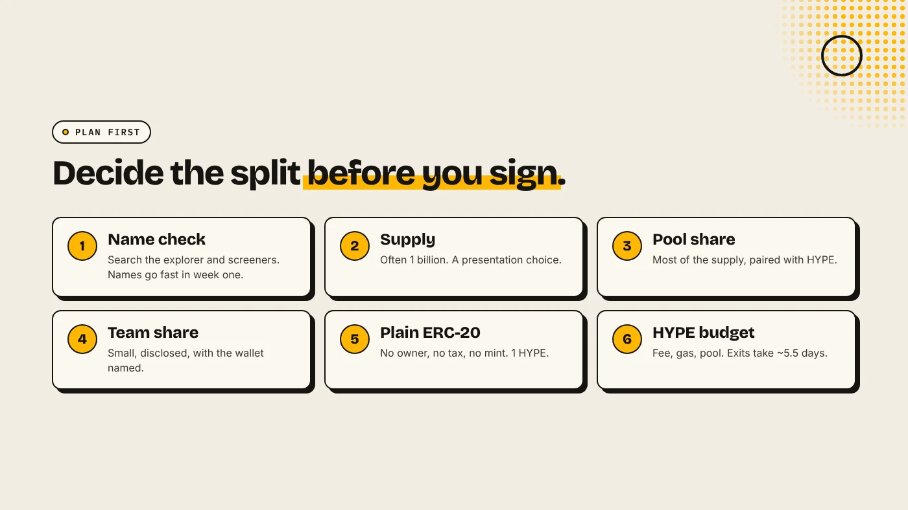
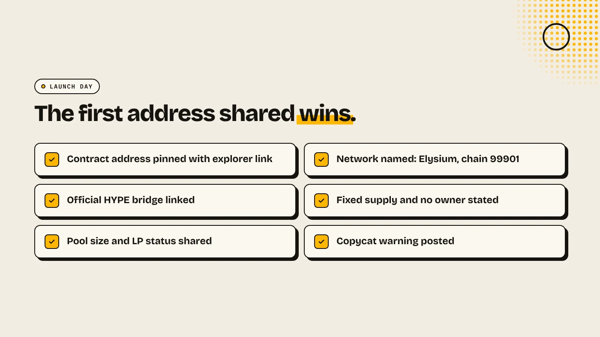

To make a meme coin on Elysium, choose a name, ticker and supply, bridge HYPE from HyperEVM, create the token with a token creator for 1 HYPE, then open a Uniswap pool with HYPE and share the contract address. Pump.fun is the other route. Elysium launched on November 9, 2026, so early coins get attention, and so do bots and copycats.

:::note Key facts
- **Chain:** Elysium, chain ID **99901**, gas in **HYPE**.
- **Create:** [DegenKit's Elysium token creator](/launch/elysium/), **1 HYPE** plus gas. Fixed supply, no mint, no owner.
- **Pool:** Uniswap v2, v3 and v4 are live on Elysium. Pump.fun supported Elysium from day one.
- **Exit:** bridging HYPE back to HyperEVM takes about **5.5 days**.
:::

:::note Not affiliated
DegenKit is not affiliated with Kinetiq, Hyperliquid, Uniswap or pump.fun.
:::

## What makes a meme coin on Elysium different?

The steps are the same as on any EVM chain, but three things are new:

- **The chain is days old.** There are few coins and lots of first-week attention, and few tools have caught up.
- **The pair asset is HYPE.** Buyers need HYPE on Elysium to trade your coin, and so do you.
- **Leaving is slow.** The official bridge back to HyperEVM has a challenge period of about 5.5 days, so plan your HYPE before you start.

For the chain itself, see [what is Elysium chain](/blog/what-is-elysium-chain/).

## How do you plan the coin?

- **Name and ticker.** Search the Elysium explorer and DEX screeners first. On a new chain, the obvious names go in the first hours.
- **Supply.** Many meme coins use 1 billion. The number is a presentation choice. What you put in the pool matters more.
- **Allocation.** Decide what goes in the pool, what you keep and what you airdrop. Say it publicly before launch.
- **Plain token.** For a meme coin, a plain ERC-20 with no owner is the clearest signal. A tax adds owner power that buyers on a new chain tend to avoid.

## How do you create it?

1. **Bridge HYPE** from HyperEVM at Kinetiq's bridge. Bring enough for the 1 HYPE fee, gas and your pool. See [bridging HYPE to Elysium](/blog/bridge-hype-to-elysium/).
2. Open the [Elysium launcher](/launch/elysium/), click **Connect wallet** and approve the switch to chain ID 99901.
3. Choose **Token Creator**. Fill in **Token name**, **Symbol** and **Total supply**.
4. Sign once. The **Contract address** appears and the full supply is in your wallet.

The [Elysium token creator guide](/blog/elysium-token-creator/) shows each field.

## How do you open the pool?

Open Uniswap, switch it to Elysium, and start a position with your token and HYPE. The ratio sets the first price. For example, 800,000,000 tokens with 40 HYPE starts one token at 0.00000005 HYPE.

ElyScreener, a third-party site, gives a launch-week rule of thumb: with about $3,000 of liquidity, a $500 buy can move the price by around 50%. A deeper pool makes the chart steadier and makes a sniper's first buy less damaging.

Then decide what happens to the LP. Locking or burning it is the strongest single trust signal on a chain this new.

## Should you use pump.fun on Elysium instead?

Pump.fun confirmed support for Elysium at launch. It sells a coin on a bonding curve until it graduates to a pool, so you need no liquidity up front, but you do not choose the supply or the starting price. Its Elysium terms may differ from Solana's, so check its site. Our comparison of [the Elysium token creator vs pump.fun](/blog/elysium-token-creator-vs-pump-fun/) sets out both.

## How do you launch without copycats?

- **Post the contract address first**, with the explorer link, before the name spreads.
- **Pin it** on X and Telegram, and repeat that Elysium is chain 99901.
- **Tell buyers they need HYPE on Elysium** and link the official bridge.
- **Share the facts:** fixed supply, no owner, pool size and LP status.

## What are the risks?

- **A days-old chain** with a single sequencer at launch.
- **Bots in the first block** and thin liquidity.
- **Slow exits** of about 5.5 days to HyperEVM.
- **Most meme coins lose value**, on new chains as on old ones.

You can lose money in crypto. This is not financial advice.

## FAQ

### How much does it cost to make a meme coin on Elysium?

On DegenKit, 1 HYPE plus gas to create. The pool needs the HYPE and tokens you deposit, which is usually the largest amount.

### Can I add a tax to an Elysium meme coin?

Yes, with **Tax Token** instead of Token Creator. See [the Elysium tax token guide](/blog/elysium-tax-token/). Most meme coins stay plain.

### Which Uniswap version should I use?

Any version works for a plain token. Full range on v2 is the simplest.

## Sources

- [Kinetiq launch release (GlobeNewswire via The Manila Times)](https://www.manilatimes.net/2026/11/09/tmt-newswire/globenewswire/kinetiq-launches-elysium-public-mainnet-a-high-performance-layer-2-built-for-hyperliquid/2465340)
- [Coinranking: Elysium mainnet goes live with trading apps](https://coinranking.com/news/elysium-layer-2-mainnet-launches-november-9-trading-apps)
- [TokenPost: Elysium launch](https://www.tokenpost.com/news/technology/52986)
- [ElyScreener: Mainnet day playbook](https://elyscreener.com/learn/elysium-mainnet-day-playbook/)

Create your Elysium meme coin with the [DegenKit Elysium token creator](/launch/elysium/).
