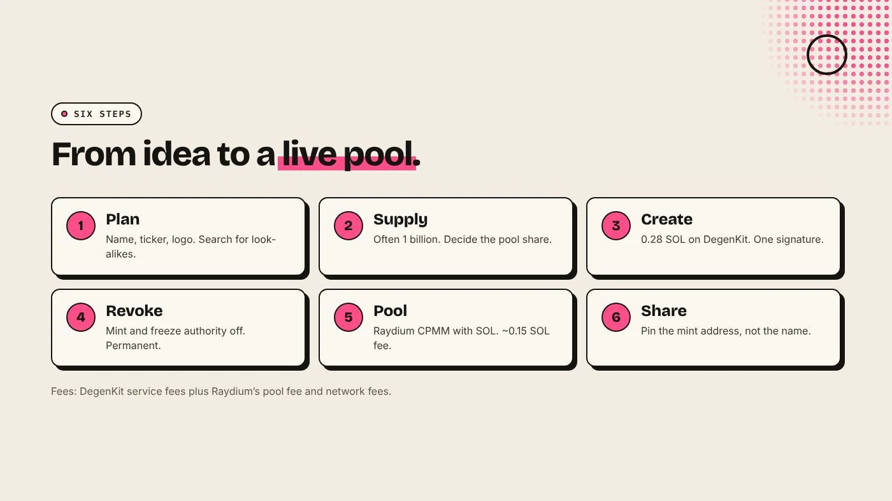
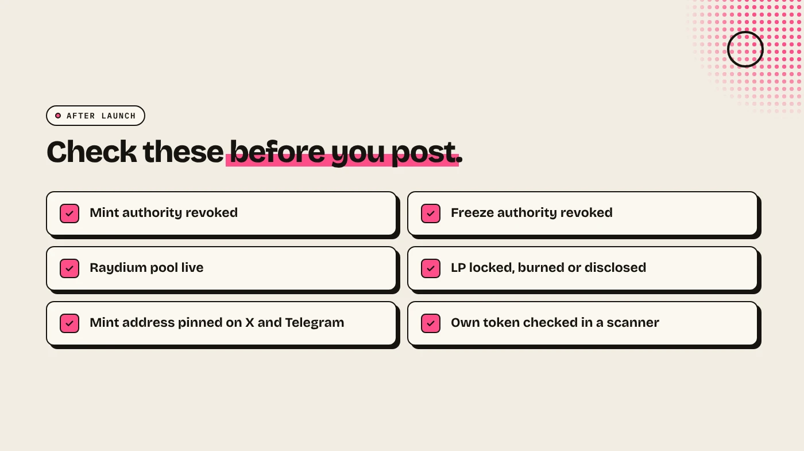

To make a meme coin on Solana, choose a name, ticker and supply, create an SPL token with a token creator, revoke the mint and freeze authorities, then open a Raydium pool with SOL so people can trade it. Share the mint address, not just the name. The coding is optional. The decisions are what matter.

:::note Key facts
- **Create:** an SPL token on [DegenKit's Solana launcher](/launch/solana/) costs a **0.28 SOL** service fee plus network fees.
- **Defaults:** 6 decimals and 1,000,000,000 supply. Both are editable before you sign.
- **Trust signals:** revoke mint and revoke freeze authority. Both are toggles in the create form.
- **Pool:** a Raydium CPMM pool costs about **0.15 SOL** in Raydium's fee plus a 0.05 SOL DegenKit fee, plus the SOL you deposit.
:::

:::note Not affiliated
DegenKit is not affiliated with Solana, Raydium, Jupiter or pump.fun.
:::

## What do you need before you start?

- **A Solana wallet** such as Phantom, Solflare or Backpack, with SOL for fees and liquidity.
- **A name and ticker** that are not already a well-known coin. Search DexScreener first so you do not launch a look-alike by accident.
- **A square logo**, usually PNG or WebP. It is shown in wallets and on DEX listings.
- **A supply and allocation plan.** Decide what goes into the pool, what you keep and whether any goes to an airdrop. Our guide to [token supply and allocation](/blog/token-supply-and-allocation/) covers the trade-offs.

Meme coins often use a large supply such as 1 billion so the price per token is a small number. Supply does not change value by itself. What matters is the share each holder owns and how much liquidity backs the pool.

## How do you create the token?

1. Open the [Solana launcher](/launch/solana/) and connect your wallet.
2. Fill in **Token name**, **Symbol**, **Decimals**, **Total supply** and a short **Description**.
3. Upload the **Token image**.
4. Turn on **Revoke mint authority** and **Revoke freeze authority**.
5. Check the summary and sign. The mint account, metadata and full supply are created in one transaction, and the **Contract address** appears.

On DegenKit, metadata (name, symbol and image) is created locked, so it cannot be edited later. Check the spelling and logo before you sign. For background, see [Solana token metadata explained](/blog/solana-token-metadata-explained/).

## Why revoke mint and freeze authority?

**Mint authority** can create new tokens. If it stays active, the creator could print more supply and dilute every holder. **Freeze authority** can freeze a holder's token account so they cannot sell. Scanners and many buyers check both. Revoking them is permanent, and it is one of the simplest ways to show a coin cannot be inflated or frozen. Our explainer on [mint authority vs freeze authority](/blog/mint-authority-vs-freeze-authority/) goes deeper.

## How do you make the coin tradable?

A new token has no price until a pool exists. On DegenKit, **Create Liquidity** opens a Raydium CPMM pool in one transaction:

- **Pair:** SOL or USDC. Most meme coins pair with SOL. See [SOL or USDC as the pair](/blog/sol-or-usdc-liquidity-pair/).
- **Amounts:** the ratio of tokens to SOL sets the starting price. For example, 800,000,000 tokens with 10 SOL starts one token at 0.0000000125 SOL.
- **Fees:** Raydium's one-time pool creation fee of about 0.15 SOL, plus the 0.05 SOL DegenKit fee.

Once the pool is live, the token can be traded on Raydium and routed through Jupiter. The LP tokens go to your wallet. Keep them safe, or lock or burn them to show liquidity cannot be pulled. See [locking liquidity on Solana](/blog/lock-liquidity-on-solana-burn-and-earn/).

## Should you use pump.fun instead?

Pump.fun is the other common route. It creates a coin with a fixed 1 billion supply and sells it on a bonding curve until it graduates to a pool. It is faster and cheaper up front, but you do not choose the supply, the starting price or what happens to liquidity. A token creator gives you the full supply and your own pool. Our comparison of [pump.fun vs Raydium](/blog/pump-fun-vs-raydium/) sets out both routes.

## What should you do after launch?

- **Pin the mint address** on X and Telegram with an explorer link.
- **Check your own token** with a scanner. DegenKit's Scanner shows mint and freeze status, top holder share and a bubblemap of the top 10 holders.
- **Tell holders the facts:** total supply, what is in the pool and whether LP is locked or burned.
- **Keep some SOL** for later transactions.

## What are the risks?

- **Most meme coins lose value.** MadeOnSol counted a graduation rate of about 1.8% for pump.fun coins in August 2026.
- **Thin pools move fast.** A small pool lets a single buy or sell swing the price.
- **Snipers and bundled buys** can take supply in the first block. See [Solana bundlers explained](/blog/solana-bundler-explained/).
- **Copycats** will use your name. Only the mint address identifies your coin.

You can lose money in crypto. This is not financial advice.

## FAQ

### How much does it cost to make a meme coin on Solana?

On DegenKit, creation is 0.28 SOL plus network fees. A Raydium pool adds about 0.15 SOL in Raydium's fee and 0.05 SOL to DegenKit, plus the SOL you put in the pool.

### Do I need to code to make a Solana meme coin?

No. A token creator writes the SPL token for you from a form, and you sign with your wallet.

### Can I change the name or logo later?

Not on DegenKit, because metadata is created locked. Check everything before you sign.

### How many tokens should a meme coin have?

Many use 1 billion. The number is a presentation choice. Ownership share and liquidity matter more.

## Sources

- [Backpack Learn: How to launch a meme coin on Solana](https://learn.backpack.exchange/articles/launch-a-meme-coin-on-solana)
- [MadeOnSol: Pump.fun vs PumpSwap vs Raydium](https://madeonsol.com/blog/pump-fun-vs-pumpswap-vs-raydium)
- [crypto.news: How meme coins are made, bonding curves and pump.fun](https://crypto.news/how-meme-coins-are-made-bonding-curves-pump-fun-rug-pulls/)

Create your meme coin with the [DegenKit Solana token creator](/launch/solana/).
