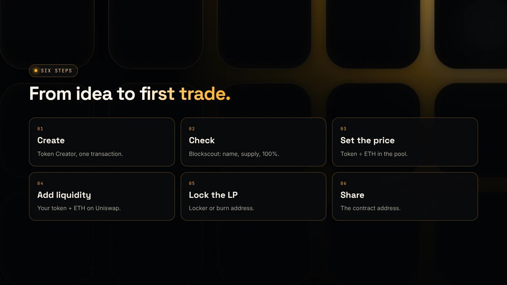
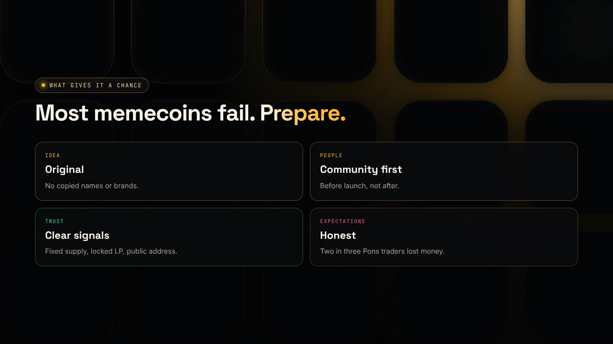

To make a memecoin on Robinhood Chain, create an ERC-20 with a token generator, add liquidity on Uniswap with ETH, and share the contract address with your community. The technical part takes minutes. The hard part is the idea and the people, since most new memecoins lose value quickly.

:::note Key facts
- **Network:** Robinhood Chain, chain ID **4663**, gas in ETH on Robinhood Chain.
- **Creation:** one transaction with DegenKit's **Token Creator**: fixed supply, no mint function, no owner.
- **Liquidity:** your token + ETH on Uniswap. The ratio sets the starting price.
- **Reality check:** memecoins dominated Robinhood Chain's trending lists in July 2026 (CoinDesk), and most launchpad coins lose value (Bitquery).
:::

## What is a memecoin?

A memecoin is a token whose value comes from a joke, a culture or a community rather than a product. It is technically an ordinary token. On Robinhood Chain that means a standard ERC-20.

Memecoins are a large part of activity on the network. In July 2026, CoinDesk reported that memecoins topped the DEX Screener trending list on Robinhood Chain, and that one early coin, CASHCAT, rose more than 1,700% and then fell about 75% from its peak ([CoinDesk](https://www.coindesk.com/business/2026/07/25/robinhood-chain-s-real-world-assets-jump-fivefold-as-tokenized-stocks-start-trading-in-bigger-size)). Robinhood had no part in it.

## What do you need before you start?

- An EVM wallet such as MetaMask or Rabby.
- ETH on Robinhood Chain for fees, gas and the pool. See [how to bridge ETH to Robinhood Chain](/blog/bridge-eth-to-robinhood-chain/).
- A **name** (up to 40 characters), **symbol** (up to 10 characters) and **supply**. Many memecoins use 1,000,000,000 so prices are small numbers.
- An image and a place for your community, such as an X account or a Telegram group.

## How do you make the memecoin?

1. **Create the token.** Open the [Robinhood Chain token generator](/launch/robinhood/), click **Connect wallet**, choose **Token Creator**, fill in **Token name**, **Symbol** and **Total supply**, then click **Create token** and confirm. Result: the **Contract address** appears and the full supply is in your wallet.
2. **Check it.** Click **View on Blockscout →** and confirm the name, symbol and supply. Result: your wallet holds 100%.
3. **Decide the starting price.** For example, 500,000,000 tokens with 0.5 ETH starts one token at 0.000000001 ETH. Result: a deliberate price, not a guess.
4. **Add liquidity on Uniswap** with your token and ETH. Result: the token can be bought and sold. See [which Uniswap version to use](/blog/robinhood-chain-uniswap-v2-v3-v4/).
5. **Lock or burn the LP** if you want buyers to trust that liquidity stays. See [Robinhood Chain liquidity locks](/blog/robinhood-chain-liquidity-lock/).
6. **Share the contract address** with the Blockscout link. Result: people can find the real token, not a copy.

## How much does it cost?

- **Creation:** DegenKit's service fee, shown on the form before you sign, plus gas.
- **Liquidity:** the ETH you put in the pool, plus gas. This is usually the largest amount.
- **Locking:** gas, plus any locker service fee.

There are no ongoing fees for a plain token. See [DegenKit fees](/docs/fees/).

## Token generator or launchpad?

Launchpads such as Pons create a coin and sell it on a bonding curve until it graduates to Uniswap. A token generator gives you the full supply and lets you set the price, pool and lock yourself. Compare them in [Pons launchpad vs a token generator](/blog/pons-launchpad-vs-token-generator/).

:::note Not affiliated
DegenKit is not affiliated with Pons or Robinhood.
:::

## What gives a memecoin a chance?

- **A clear, original idea.** Do not copy another coin's name or use Robinhood's brand.
- **A real community** before launch, not after.
- **Trust signals:** fixed supply, no owner, locked or burned LP and a public contract address.
- **Honest expectations.** Bitquery found that in Pons' first month, two in three trading wallets lost money and the median graduated coin fell about 85% from its first hour ([Bitquery](https://bitquery.io/investigations/pons-launchpad)).

## What are the risks?

- **Loss of the ETH you put in the pool** if the price falls.
- **Permanent mistakes.** Name, symbol and supply cannot change.
- **Copycats** with the same name and a different address.
- **Legal issues** if you promise profits or imitate a brand.

You can lose money in crypto. This is not financial advice.

## FAQ

### How do you start a memecoin?

Pick an original name and idea, build a small community, create the token with a token generator, add liquidity on a DEX and share the contract address.

### How do you create a memecoin for free?

You always pay network gas, and you need some ETH or another asset for liquidity if you want it to trade. Creation itself is a single, low-cost transaction.

### Can you trade memecoins on Robinhood?

Memecoins trade on DEXs such as Uniswap on Robinhood Chain, using a self-custody wallet. Which coins the Robinhood app lists is a separate question for Robinhood.

### What is a memecoin?

A token whose value comes from a meme, culture or community rather than a product. Technically it is an ordinary token such as an ERC-20.

## Sources

- [CoinDesk: Robinhood Chain's real-world assets jump fivefold](https://www.coindesk.com/business/2026/07/25/robinhood-chain-s-real-world-assets-jump-fivefold-as-tokenized-stocks-start-trading-in-bigger-size)
- [Bitquery: Pons Launchpad growth on Robinhood Chain](https://bitquery.io/investigations/pons-launchpad)
- [Robinhood Chain docs: Connecting](https://docs.robinhood.com/chain/connecting)

When your idea is ready, create it with the [DegenKit token generator for Robinhood Chain](/launch/robinhood/).
