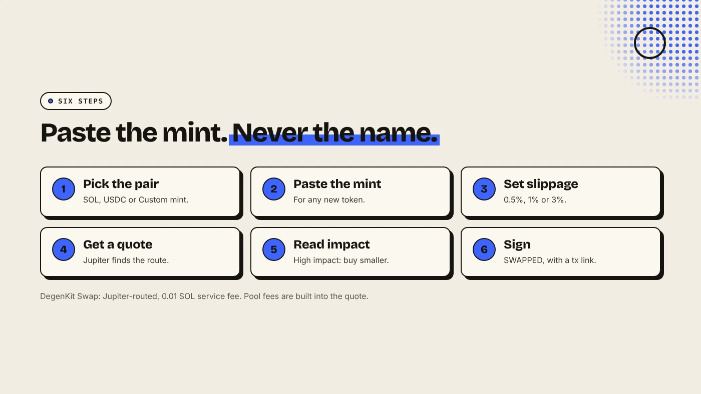
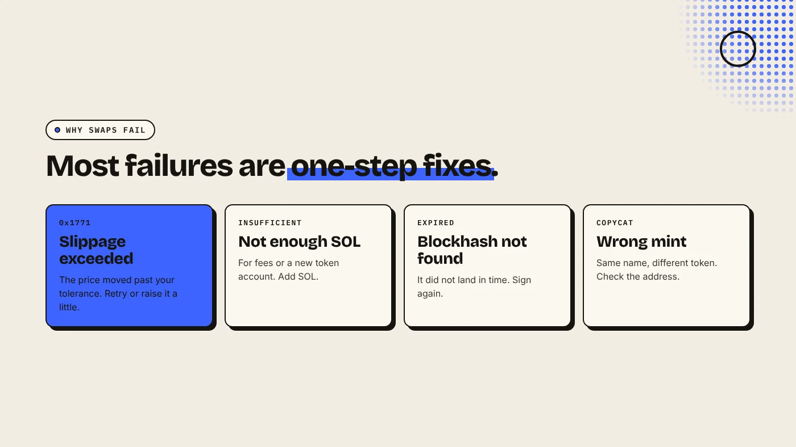

To swap tokens on Solana, connect a wallet, choose what you pay and what you receive (paste the mint address for any token not listed), set slippage, check the price impact and sign. Aggregators such as Jupiter split your trade across many DEXs to find the best price. Most failed or expensive swaps come from the wrong mint address, too little slippage or too much price impact.

:::note Key facts
- **Routing:** Jupiter connects **30+ Solana DEX programs** and can split one trade across several (Eco).
- **Jupiter's spot router charges no swap fee.** Each DEX charges its own pool fee.
- **DegenKit Swap:** Jupiter-routed, slippage **0.5%, 1% or 3%**, service fee **0.01 SOL**.
- **Failed swaps still pay** the network base fee of 5,000 lamports per signature (Solana docs).
:::

:::note Not affiliated
DegenKit is not affiliated with Jupiter, Raydium, Orca or Meteora. Swaps on DegenKit are routed and executed by Jupiter's public aggregator.
:::

## How does a Solana swap work?

A swap trades one token for another through a liquidity pool. Solana has many pools for popular pairs, spread across DEXs such as Raydium, Orca and Meteora. An **aggregator** checks them all and builds the best route. Eco describes how Jupiter's routing engine splits a large trade across several venues when one pool cannot fill it at the best price. The route is fixed when you sign.

For a new token with a single Raydium pool, the route is simply that pool.

## How do you swap with DegenKit?

1. Open the [Solana launcher](/launch/solana/), connect your wallet and choose **Swap**.
2. Under **You pay**, pick SOL, USDC or **Custom mint…** and enter the amount.
3. Under **You receive**, pick the token. For a new token, choose **Custom mint…** and paste its mint address.
4. Choose **Slippage tolerance**: 0.5%, 1% or 3%.
5. Click **Get quote**. Check the estimated amount and **Price impact**.
6. Sign. You see **SWAPPED** and the transaction link.

## What is the difference between slippage and price impact?

- **Price impact** is how much *your own trade* moves the pool's price. It grows with trade size and shrinks with pool depth.
- **Slippage tolerance** is how much worse than the quote you will accept if *the price moves* before your swap lands. If it moves more, the swap fails rather than filling at a bad price.

Low slippage protects you but fails more often in fast markets. High slippage fills more reliably but leaves more room for a worse price. Our guide to [slippage vs price impact](/blog/slippage-vs-price-impact/) covers both in depth.

## What does a swap cost?

- **Network fee:** 5,000 lamports (0.000005 SOL) per signature, plus any priority fee.
- **Pool fee:** each DEX charges its own fee, usually a fraction of a percent, built into the quote.
- **DegenKit service fee:** 0.01 SOL per swap.
- **Token account rent:** the first time you receive a token, a small refundable SOL deposit opens its account. See [Solana fees and rent explained](/blog/solana-fees-and-rent-explained/).

## Why do swaps fail?

- **Slippage exceeded:** the price moved more than your tolerance. Error code 0x1771 is a common sign.
- **Not enough SOL** for fees and the new token account.
- **Expired blockhash** during congestion.

Our guide to [failed Solana transactions](/blog/solana-transaction-failed/) lists each error and its fix.

## What are the risks?

- **Copycat tokens.** The same name and logo can sit on a different mint. Always paste the address.
- **Thin pools.** New tokens can show very high price impact. Buy smaller.
- **Price moves.** The price can change between your quote and your signature.
- **Honeypots.** Some tokens let you buy but not sell. Scan first with the [Solana token scanner guide](/blog/solana-token-scanner/).

You can lose money in crypto. This is not financial advice.

## FAQ

### Does Jupiter charge a fee?

Jupiter's spot router does not add a swap fee. The pools along the route charge their own fees, and apps built on Jupiter can add a service fee.

### What slippage should I use on Solana?

0.5% to 1% for liquid pairs. New or volatile tokens may need more. Never set it higher than the loss you would accept.

### Why did my swap fail but I still paid a fee?

Solana charges the base fee even when a transaction fails on-chain.

## Sources

- [Eco: Jupiter aggregator, how Solana's DEX router works](https://eco.com/support/en/articles/14801182-jupiter-aggregator-how-solana-s-dex-router-works)
- [Solana docs: Fee structure](https://solana.com/docs/core/fees/fee-structure)
- [RPC Fast: Solana transaction error codes](https://rpcfast.com/blog/solana-transaction-error-code)

Swap at the best Jupiter route with **Swap** on the [DegenKit Solana launcher](/launch/solana/).
