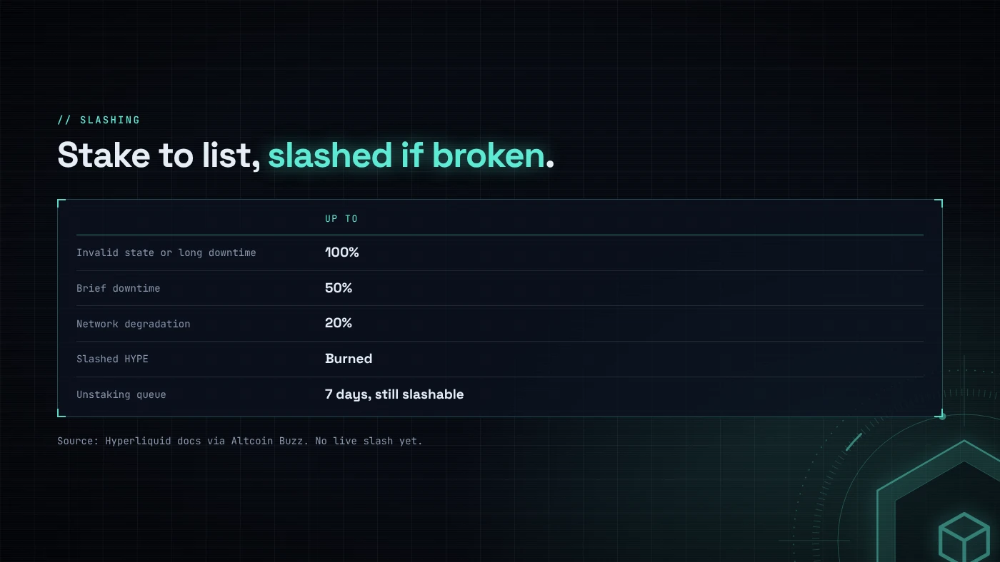
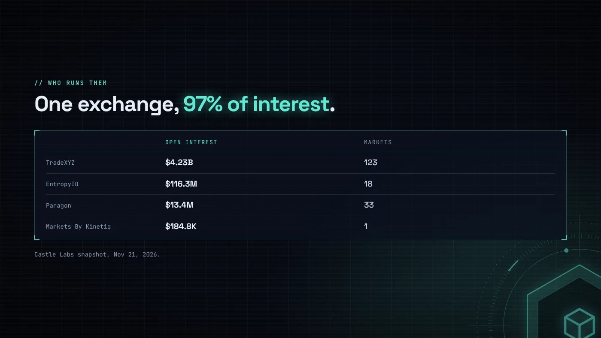

HIP-3 lets anyone who stakes 500,000 HYPE run their own perpetual futures exchange on Hyperliquid, with its own markets, order books and fees. It went live in October 2025. By November 21, 2026, HIP-3 exchanges held $4.36 billion in open interest, 97% of it on TradeXYZ, and stocks and commodities made up 69% of Hyperliquid's non-BTC, non-ETH volume. ICE plans to bring these markets to the U.S.

:::note Key facts
- **Stake:** **500,000 HYPE** per deployer, slashable by validator vote (Altcoin Buzz, citing Hyperliquid docs).
- **Open interest:** **$4.36B** across live HIP-3 exchanges, Nov 21 (Castle Labs).
- **Leader:** TradeXYZ, **$4.23B** across 123 markets.
- **U.S.:** ICE agreed on **Oct 29, 2026** to run U.S. markets built with TradeXYZ, subject to approval (The Block).
:::

:::note Not affiliated
DegenKit is not affiliated with Hyperliquid, TradeXYZ, ICE or any exchange named here. DegenKit's Elysium support covers token creation, not perpetual futures.
:::

## How does HIP-3 work?

- **One deployer, one perp exchange.** Each has its own margining, order books and settings.
- **Listing:** the first three assets skip the auction. Later assets go through a Dutch auction shared across all HIP-3 exchanges.
- **Fees:** deployers set a fee share from 0% to 300% (0% to 100% in growth mode).
- **Sub-deployers** can run day-to-day market control without moving the stake.
- **No HLP backstop.** HIP-3 markets depend on the deployer's liquidity, not Hyperliquid's HLP pool.

## What are the slashing rules?

Validators can slash a deployer's stake by stake-weighted vote:

| Issue | Up to |
|---|---|
| Invalid state transitions or long downtime | 100% |
| Brief downtime | 50% |
| Network degradation | 20% |

Slashed HYPE is burned, not paid to traders. Slashing still applies during the 7-day unstaking queue. Hyperliquid's docs say slashing "does not distinguish between malicious and incompetent behavior". No live slash has happened yet.

## Why are stocks leading?

Delphi Digital, via Altcoin Buzz:

- **July 2026:** real-world asset perps passed half of Hyperliquid's weekly volume for the first time.
- **November 19, 2026:** stocks and commodities were 69% of volume outside BTC and ETH, versus 94% for altcoins a year earlier.
- **Daily volume** in stock and commodity perps passed $4 billion, up from about $140 million a year earlier.

## Who runs HIP-3 exchanges?

Castle Labs' November 21 snapshot: four of ten registered exchanges had live markets.

| Exchange | Open interest | Markets |
|---|---|---|
| TradeXYZ | $4.23B | 123 |
| EntropyIO | $116.3M | 18 |
| Paragon | $13.4M | 33 |
| Markets By Kinetiq | $184.8K | 1 |

Kinetiq is also behind Elysium. See [what is Elysium](/blog/what-is-elysium-chain/).

## How is HIP-3 coming to the U.S.?

- **ICE,** the NYSE's parent, agreed on October 29 to operate U.S. markets and clearing for perps built with TradeXYZ, and to invest in TradeXYZ. Subject to regulatory approval.
- **Hyperliquid Strategies** (Nasdaq: PURR) filed on November 5 to become a CFTC-registered futures commission merchant, to carry U.S. accounts for HIP-3 markets.
- **HIP-3\*,** an optional allowlist for permissioned markets, reached testnet on October 26.

See [U.S. crypto perpetual futures](/blog/us-crypto-perpetual-futures/).

## What does HIP-3 mean for token creators?

HIP-3 lists perpetual futures, not spot tokens, and the stake is out of reach for most projects. For a token on the Hyperliquid ecosystem, the path is still spot: HIP-1 on HyperCore or an ERC-20 on an EVM chain like Elysium. See [HIP-1 token vs Elysium ERC-20](/blog/hip-1-token-vs-elysium-erc20/) and [what is the HYPE token](/blog/what-is-hype-token/).

## What are the risks?

- **No HLP backstop:** losses beyond margin can fall on winners through auto-deleveraging.
- **Deployer risk:** a flawed or compromised deployer can harm a market.
- **Concentration:** one exchange holds 97% of HIP-3 open interest.

You can lose money in crypto. This is not financial advice.

## FAQ

### What is Hyperliquid HIP-3?

A framework that lets anyone staking 500,000 HYPE run a perpetual futures exchange on Hyperliquid.

### What can get a HIP-3 deployer slashed?

Invalid state transitions, downtime or degraded performance, by validator vote. Slashed HYPE is burned.

### Can U.S. users trade HIP-3 markets?

Not yet directly. ICE and others plan regulated U.S. access, subject to approval.

## Sources

- [Altcoin Buzz: HIP-3 rules and slashing](https://www.altcoinbuzz.io/hyperliquid-s-hip-3-rules-put-500k-hype-at-risk-of-slashing)
- [The Block: ICE moves to bring Hyperliquid perps to U.S.](https://www.theblock.co/news/business/2026-10-29-ice-tradexyz-hyperliquid-perpetual-futures-us-432132)
- [The Block: Hyperliquid Strategies files to become FCM](https://www.theblock.co/news/markets/2026-11-05-hyperliquid-strategies-files-become-cftc-registered-fcm-posts-13-3-million-quaterly-revenue-435455)

Create a token on Elysium with the [DegenKit token generator](/launch/).
