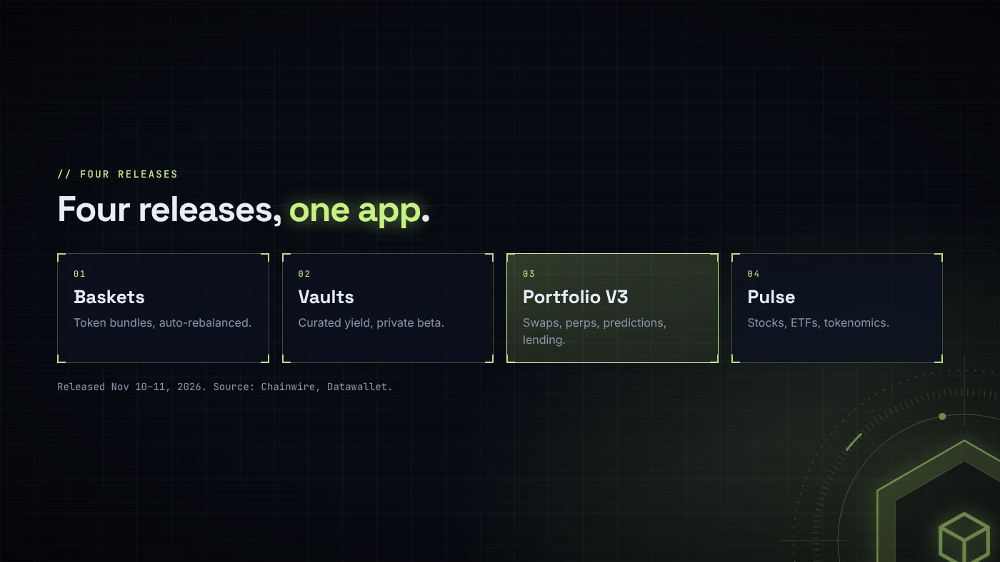
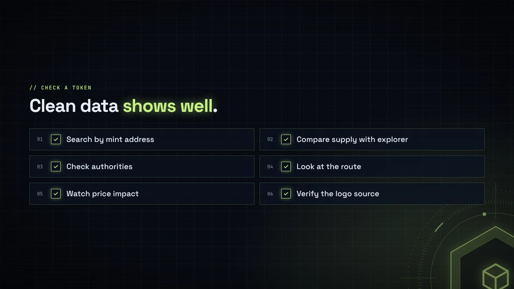

Jupiter, Solana's largest trading platform, launched four products on November 10–11, 2026 under the name "Aggregate Everything": Baskets for buying token bundles, Vaults for curated yield, Portfolio V3 for managing positions in one place, and Pulse with rebuilt token pages. Jupiter reports more than $1.3 trillion in cumulative aggregator volume, about $1.7 billion in value locked and over $1 billion in active loans.

:::note Key facts
- **Released:** **November 10–11, 2026** (Chainwire, Datawallet).
- **Four products:** Baskets, Vaults (private beta for **19,000+** waitlisted users), Portfolio V3, Pulse.
- **Scale:** **$1.3T+** cumulative aggregator volume, **~$1.7B** value locked, **$1B+** active loans.
- **Quote:** COO Kash Dhanda, "the era of do-it-yourself DeFi is over".
:::

:::note Not affiliated
DegenKit is not affiliated with Jupiter. Product details are as reported by the sources listed.
:::

## What are the four products?

| Product | What it does | Status |
|---|---|---|
| Baskets | Buy a bundle of tokens with one SOL or USDC deposit, auto-rebalanced | Rolling out |
| Vaults | Yield strategies run by independent curators | Private beta |
| Portfolio V3 | Trade, perps, predictions and lending from one page, with liquidation alerts | Live |
| Pulse + token pages | Market data for tokenized stocks and ETFs, DeFi tokenomics | Rolling out |

## How do Baskets work?

A user deposits SOL or USDC once and receives a set of tokens. Holdings follow market-cap weights or fixed targets and rebalance automatically. It is Jupiter's version of an index product on Solana.

## How do Vaults work?

Vaults are yield strategies built and run by independent curators, not by Jupiter. They opened on November 11 as a private beta for more than 19,000 people on the waitlist. Curated strategies carry the curator's risk as well as smart contract risk.

## What is new in Portfolio V3 and Pulse?

- **Portfolio V3** brings swaps, perpetual futures, prediction markets and lending into one page, with alerts when positions near liquidation. Jupiter has offered Polymarket predictions since February 2026. See [prediction markets on Solana](/blog/prediction-markets-on-solana/).
- **Pulse and token pages** add data for tokenized stocks and ETFs, and tokenomics for DeFi projects. See [tokenized stocks on Solana](/blog/tokenized-stocks-on-solana/).

## What does this mean for token creators?

- **Token pages matter more.** Jupiter now shows tokenomics on token pages. Clean supply data and revoked authorities read well. See [Jupiter token verification](/blog/jupiter-token-verification/).
- **Routing is still the core.** Once your token has a pool on Raydium or Meteora, Jupiter can route trades to it.
- **Baskets favor larger tokens.** Market-cap weighting makes small new tokens unlikely to appear in baskets at first.
- **Missing logo or price?** See [why your token is not showing in Phantom](/blog/token-not-showing-in-phantom/).

## How does this fit Solana's direction?

Jupiter is turning into a single "money app", in Dhanda's words. That mirrors moves across Solana: pump.fun added perps and predictions, and Samsung Wallet added USDC. See [Samsung Wallet USDC on Solana](/blog/samsung-wallet-usdc-solana/).

## How can you check a token on Jupiter?

1. Search the token by its **mint address**, not its name, because names can be copied.
2. Open the token page and compare **supply, holders and authorities** with the explorer.
3. Check the **route**: which pools Jupiter uses and how deep they are.
4. Look at **price impact** before you swap. A high number means thin liquidity.

These checks take a minute and catch most copycat and thin-pool problems. See [how to spot rug pull risk](/blog/how-to-spot-rug-pull-risk/).

## What are the risks?

- **Curator risk** in Vaults.
- **Leverage** in perps from the portfolio page.
- **Smart contract risk** across every product.

You can lose money in crypto. This is not financial advice.

## FAQ

### What is Jupiter's Aggregate Everything release?

Four products launched in November 2026: Baskets, Vaults, Portfolio V3 and Pulse with rebuilt token pages.

### Are Jupiter Vaults run by Jupiter?

No. Independent curators run the strategies.

### Will my new token appear on Jupiter?

Jupiter routes to tokens with liquidity in supported pools. Verification and token page data depend on Jupiter's own rules.

## Sources

- [Chainwire: Jupiter launches Aggregate Everything](https://chainwire.org/2026/11/10/jupiter-launches-the-aggregate-everything-release-with-4-new-products/)
- [Datawallet: Jupiter launches four new products](https://www.datawallet.com/news/jupiter-launches-four-new-products)
- [The Block: Polymarket expands to Solana through Jupiter](https://www.theblock.co/post/387945/jupiter-polymarket-solana)

Create a Solana token Jupiter can route to with the [DegenKit token generator](/launch/).
