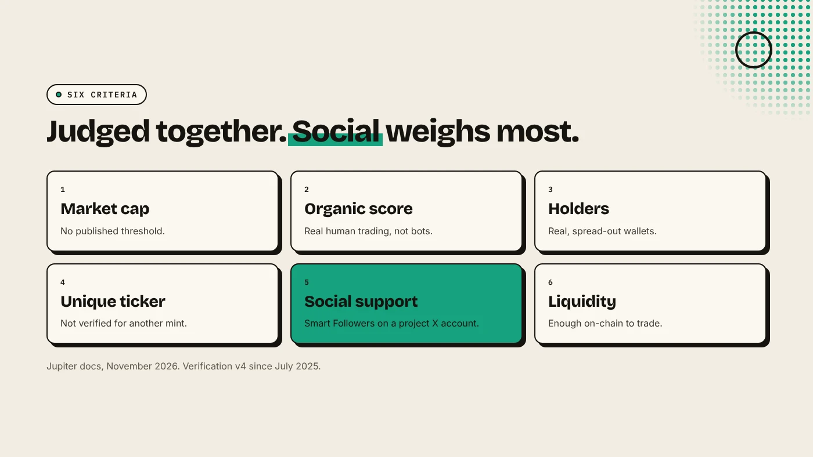
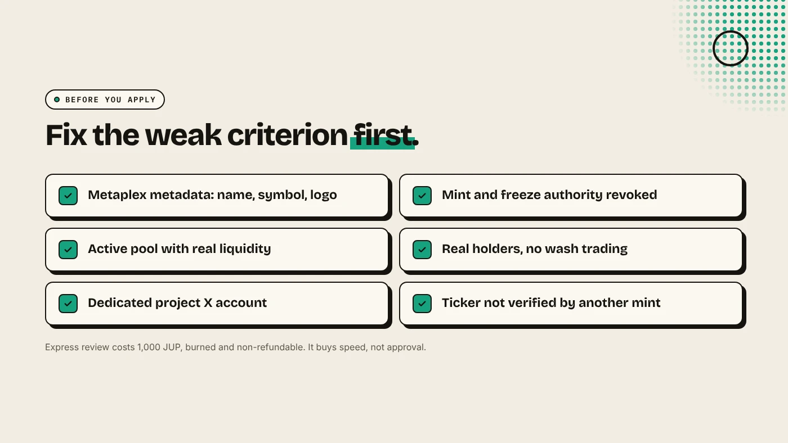

To get a token verified on Jupiter, submit its mint address at verified.jup.ag. Jupiter reviews six criteria: market cap, organic score, holders, ticker uniqueness, social support and on-chain liquidity. Standard review is free with no set timeline. Express review costs 1,000 JUP for a first answer in 24 to 48 hours. Verification marks the canonical token. It does not mean the token is safe.

:::note Key facts
- **Submit at:** verified.jup.ag. Anyone can submit, not only the team (Jupiter docs).
- **Six criteria,** judged together. **Social support** on a dedicated project X account matters most.
- **Standard review:** free. **Express review:** 1,000 JUP, burned, non-refundable.
- **Not permanent.** Jupiter can remove the badge if liquidity or trading stops.
:::

:::note Not affiliated
DegenKit is not affiliated with Jupiter. Criteria and fees below are from Jupiter's documentation as of November 2026 and can change.
:::

## What does "verified" on Jupiter mean?

A verified token gets a green badge next to its ticker in Jupiter's apps and in partner wallets such as Phantom. It tells traders that this mint address is the canonical token for that name, not a copy. It also removes Jupiter's "Not Verified" JupShield warning.

Jupiter is clear that the badge "is not an endorsement" and not a guarantee of safety. Unverified tokens can still be traded on Jupiter if they have enough liquidity.

Verification also helps outside Jupiter. Solana Explorer shows a token in search once any of five providers recognizes it, and Jupiter is one of them. Solflare's token list largely follows Jupiter's.

## What does Jupiter check?

Jupiter's Verification v4, launched in July 2025, replaced fixed thresholds with a holistic review of six criteria:

1. **Market cap.**
2. **Organic score:** Jupiter's measure of genuine human trading, designed to discount volume bots. The exact formula is not public.
3. **Token holders.**
4. **Ticker uniqueness:** a ticker already verified for another mint is rejected.
5. **Social support:** "Smart Followers" and engagement on a project X account. A personal or influencer account does not count.
6. **On-chain liquidity.**

Exact thresholds are not published.

## How do you apply?

1. **Get the basics right first.** Valid Metaplex metadata (name, symbol, logo), an active pool, and revoked mint and freeze authority. See [how to make a meme coin on Solana](/blog/how-to-make-a-meme-coin-on-solana/).
2. Open **verified.jup.ag**, paste the **mint address** and fill in the form. Linking the project's X account is optional.
3. Choose **Standard** (free, queued by submission age, volume and Smart Likes) or **Express** (1,000 JUP for a first review within 24 to 48 hours, with up to two re-reviews).
4. Track the status on Jupiter's browse page for the last 30 days.

Express buys speed, not approval. Jupiter says the criteria are the same.

## Why do tokens get rejected?

- **Ticker conflict:** another mint already holds the verified ticker.
- **Below thresholds:** most often market cap, organic score, holders, liquidity or social support.
- **JupShield warnings** such as Not Sellable or Low Liquidity do not reject a token automatically, but they count against it.

There is no waiting period before you reapply. Jupiter notes that resubmitting without better numbers will likely get the same answer.

## What helps a new token qualify?

- **A dedicated project X account** with real followers and engagement.
- **A deeper pool.** See [SOL or USDC as the pair](/blog/sol-or-usdc-liquidity-pair/) and [locking liquidity on Solana](/blog/lock-liquidity-on-solana-burn-and-earn/).
- **Real holders, not bots.** Wash trading lowers the organic score.
- **A distinctive ticker** that nobody has verified.

## What are the risks?

- **Paying for Express too early.** The 1,000 JUP fee is burned whether or not you pass.
- **Losing the badge.** Jupiter can remove it if liquidity dries up or the token migrates.
- **Fake "verification services".** Nobody can sell you the badge. Apply only on Jupiter's own site.

You can lose money in crypto. This is not financial advice.

## FAQ

### How much does Jupiter verification cost?

Standard review is free. Express review is 1,000 JUP per submission, burned by Jupiter and not refundable.

### How long does Jupiter verification take?

Standard has no set timeline. Express gives a first review within 24 to 48 hours.

### Can anyone submit my token?

Yes. Jupiter accepts submissions from community members as well as the team.

### Does verification mean a token is safe?

No. It marks the canonical mint for a ticker. It is not an endorsement.

## Sources

- [Jupiter docs: Token verification](https://docs.jup.ag/user-docs/launch/vrfd/token-verification)
- [Jupiter forum: Verification v4](https://discuss.jup.ag/t/verification-v4-faster-clearer-and-better-than-ever-before/39294)
- [Solana docs: How to verify a token](https://solana.com/docs/tokens/how-to-verify-a-token)

Start with a clean token, revoked authorities and a pool from the [DegenKit Solana launcher](/launch/solana/).
