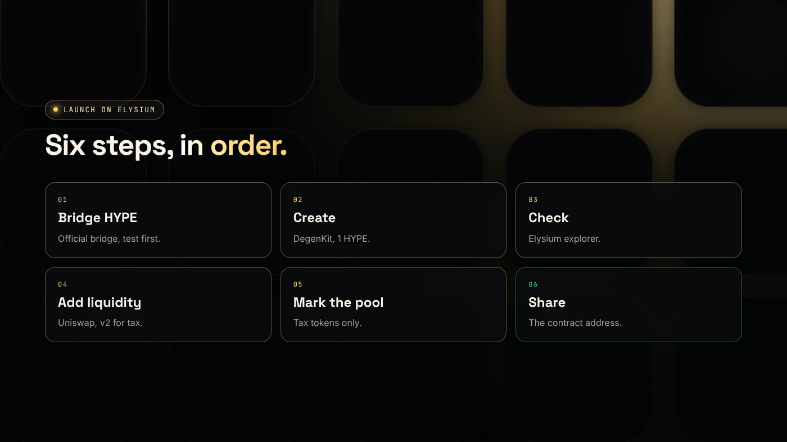
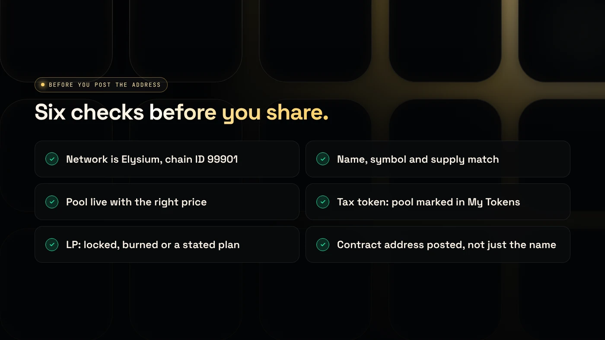

To launch a token on Elysium, bridge HYPE from HyperEVM, create the token with a token creator, check it on the Elysium explorer, add a Uniswap pool with HYPE, mark the pool if it is a tax token, and share the contract address. Each step is quick. The order matters.

:::note Key facts
- **Gas and pair asset:** HYPE on Elysium, chain ID **99901**.
- **Create:** DegenKit's Elysium token creator, **1 HYPE** plus gas.
- **Liquidity:** Uniswap v2, v3 or v4 on Elysium. Use v2 for tax tokens.
- **Exit:** bridging back to HyperEVM takes about **5.5 days**.
:::

:::note Not affiliated
DegenKit is not affiliated with Kinetiq, Hyperliquid or Uniswap.
:::

## What are the six steps?

1. Bridge HYPE to Elysium.
2. Create the token.
3. Check it on the explorer.
4. Add liquidity on Uniswap.
5. Mark the pool (tax tokens only).
6. Share the contract address.

## Step 1: How much HYPE should you bridge?

Bridge enough for the 1 HYPE creation fee, gas for four or five transactions, and the HYPE you will put in the pool, plus a buffer. Use the official bridge at elysium.kinetiq.xyz/bridge and send a small test amount first. See [how to bridge HYPE to Elysium](/blog/bridge-hype-to-elysium/).

## Step 2: How do you create the token?

Open the [Elysium token creator](/launch/elysium/), connect your wallet and approve chain ID 99901. Then choose:

- **Token Creator** for a plain ERC-20 with fixed supply and no owner. See the [Elysium token creator guide](/blog/elysium-token-creator/).
- **Tax Token** for buy and sell tax. See [creating an Elysium tax token](/blog/elysium-tax-token/).

Sign once. The full supply goes to your wallet.

## Step 3: What should you check on the explorer?

Open the contract on the Elysium explorer (elysium.kinetiq.xyz/explorer) and confirm:

- the network is Elysium (99901),
- name, symbol and total supply,
- your wallet holds 100%.

Import the token into your wallet with the contract address.

:::warning Decide the starting price before you deposit
The ratio of your token to HYPE in a new pool sets the first price. For example, 500,000,000 tokens with 50 HYPE starts one token at 0.0000001 HYPE. Count the zeros twice.
:::

## Step 4: How do you add liquidity?

Uniswap v2, v3 and v4 are live on Elysium as a launch partner ([Coinranking](https://coinranking.com/news/elysium-layer-2-mainnet-launches-november-9-trading-apps)). Switch Uniswap to Elysium, start a position with your token and HYPE, approve your token and confirm.

- **Plain token:** any version works. Full range is simplest.
- **Tax token:** use **v2**. Uniswap says fee-on-transfer tokens do not work with its v3 routers ([Uniswap docs](https://developers.uniswap.org/docs/protocols/v3/concepts/unsupported-tokens)).

Plan what happens to the LP tokens or position NFT. Locked or burned liquidity is a strong trust signal on a new chain.

## Step 5 and 6: How do you finish the launch?

**Mark the pool (tax tokens only).** Copy the pair address, open **My Tokens → Manage tax** and choose **Mark as pool**. The tax starts on the next trade.

**Share the contract address,** not just the name. Pin it with the explorer link. Then tell your community:

- the network is **Elysium (99901)** and buyers need HYPE there,
- the supply is fixed with no mint function,
- for a tax token, the rates, the tax wallet and your ownership plan,
- what happens to the LP.

## What are the risks?

- **A days-old chain** with a single sequencer at launch.
- **Bots in the first block** and thin liquidity.
- **Slow exits** of about 5.5 days to HyperEVM.
- **Copycat tokens** with your name and a different address.

You can lose money in crypto. This is not financial advice.

## FAQ

### How long does an Elysium launch take?

The bridge and each transaction are quick. Most of the time goes into checking the token, the starting price and the pool.

### Does DegenKit add liquidity on Elysium?

No. You create the token and manage taxes on DegenKit, and add liquidity on Uniswap yourself.

### Which Uniswap version should I use on Elysium?

V2 for tax tokens. For plain tokens, any version works, and full range is simplest.

## Sources

- [Kinetiq launch release (GlobeNewswire via The Manila Times)](https://www.manilatimes.net/2026/11/09/tmt-newswire/globenewswire/kinetiq-launches-elysium-public-mainnet-a-high-performance-layer-2-built-for-hyperliquid/2465340)
- [Coinranking: Elysium mainnet goes live with trading apps](https://coinranking.com/news/elysium-layer-2-mainnet-launches-november-9-trading-apps)
- [Uniswap: Token integration issues (v3)](https://developers.uniswap.org/docs/protocols/v3/concepts/unsupported-tokens)
- [Chainstack: Elysium tooling](https://docs.chainstack.com/docs/elysium-tooling)

Start your launch with the [DegenKit Elysium token creator](/launch/elysium/).
