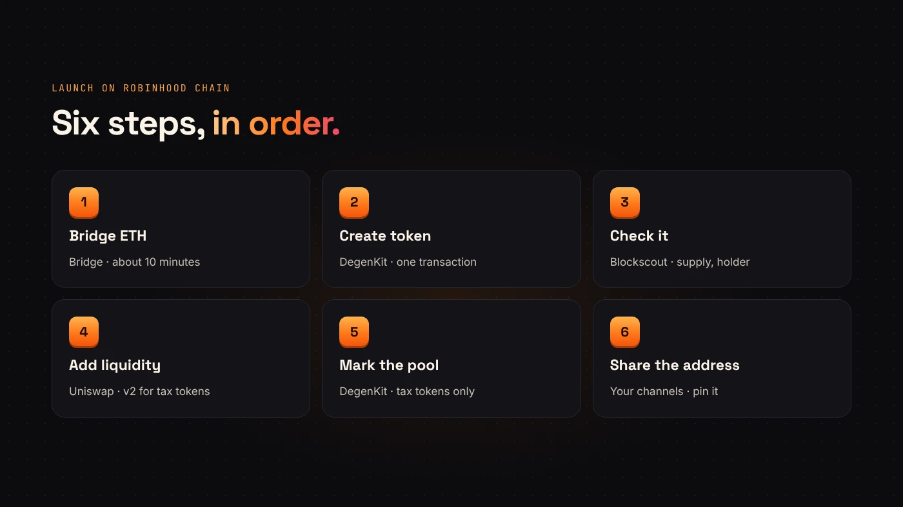
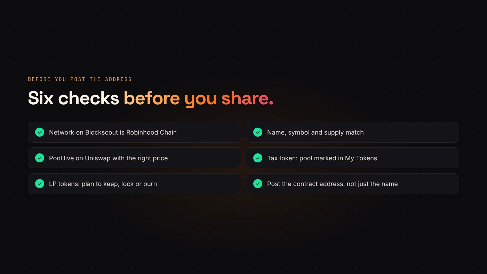

Launching on Robinhood Chain takes more than one transaction. You fund the wallet, create the token, check it, give it a pool and tell people where to find it. Each step is simple, but the order matters.

This guide puts the whole launch in sequence. Each step links to a deeper guide if you need more detail.

## The six steps at a glance

1. Bridge ETH to Robinhood Chain.
2. Create the token on DegenKit.
3. Check it on Blockscout.
4. Add liquidity on Uniswap.
5. Mark the pool (tax tokens only).
6. Share the contract address.

## 1. Bridge ETH

Gas on Robinhood Chain is paid in ETH **on Robinhood Chain**. Move enough for the service fee, gas for four or five transactions and the ETH you plan to put in the pool. The canonical bridge takes about 10 minutes in. Read [how to bridge ETH to Robinhood Chain](/blog/bridge-eth-to-robinhood-chain/).

## 2. Create the token

Open the [Robinhood Chain launcher](https://degenkit.app/launch/robinhood/) and connect your wallet. DegenKit asks it to switch to Robinhood Chain, chain ID 4663. Then pick a creator:

- **Token Creator** — a plain ERC-20 with a fixed supply.
- **Tax Token** — the same, plus a buy and sell tax you set. See [creating a tax token on Robinhood Chain](/blog/create-tax-token-on-robinhood-chain/).

Not sure which? Read [plain token or tax token](/blog/plain-or-tax-token-robinhood-chain/).

Both have **no mint function** and 18 decimals. The name, symbol and supply you sign are final, and the full supply goes to your wallet in one transaction.

## 3. Check it on Blockscout

DegenKit shows the contract address with a **View on Blockscout** link. Open it and confirm:

- The network is Robinhood Chain.
- The name, symbol and total supply are right.
- The full supply is in your wallet.

Then import the token into your wallet with the contract address so you can see the balance. Our guide to [reading a token page on Blockscout](/blog/read-token-page-etherscan-blockscout/) explains each tab.

:::warning Decide the starting price before you deposit
In a new pool, the ratio of your token to ETH sets the first price. 500,000,000 tokens with 0.5 ETH starts one token at 0.000000001 ETH. Count the zeros twice.
:::

## 4. Add liquidity on Uniswap

[Uniswap says](https://blog.uniswap.org/robinhood-chain-is-live) it is the primary public exchange on Robinhood Chain, with v2, v3 and v4 live since launch. Switch the Uniswap app to Robinhood Chain, start a new position with your token and ETH, approve your token, and confirm.

For a plain token, any version works. For a tax token, use **v2**. The full walkthrough is in [adding liquidity on Uniswap](/blog/add-liquidity-uniswap-erc20/).

Keep the LP tokens or position NFT safe. Whoever holds them can remove the liquidity, and buyers will ask about it.

## 5. Mark the pool (tax tokens only)

Copy the pair address from the liquidity transaction, then open **My Tokens → Manage tax** on DegenKit and choose **Mark as pool**. The tax starts on the next trade. Skip this step for a plain token.

## 6. Share the contract address

Post the **contract address**, not just the name. Anyone can create a token with the same name and symbol, so the address is the only reliable identifier. Pin it everywhere and link the Blockscout page.

## What to tell your community

- The network is **Robinhood Chain**, and buyers need ETH there.
- The contract address and Blockscout link.
- The supply is fixed, with no mint function.
- For a tax token: the rates, the tax wallet and whether ownership is kept or renounced.
- Your plan for the LP tokens.

## Questions people ask

### Does DegenKit add liquidity on Robinhood Chain?

Not yet. You create the token and manage taxes on DegenKit, and add liquidity on Uniswap.

### How long does the whole launch take?

The bridge takes about 10 minutes. Each transaction after that confirms quickly. Most of the time goes into checking.

## Wrap up

Bridge ETH, create the token, check it on Blockscout, add a Uniswap pool, mark it if it's a tax token, then share the address. [Start your Robinhood Chain launch](https://degenkit.app/launch/robinhood/).

**Related:** [What is Pons?](/blog/what-is-pons-launchpad-robinhood-chain/) and [Pons vs creating your own token](/blog/pons-vs-create-your-own-token-robinhood-chain/).
