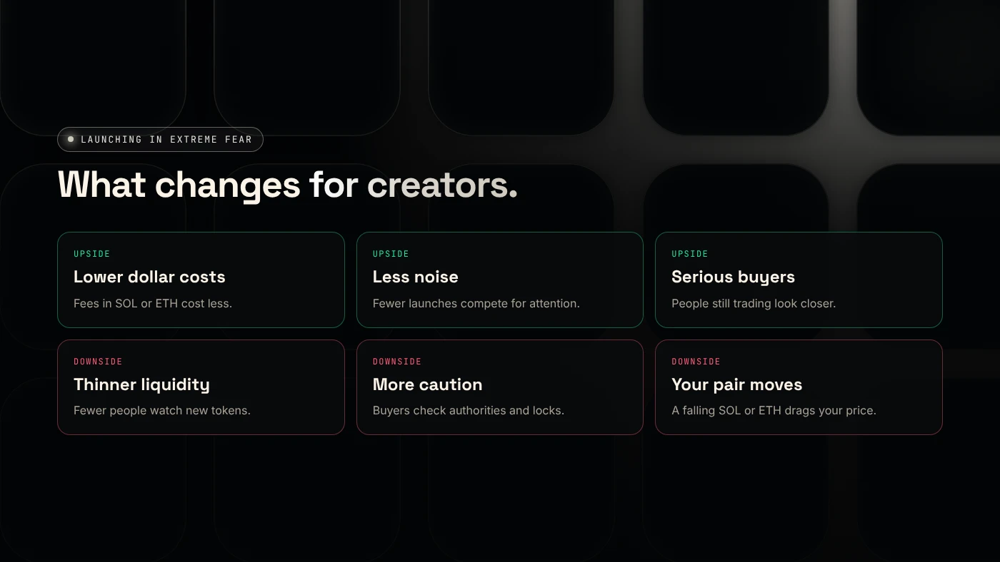
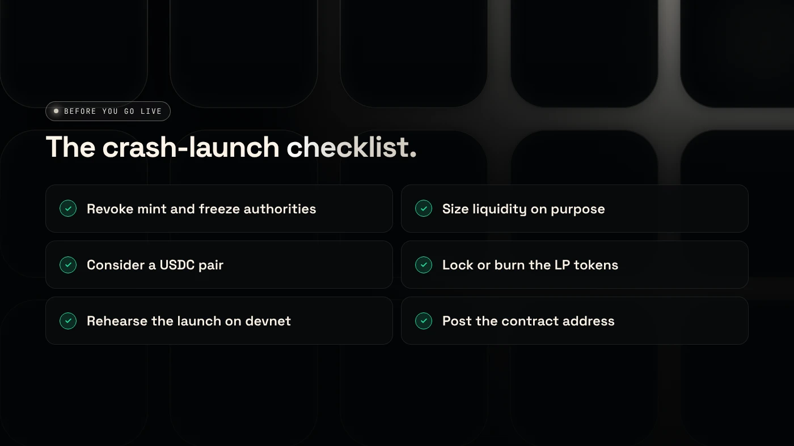

You can launch a token in a crypto bear market, but expect lower costs, less attention and more careful buyers than in a rising market. As of November 7, 2026, the Fear & Greed Index read 25, "Extreme Fear", so plan your launch around trust signals and realistic liquidity rather than hype.

:::note Key facts
- Market mood on November 7, 2026: Fear & Greed **25**, total market cap about **$2.58 trillion**.
- Fees paid in SOL or ETH cost fewer dollars when those coins fall. DegenKit's Solana creation fee is **0.28 SOL**.
- Buyers check revoked authorities, locked liquidity and holder spread more closely in falling markets.
- On DegenKit, creating a token and adding liquidity are separate steps, so you can create now and add liquidity later.
:::

## Is crypto in a bear market?

A bear market usually means prices have fallen far from their highs and stay weak for months. There is no official definition. As of November 7, 2026, the signs most people use point that way:

- **Bitcoin** was near $76,000, roughly 40% below its October 2025 high.
- **Ether** was near $2,240, about 55% below its August 2025 high.
- **Solana** was near $89, about 70% below its all-time high.
- **Sentiment** was at 25, "Extreme Fear", according to [The Currency Analytics](https://thecurrencyanalytics.com/bitcoin/bitcoin-holds-steady-as-crypto-market-cap-slides-to-2-58t-308173).

The recent drop came from a hawkish Fed, the Binance hack and a tech-stock sell-off. Our news post on [why crypto is crashing](/blog/crypto-crash-november-2026/) has the full timeline.

## What changes for token creators in a bear market?

**What gets easier**

- **Lower dollar costs.** Network and service fees paid in SOL or ETH cost less. See [DegenKit fees](/docs/fees/).
- **Less noise.** Fewer new tokens compete for the same attention.
- **More serious buyers.** People still trading in extreme fear tend to look closer and hold longer.

**What gets harder**

- **Thinner liquidity.** Fewer buyers means bigger price swings for each trade.
- **More checks.** Buyers look at mint and freeze authorities, LP status and the top holders before buying.
- **Your pair moves.** A token paired with SOL or ETH loses dollar value when that coin falls.

## How should you adjust your launch plan?

1. **Lead with trust.** On Solana, revoke mint and freeze authority so no one can create more tokens or freeze wallets. See [mint vs freeze authority](/blog/mint-authority-vs-freeze-authority/).
2. **Size liquidity on purpose.** The ratio of token to SOL or USDC sets your starting price. A very small pool swings sharply. Read [creating a token vs adding liquidity](/blog/creating-a-token-vs-adding-liquidity/).
3. **Consider a USDC pair.** USDC keeps your pool's value in dollars while SOL is volatile. See [SOL or USDC for your liquidity pair](/blog/sol-or-usdc-liquidity-pair/).
4. **Show what happens to the LP tokens.** Burned or locked LP tokens show buyers the liquidity cannot be pulled. See [locking liquidity on Solana](/blog/lock-liquidity-on-solana-burn-and-earn/).
5. **Rehearse on devnet first.** Run the whole launch on Solana's test network with free test SOL. See [rehearsing a Solana launch on devnet](/blog/rehearse-solana-launch-on-devnet/).

## Should you launch now or wait?

**Launch now if** your token has a purpose beyond a rising market, such as a community you already have, a product or a clear use, and you are comfortable growing slowly.

**Wait if** your plan depends on fast attention and new buyers arriving every day. Those conditions are rare in extreme fear.

**Prepare either way.** Create the token on devnet, write your token page, set up your community channels and draft the announcement. Nothing on DegenKit expires: you can create the token on mainnet when you choose and add liquidity later.

## What should you check before going live?

- Mint and freeze authorities revoked, or a fixed-supply token on EVM chains.
- Starting price checked: token amount divided by SOL or USDC amount.
- Pair chosen deliberately: SOL or USDC.
- LP tokens burned or locked, and that stated publicly.
- Full launch rehearsed on devnet.
- Contract address posted everywhere, not just the name.

The [DegenKit scanner docs](/docs/scanner/) show what buyers will see when they check your token.

## What are the risks?

- **Low volume.** Your token may trade very little at first.
- **Price swings.** Small pools move a lot on each trade.
- **Pair losses.** A falling SOL or ETH lowers your pool's dollar value.
- **Liquidity is money at risk.** Funds you put into a pool can lose value, and burned LP cannot be recovered.

You can lose money in crypto. This is not financial advice.

## FAQ

### Is crypto in a bear market?

There is no official definition, but as of November 7, 2026, Bitcoin was about 40% below its high and sentiment was at "Extreme Fear". Most people would describe that as bear-market conditions.

### How long do crypto bear markets last?

They have lasted from several months to more than a year in past cycles. No one can say how long this one will last.

### How do you make money in a bear market in crypto?

We don't give trading or investment advice. For creators, a bear market is often used to build, test and grow a community before conditions improve.

## Sources

- [The Currency Analytics: Crypto market cap slides to $2.58T](https://thecurrencyanalytics.com/bitcoin/bitcoin-holds-steady-as-crypto-market-cap-slides-to-2-58t-308173)
- [crypto.news: Bitcoin price today and ETF outflows](https://crypto.news/bitcoin-price-today-rebounds-76000-etf-outflows/)
- [CryptoTicker: Solana price at the 200-day line](https://cryptoticker.io/en/solana-price-prediction-200-day-line-dex-volume-november-2026/)
- [Solana docs: Clusters and RPC endpoints](https://solana.com/docs/references/clusters)

When you are ready, the [DegenKit Solana launcher](/launch/solana/) lets you create the token first and add liquidity when the time is right.
