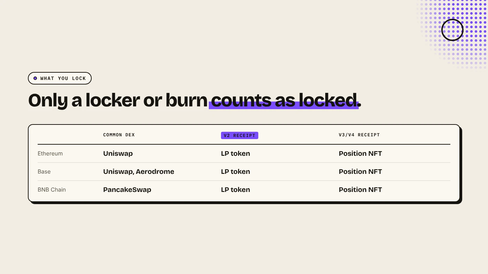
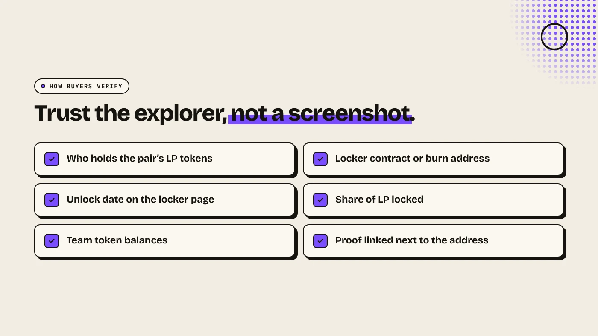

To lock liquidity on Ethereum, Base or BNB Chain, add your token and the chain's coin to a DEX pool, then send the LP receipt to a locker contract with an unlock date, or burn it by sending it to a dead address. Buyers check it by seeing who holds the LP on Etherscan, BaseScan or BscScan.

:::note Key facts
- **Lockers** hold your LP tokens in a smart contract until the unlock date (Bitbond).
- **Bitbond names** Uniswap V2 and V3, PancakeSwap and others among the pools UNCX can lock.
- **Burn** = send LP to an address nobody controls, such as `0x…dEaD`. Permanent.
- **Common practice:** lock most of the LP for at least a year (Bitbond).
:::

:::note Not affiliated
DegenKit is not affiliated with UNCX, Team Finance, Uniswap, PancakeSwap or Aerodrome. Check each locker's own site for current chains and fees.
:::

## Why lock liquidity?

Whoever holds the LP tokens can withdraw the pool's tokens and ETH or BNB at any time. Removing liquidity after people buy is a classic rug pull. Locking or burning the LP removes that option and is one of the first things buyers check. See [how to spot rug pull risk](/blog/how-to-spot-rug-pull-risk/).

## Which DEX pool are you locking?

| Chain | Common DEX | V2 receipt | V3/V4 receipt |
|---|---|---|---|
| Ethereum | Uniswap | LP token | Position NFT |
| Base | Uniswap, Aerodrome | LP token | Position NFT |
| BNB Chain | PancakeSwap | LP token | Position NFT |

V2 LP tokens are the easiest to lock and the easiest for buyers to check. For pool setup, see [adding liquidity on Uniswap](/blog/add-liquidity-uniswap-erc20/), [on PancakeSwap](/blog/add-liquidity-pancakeswap/), or [Aerodrome vs Uniswap on Base](/blog/aerodrome-vs-uniswap-base/).

## How do you lock with a locker?

1. **Pick a locker** that supports your chain and DEX. UNCX and Team Finance are well-known options. Confirm support on their site before you start.
2. **Connect the wallet** that holds the LP tokens.
3. **Select the pair** or paste the pair address.
4. **Choose the amount** to lock. Most projects lock most or all of it.
5. **Set the unlock date.** Bitbond recommends at least a year.
6. **Approve and confirm.** Lockers charge a fee. Check it before you sign.
7. **Share the lock page** next to your contract address.

## How do you burn LP instead?

Send the LP tokens to a burn address such as `0x000000000000000000000000000000000000dEaD` from your wallet. Check the address character by character. A typo sends the LP to a wallet someone might control.

Burning is permanent. You give up the LP's share of the pool and any trading fees it earns.

## Lock or burn?

- **Burn** for a meme coin with no plans to move liquidity. It is the strongest signal.
- **Lock** if you may need to migrate, add liquidity or recover the pool later. Pick a date long enough to mean something.

## How do buyers verify it?

1. Open the token on Etherscan, BaseScan or BscScan and find its pool.
2. Open the **pair contract** and check **Holders**. LP in a locker contract or a burn address means locked.
3. On the locker's page, check the **unlock date** and the **share** of LP locked.

Our guide to [reading a token page on Etherscan or Blockscout](/blog/read-token-page-etherscan-blockscout/) shows where to click.

## What are the risks?

- **Short locks** protect buyers only until the date.
- **Partial locks** leave the rest withdrawable.
- **Locker risk:** a lock depends on the locker contract.
- **Locks do not cover the supply.** A team can still sell its own tokens.

You can lose money in crypto. This is not financial advice.

## FAQ

### How do I lock liquidity on BNB Chain?

Add liquidity on PancakeSwap, then send the LP tokens to a locker that supports BNB Chain, or burn them.

### Is burning LP better than locking it?

Burning is permanent and the strongest signal. Locking keeps the option to recover the LP after a date.

### Does DegenKit lock liquidity?

No. DegenKit creates the token. You add and lock liquidity on the DEX and locker of your choice.

## Sources

- [Bitbond: UNCX locker review and guide](https://www.bitbond.com/resources/uncx-locker-token-vesting-review-and-guide)
- [Team Finance: How to choose a liquidity locker](https://blog.team.finance/choosing-the-top-liquidity-locking-service)
- [PancakeSwap docs: Liquidity pools](https://docs.pancakeswap.finance/earn/pancakeswap-pools)

Create a token you fully control on the [DegenKit launcher](/launch/).
