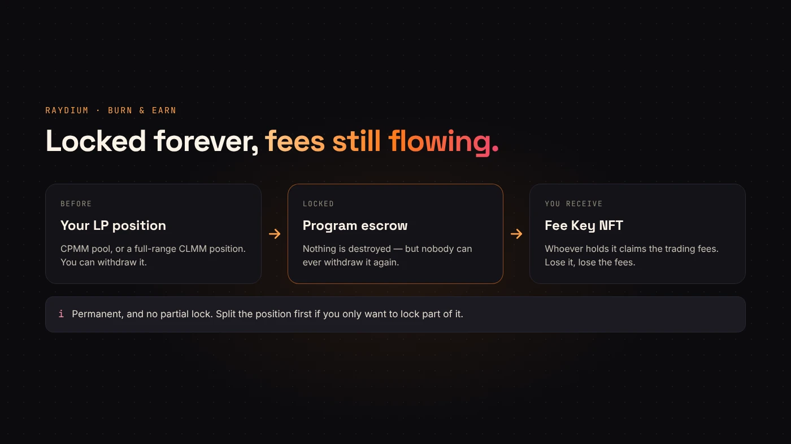
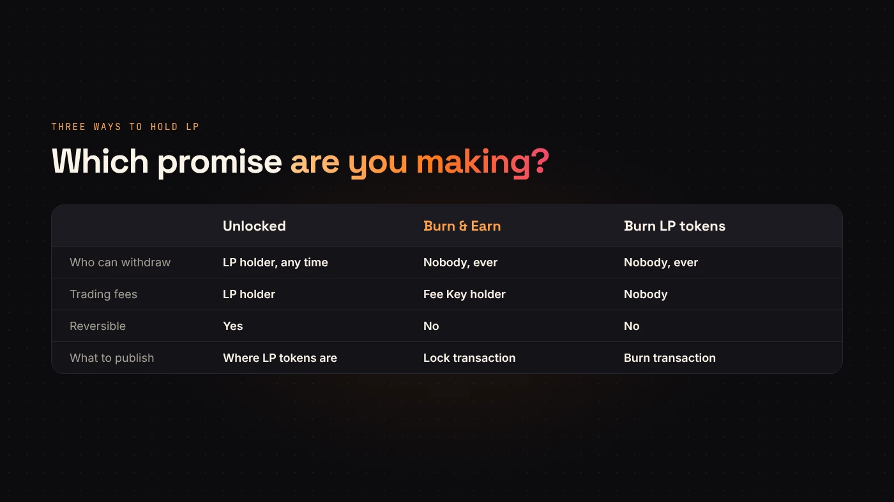

After you add liquidity, buyers ask one question: can the creator pull it? If you hold the LP tokens, the honest answer is yes. Raydium's **Burn & Earn** lets you change that answer to "never", while still earning the trading fees your liquidity generates.

If pools are new to you, start with [creating a token vs. adding liquidity](/blog/creating-a-token-vs-adding-liquidity/).

## What Burn & Earn does

[Raydium's Burn & Earn documentation](https://docs.raydium.io/user-flows/burn-and-earn) explains that despite the name, nothing is destroyed. Your LP position goes into a program-owned escrow. The liquidity can never be withdrawn, but fees keep accruing.

In return you receive a **Fee Key NFT**. Whoever holds it can claim the position's trading fees. It is transferable, and Raydium warns that losing the Fee Key means losing the fees forever.

## Which pools work

According to Raydium's docs:

- **CPMM (standard) pools** — supported. Pools created with DegenKit's **Create Liquidity** are CPMM pools.
- **CLMM pools** — full-range positions only.
- **AMM v4** — not supported.

## Before you lock

The lock is permanent, and there is no partial lock. Raydium's interface asks you to type a confirmation sentence because the action can't be undone.

- Decide how much should be locked. To lock only part, split the position first, for example by removing some liquidity with DegenKit's **Remove Liquidity** tool.
- Make sure the wallet holding the LP tokens is the one you'll keep the Fee Key in.
- Plan where you'll announce the lock and the transaction.

:::warning There is no undo
Once locked, nobody — including you — can withdraw that liquidity again. If you might need it, don't lock it.
:::

## Steps

Raydium's docs describe the flow:

1. Create the pool. On DegenKit, use **Create Liquidity**; the LP tokens go to your wallet.
2. On Raydium, open **Liquidity → Create → Burn & Earn**.
3. Select the position to lock.
4. Check the position, its size and the pool, then type the confirmation sentence.
5. Confirm. The Fee Key NFT appears in your wallet and under locked positions in your Portfolio.

## Claiming fees later

Fees are claimed from Raydium's Portfolio page with the wallet that holds the Fee Key. The locked position itself never leaves the escrow.

## Proving it to buyers

A lock only builds trust if people can check it:

- Publish the **lock transaction** and the **pool address**.
- Say how much of your liquidity is locked — all of it or a share.
- Keep the Fee Key in a wallet you control long-term; our [wallet security guide](/blog/wallet-security-for-token-creators/) explains why that should be a vault.

## Questions people ask

### Is Burn & Earn the same as burning LP tokens?

The effect on withdrawals is the same: nobody can pull the liquidity. The difference is that burning LP tokens also gives up the fees, while Burn & Earn keeps them claimable through the Fee Key.

### Can I lock liquidity on EVM networks the same way?

Burn & Earn is a Raydium feature on Solana. On EVM networks, look for a lock service that supports your DEX and pool type.

## Wrap up

Burn & Earn makes your Raydium liquidity permanent and keeps the fee stream with the Fee Key holder. Decide the amount, lock it, and publish the transaction. Start by [creating your pool on DegenKit](https://degenkit.app/launch/solana/).
