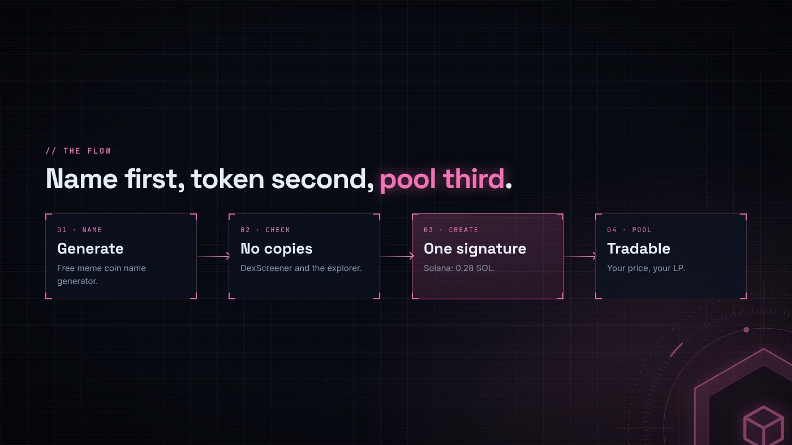
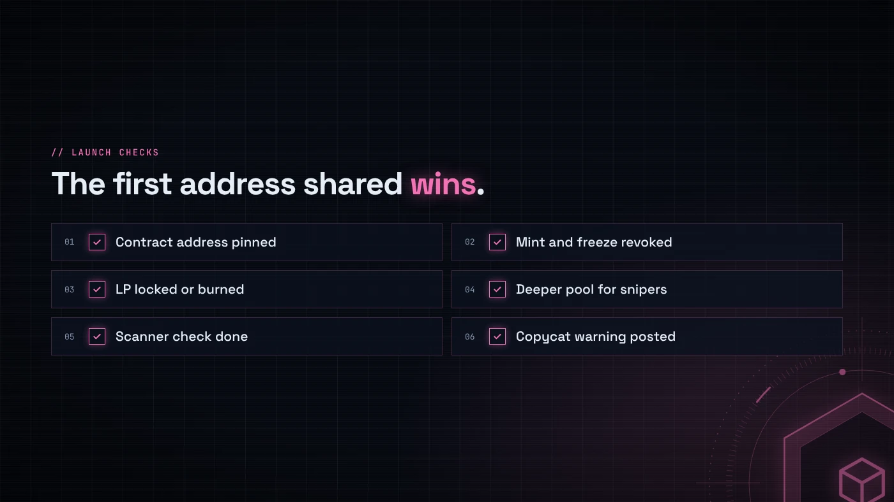

A meme coin generator turns an idea into a tradable token without code. Generate a name and ticker, create the token with a token generator on Solana or an EVM chain, then open a liquidity pool so people can buy it. On DegenKit, a Solana meme coin costs 0.28 SOL to create, with authorities revoked and metadata locked in the same transaction.

:::note Key facts
- **Name ideas:** the free [meme coin name generator](/tools/meme-coin-name-generator/).
- **Create:** a plain token on six networks. Solana is the most popular for meme coins.
- **Solana defaults on DegenKit:** 1 billion supply, 6 decimals, mint and freeze revoked, metadata locked.
- **Trade:** a pool on Raydium, Uniswap or PancakeSwap, or a bonding-curve launchpad.
:::

## What makes a meme coin different?

Technically, nothing. A meme coin is an ordinary token whose value comes from community and attention, not a product. That changes what matters at launch: a name people remember, a clean contract buyers trust, and enough liquidity that early trades do not break the chart.

## Step 1: How do you pick the name and ticker?

- **Generate options** with the [meme coin name generator](/tools/meme-coin-name-generator/).
- **Check for copies** on DexScreener and the chain's explorer. A name already in use confuses buyers.
- **Keep the ticker short,** usually 3 to 6 letters.
- **Prepare a square logo.** On Solana, it goes into the metadata and cannot be changed after creation on DegenKit.

See [choosing decimals, name and symbol](/blog/choosing-decimals-name-and-symbol/).

## Step 2: Which chain fits a meme coin?

- **Solana:** the largest meme coin audience and the cheapest launch. See [how to make a meme coin on Solana](/blog/how-to-make-a-meme-coin-on-solana/).
- **Base and BNB Chain:** low fees on EVM chains.
- **Robinhood Chain and Elysium:** newer chains where early coins get attention. See [how to make a meme coin on Robinhood Chain](/blog/how-to-make-a-memecoin-robinhood-chain/).
- **Ethereum:** the highest gas, usually for larger budgets.

## Step 3: How do you create the coin?

1. Open the [DegenKit launcher](/launch/) and pick the network.
2. Choose **Token Creator**. A plain token suits meme coins best.
3. Enter name, symbol and supply, and on Solana the image.
4. Sign. The contract address appears.

On Solana, revoking mint and freeze authority is built in, so buyers' scanners see a clean token. On EVM chains, DegenKit tokens have no mint function.

## Step 4: How do you make it tradable?

Two routes:

- **Your own pool:** deposit your coin plus SOL, ETH or BNB on a DEX. The ratio sets the first price. Use the [liquidity calculator](/tools/liquidity-calculator/) first.
- **A bonding-curve launchpad** such as pump.fun: no liquidity up front, but the platform sets the supply and curve. See [pump.fun vs Raydium](/blog/pump-fun-vs-raydium/).

## Step 5: How do you launch without getting copied?

- **Post the contract address first,** with an explorer link.
- **Lock or burn the LP** and say which.
- **Expect snipers** and use a deeper pool.
- **Check your own coin** in a scanner, as buyers will.

See the [token launch checklist](/blog/token-launch-checklist/) and the main [token generator guide](/blog/token-generator/).

## What are the risks?

- **Most meme coins go to zero.** Attention moves fast.
- **Snipers and bundled buys** in the first block.
- **Copycats** with the same name and logo.
- **Thin pools** that swing hard on small trades.

You can lose money in crypto. This is not financial advice.

## FAQ

### What is a meme coin generator?

A no-code tool, or set of tools, that helps you name, create and launch a meme coin token.

### How much does it cost to make a meme coin?

On DegenKit, 0.28 SOL on Solana plus network fees. Your liquidity is usually the larger cost.

### Can I change my meme coin's name later?

Not on Solana tokens made with DegenKit, because metadata is locked. EVM names and symbols are also permanent.

## Sources

- [DegenKit docs: Token Creator (Solana)](https://degenkit.app/docs/token-creator/)
- [DegenKit docs: Fees](https://degenkit.app/docs/fees/)
- [crypto.news: How meme coins are made](https://crypto.news/how-meme-coins-are-made-bonding-curves-pump-fun-rug-pulls/)

Create your meme coin in one transaction on the [DegenKit launcher](/launch/).
