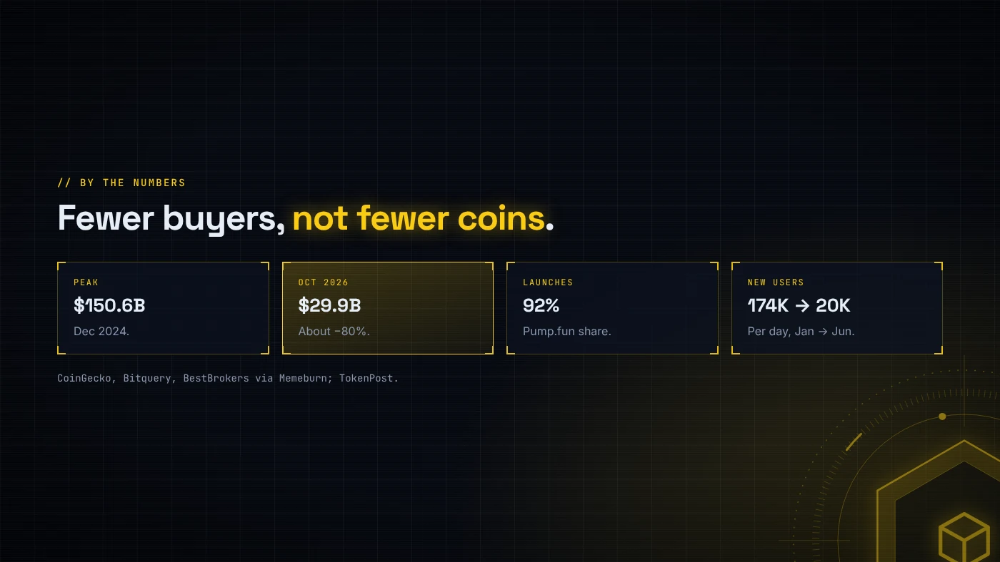
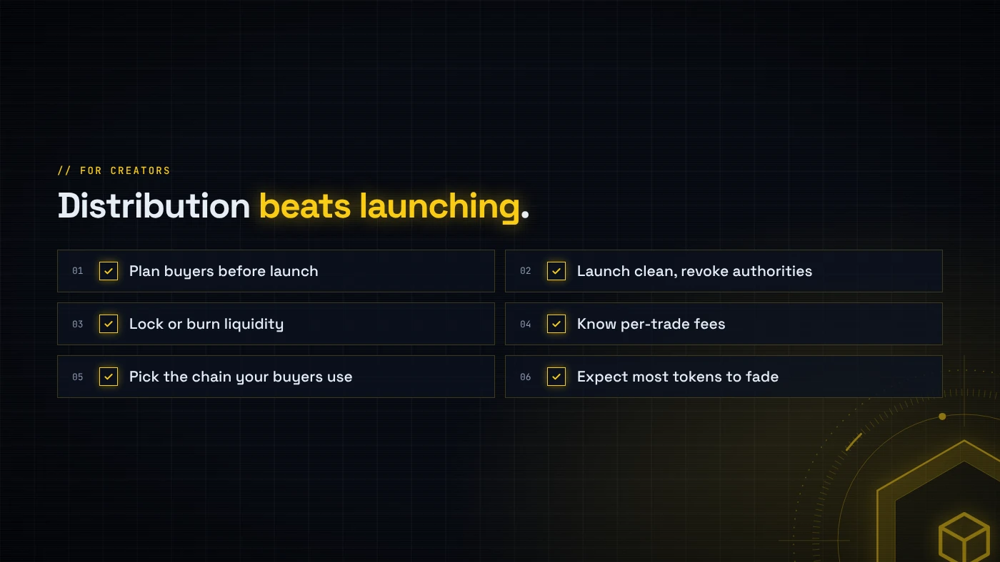

The memecoin market is much smaller than at its peak. Category value was about $29.9 billion in October 2026, roughly 80% below December 2024's $150.6 billion. Launches have not stopped: pump.fun made 92% of launchpad launches in the 30 days to November 9. The problem is buyers, not coins. Only about 1 in 437 pump.fun launches still trades actively by week five.

:::note Key facts
- **Category value:** **$150.6B** (Dec 2024) → **$29.9B** (Oct 18, 2026), CoinGecko via Memeburn.
- **Pump.fun share:** **92%** of launchpad launches and **84%** of launchpad volume, 30 days to Nov 9 (TokenPost).
- **Survival:** **79%** of pump.fun tokens never traded after launch day (Bitquery via Memeburn).
- **$10M market cap:** **24** of 3.05 million launches in Q3 2026, versus 207 of 3.16 million in Q4 2024.
:::

## How big is the memecoin market now?

Per Memeburn's summary of CoinGecko data, the memecoin category peaked at $150.6 billion in December 2024 and was about $29.9 billion on October 18, 2026. Dogecoin and Shiba Inu held about 51% of the category. The market fell about 61% in 2025 alone, according to The Defiant.

Total crypto value rose 39.6% in Q3 2026 while average daily trading volume fell 8.6%, per CoinGecko's Q3 report. Memecoins did not share in that rise.

## Are fewer people buying?

Yes, by Memeburn's reading of BestBrokers data:

- **New pump.fun users** hit 174,250 in a single day in January 2026, then fell to about 20,000 a day by June.
- **Returning users** held at 60,000–100,000 a day.
- **Pump.fun daily revenue** fell from $2.45 million in mid-September 2025 to $169,000–$367,000 in June 2026.

The same traders are trading each other more, while fewer newcomers arrive.

## How do new tokens survive?

Most do not. Bitquery data for Solana launchpads, via Memeburn:

| Measure | Result |
|---|---|
| Tokens traded on a median day | ~32,000 |
| Pump.fun tokens that never traded after day one | 79% |
| Half of launches: last trade within | ~3 minutes of the first |
| Still 10 trades in week five | 1 in 437 |
| Launches by wallets that made 100+ tokens | 48% |

TokenPost adds that across 24.4 million launches, 312 had market caps above $100,000 on November 9, about 1 in 78,000.

## What is pump.fun doing?

- **Fees:** bonding-curve trades cost 1.25% (0.95% to pump.fun, 0.30% to the creator). An extra 0.45% app fee applies since October 17, 2026.
- **New products:** Hyperliquid-powered perpetuals in October, cross-chain trading, and on November 16 a Predict section with Polymarket markets, not available in the U.S., UK, France or Germany (crypto.news).
- **Concentration:** about three-quarters of protocol revenue comes from tokens less than one hour old (TokenPost).

See [what is pump.fun](/blog/what-is-pump-fun/) and [pump.fun vs Raydium](/blog/pump-fun-vs-raydium/).

## Where else did memecoins move?

Robinhood Chain had a memecoin burst in September 2026 that cooled within weeks. See [Robinhood Chain in late 2026](/blog/robinhood-chain-2026-update/). Smaller bursts appear on Base and BNB Chain, usually around one launchpad or one viral token.

## What does this mean for new token creators?

- **A launch alone does not bring buyers.** Plan the community and distribution first. See [how to market a Solana token](/blog/how-to-market-a-solana-token/).
- **Look different from bundled launches.** A clean token with revoked authorities and locked liquidity stands out. See [Solana bundlers explained](/blog/solana-bundler-explained/).
- **Know your fees.** Bonding curves charge per trade. A token you create and pool yourself charges only pool fees.
- **Consider the chain.** Your buyers may already be on Base, BNB Chain or Robinhood Chain.

## What signals would show buyers returning?

Memeburn lists three: pump.fun daily new users climbing back toward January's 174,250 and holding, more than 1.5% of October launches still trading by week five, and newer memecoins taking share from Dogecoin and Shiba Inu.

## What are the risks?

- **Most new tokens go to zero** within days.
- **Bundled and bot-driven launches** dominate activity.
- **Thin markets** mean small sells move prices a lot.

You can lose money in crypto. This is not financial advice.

## FAQ

### Is the memecoin market dead?

No, but it is about 80% smaller than its December 2024 peak, with far fewer new buyers.

### What share of memecoins does pump.fun launch?

About 92% of launchpad launches across all chains, in the 30 days to November 9, 2026.

### How many pump.fun tokens survive?

About 1 in 437 still had ten trades in week five, per Bitquery data.

## Sources

- [Memeburn: Memecoin market is running out of buyers](https://memeburn.com/memecoin-market-is-running-out-of-buyers-not-coins/)
- [TokenPost: Pump.fun 92% of launchpad launches](https://www.tokenpost.com/news/investing/54556)
- [crypto.news: Pump.fun adds Polymarket prediction markets](https://crypto.news/pump-fun-polymarket-prediction-markets-mobile-app/)

Launch a clean token on your own terms with the [DegenKit token generator](/launch/).
