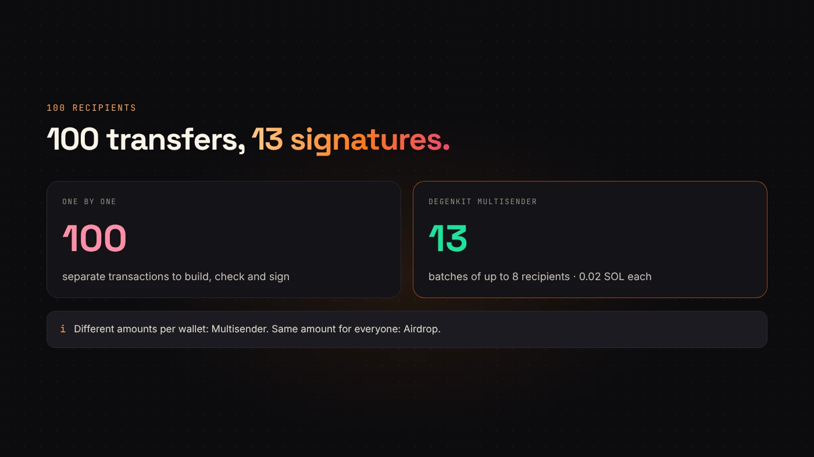
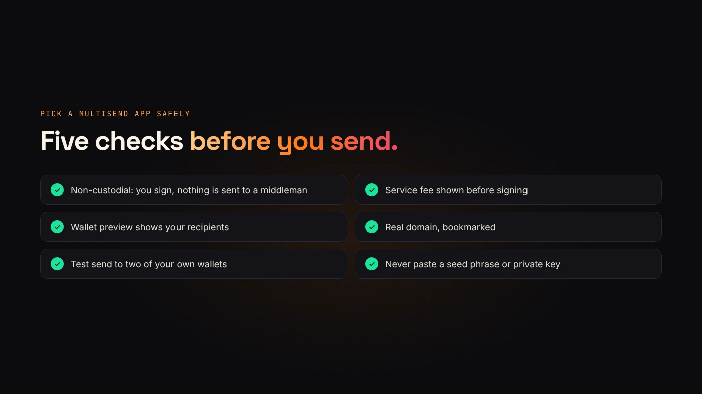

Paying contributors, rewarding a community or sending tokens to a team list means dozens or hundreds of transfers. Doing them one by one means dozens or hundreds of signatures. A **multisend app** bundles them, so you sign a handful of transactions instead.

DegenKit has a free-to-open, non-custodial multisend tool for Solana tokens: the **Multisender**, plus **Airdrop** for equal amounts.

## What a multisend app does

You give it a token and a list of recipients. It packs several transfers into each transaction and asks your wallet to sign each batch. The tokens go straight from your wallet to the recipients.

On DegenKit:

- **Multisender** sends a **different amount** to each wallet, from an `address,amount` list or a CSV.
- **Airdrop** sends the **same amount** to every wallet on the list.

## How DegenKit's Multisender works

1. Open the [Solana launcher](/launch/solana/) and choose **Multisender**.
2. Paste the token's mint address and **Load** to see your balance.
3. Paste recipients, one `address,amount` per line, or use **Import CSV**.
4. Choose **Send tokens**. DegenKit splits the list into **batches of 8 recipients**.
5. Sign each batch in your wallet. Progress shows as "Batch 2/5".

If a recipient doesn't have a token account for your token yet, DegenKit creates it in the same batch. Our [recipient list guide](/blog/airdrop-multisender-csv-guide/) covers formats and common mistakes.

## What it costs

- **Service fee:** 0.02 SOL **per batch**, not per recipient.
- **Network fees:** Solana's per-signature fee for each batch.
- **Rent:** a refundable deposit for each new token account created for a recipient.

For 100 recipients that's 13 batches and 0.26 SOL in service fees, plus network fees and any new-account rent. See [DegenKit's fees](/blog/degenkit-fees-explained/) and [Solana fees and rent](/blog/solana-fees-and-rent-explained/).

## Choosing a multisend app safely

Any multisend tool asks you to sign transactions that move many tokens at once, so pick carefully.

- **Non-custodial only.** The tool should build transactions for your wallet to sign. Never send tokens to a "distributor" address first.
- **Clear fees before signing.** DegenKit shows its service fee before you sign.
- **Readable batches.** Your wallet preview should show transfers to the addresses on your list.
- **Real domain.** Bookmark the tool. Fake multisend sites are a common phishing trick.
- **Test first.** Send to two of your own wallets before the full list. On Solana you can [rehearse on Devnet](/blog/rehearse-solana-launch-on-devnet/) for free.

:::warning Never paste a seed phrase into a multisend tool
A legitimate multisend app only needs a wallet connection and your signature. Anything asking for a recovery phrase or private key is a scam.
:::

## Questions people ask

### Does DegenKit have a multisend for Ethereum or BNB Chain?

Not yet. DegenKit's Multisender and Airdrop work with Solana tokens.

### Is there a limit on how many wallets I can send to?

Large lists are simply sent in more batches of 8. Each batch is one signature.

### What if a batch fails?

Earlier batches have already been delivered. Remove those recipients and send the rest, rather than resending the full list.

## Wrap up

A multisend app turns hundreds of transfers into a few signed batches. DegenKit's Multisender sends different amounts to many Solana wallets, 8 per batch, for 0.02 SOL per batch, straight from your wallet. [Open Multisender](https://degenkit.app/launch/solana/) with your list ready.
