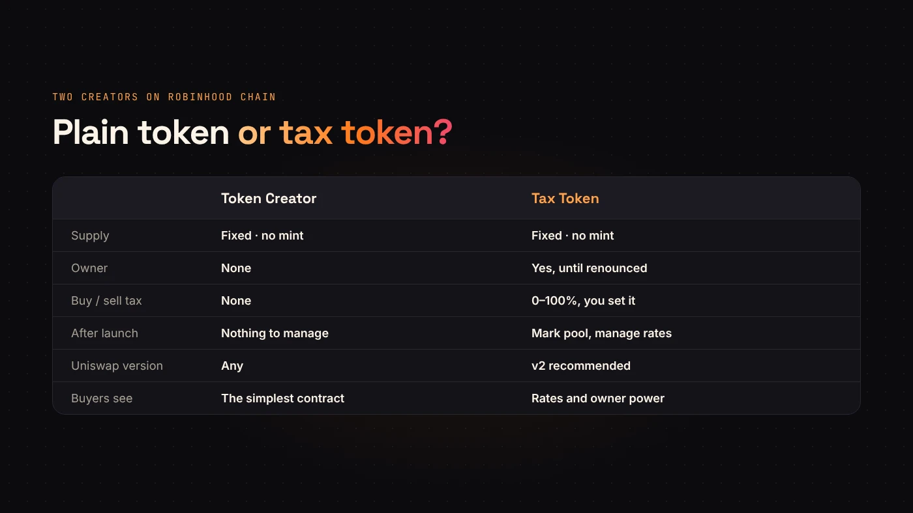
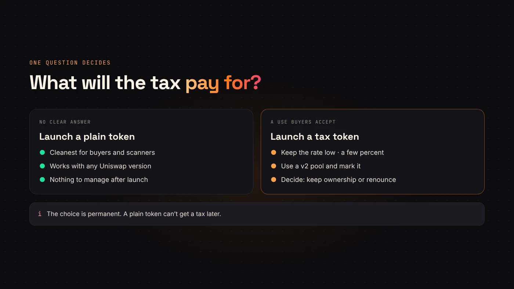

On Robinhood Chain, DegenKit has two ways to create a token: **Token Creator** and **Tax Token**. Both make a fixed-supply ERC-20 in one transaction. The difference is what happens after launch.

This guide compares the two so you can pick before you sign. The choice is permanent: you can't add a tax to a plain token later.

## What they share

- **Fixed supply.** Neither contract has a mint function. The supply you set is final for everyone, including DegenKit.
- **18 decimals**, the ERC-20 standard.
- **One transaction**, signed from your own wallet. The full supply goes to you.
- A **service fee** shown before you sign, read from the factory contract.
- Both appear in **My Tokens** on the launcher.

## Where they differ

**Token Creator** makes the simplest possible token. It has no owner functions at all. After creation there is nothing to change, renounce or explain.

**Tax Token** adds a buy tax and a sell tax, paid in your token to a tax wallet. The owner wallet can change the rates, the tax wallet and the marked pools, transfer ownership or renounce it. It has no blacklist, no pause and no trading switch.

## Choose a plain token if…

- You want the cleanest contract for buyers and scanners.
- You don't need ongoing income from trading.
- You want any Uniswap version to work, including v3 and v4.
- You'd rather not manage anything after launch.

## Choose a tax token if…

- You have a clear use for the tax, such as a treasury, marketing or rewards, and you can explain it.
- You'll keep rates low. DegenKit warns above 10%, and buyers avoid high taxes.
- You're comfortable with a **v2** pool, which suits fee-on-transfer tokens best.
- You'll mark the pool after adding liquidity, because the tax is off until you do.

:::note Owner power is a trust question
While you own a tax token, you can raise its tax. Buyers know this. Many projects announce a plan to renounce, or renounce once the rates are settled, so nobody can change them again.
:::

## Running costs

A plain token costs the creation fee and gas, then nothing.

A tax token costs the same at creation, plus gas each time you mark a pool, change a rate, change the tax wallet or renounce. On Robinhood Chain that gas is low, but you need ETH on the network to pay it.

## A quick way to decide

Ask one question: **what will the tax pay for?** If you can't answer in a sentence your buyers would accept, launch a plain token. If you can, a tax token with a low rate is a reasonable choice.

## Questions people ask

### Can I turn a tax token into a plain one?

Not exactly, but you can set both rates to 0% and then renounce. The tax is then off forever.

### Do scanners treat tax tokens differently?

Yes. They show the rates and often check whether the owner can still change them. High rates or an active owner lower trust.

### Is one cheaper to create?

Each creator has its own service fee in its factory contract. The form shows it before you sign.

## Wrap up

A plain token is simplest and works anywhere. A tax token earns from trades but needs a clear purpose, low rates, a v2 pool and a pool marking. [Pick yours on the Robinhood Chain launcher](https://degenkit.app/launch/robinhood/).
