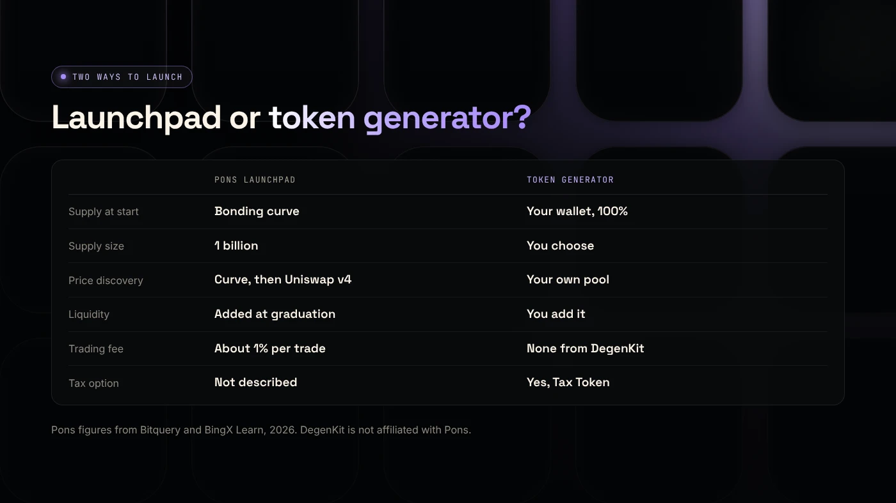
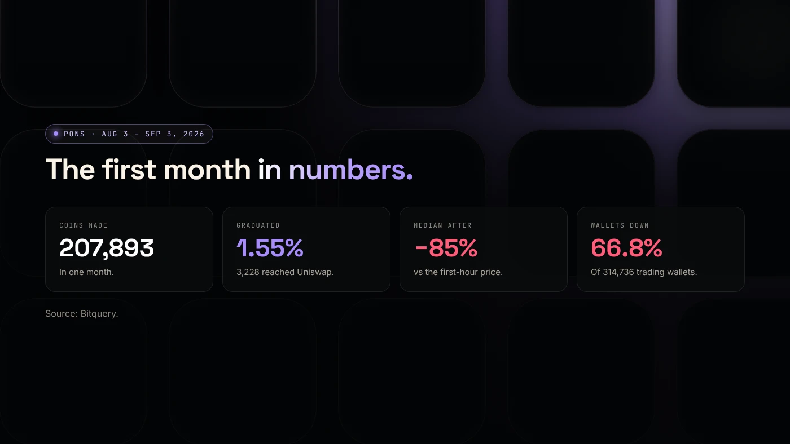

Pons is a launchpad on Robinhood Chain that creates a coin and sells it on a bonding curve until it graduates to a Uniswap pool. A token generator such as DegenKit's only creates the token and sends you the full supply, and you choose when and how to add liquidity. The right choice depends on how much control you want over supply and liquidity.

:::note Not affiliated
DegenKit is not affiliated with Pons. This comparison uses public sources listed at the end and describes Pons as of November 2026.
:::

:::note Key facts
- Pons coins are sold along a curve that mints **1 billion** tokens and graduate to **Uniswap v4** when the reserve reaches **4.2 ETH**, according to Bitquery.
- Between August 3 and September 3, 2026, **207,893** coins were made on Pons and **1.55%** graduated.
- Pons charges about **1%** on each buy and sell, Bitquery reports.
- A token generator charges a creation fee plus gas and leaves liquidity to you.
:::

## How does Pons work?

Bitquery describes Pons as a bonding-curve launchpad. You enter a name, ticker and picture, and Pons creates the coin. Buyers then buy from a **bonding curve**, a formula that raises the price as more tokens are sold. When the reserve reaches a fixed **4.2 ether**, the coin **graduates** to a Uniswap v4 pool automatically ([Bitquery](https://bitquery.io/investigations/pons-launchpad)).

Coins can be backed by ETH, the USDG stablecoin or tokenized assets such as stocks. Pons charges about 1% on each buy and sell, and about four-fifths of fees go to whoever holds the coin's fee rights.

BingX describes an earlier V1 model that created a fixed-supply ERC-20 and a one-sided Uniswap v3 position in one transaction, with the position NFT locked after creation ([BingX Learn](https://bingx.com/en/learn/article/what-is-pons-crypto-and-how-does-pons-robinhood-launchpad-work)).

## How does a token generator work?

A token generator deploys a standard ERC-20 and sends the **entire supply to your wallet**. There is no curve and no automatic pool. You decide:

- the **supply** and whether there is a buy and sell tax,
- **when** to add liquidity, on which Uniswap version and at what starting price,
- whether to **lock or burn** the LP position.

DegenKit's generator on Robinhood Chain charges a service fee read from the factory contract, plus gas. It takes no share of trading. See [the token generator guide](/blog/token-generator-robinhood-chain/) for the steps.

## How do they compare side by side?

| | Pons launchpad | Token generator (DegenKit) |
|---|---|---|
| Who holds the supply at start | The bonding curve | Your wallet, 100% |
| Supply | 1 billion per coin | You choose |
| Price discovery | Bonding curve, then Uniswap v4 | Your own Uniswap pool |
| Liquidity | Added automatically at graduation | You add it, when you choose |
| Trading fee | About 1% per buy and sell | None from DegenKit |
| Creation cost | Near-free plus gas (TrustSwap) | Service fee plus gas |
| Tax option | Not described in our sources | Yes, with Tax Token |

## What do the Pons numbers show?

Bitquery's study of the first month is useful for anyone choosing a model:

- **207,893** coins made, **3,228** graduated (1.55%).
- **79.58%** traded at least once, and **8.24%** turned over $10,000.
- The median graduated coin was about **85% below** its first-hour price.
- **66.8%** of 314,736 trading wallets finished with less money than they started.

Fast, cheap creation means many coins and heavy competition. Most coins never reach a pool, on any launchpad.

## Which should you choose?

**Choose a launchpad like Pons if** you want the fastest path to trading, are happy with a fixed 1 billion supply and curve pricing, and accept a trading fee.

**Choose a token generator if** you want to set the supply, add a tax, pick the Uniswap version and starting price, plan your own liquidity lock, or launch on a schedule with your community.

**What we do not know:** our sources do not confirm Pons' current fee split or whether every graduated pool is locked. Check each coin on Blockscout, as described in [how to check a launchpad token for rug risk](/blog/check-pons-launchpad-token-rug-risk/) and [Robinhood Chain liquidity locks](/blog/robinhood-chain-liquidity-lock/).

## What are the risks?

- **On any launchpad,** most coins lose value quickly. Bitquery's data shows two-thirds of trading wallets lost money.
- **With a generator,** you are responsible for liquidity. A thin pool swings hard, and unlocked LP can be withdrawn.
- **Copycats.** Names and symbols can be copied on both. Only the contract address identifies a token.

You can lose money in crypto. This is not financial advice.

## FAQ

### What is $PONS?

PONS is a token associated with the Pons launchpad name. Bitquery found no confirmed link between the PONS token and the launchpad, though the two share a name.

### Is Pons safe?

Pons is non-custodial, but coins on any launchpad are high risk. Check the contract, holders and liquidity of each coin before buying.

### Can I use Pons and DegenKit together?

They are separate tools. You can create a token with DegenKit and add liquidity on Uniswap yourself, or launch a separate coin on Pons.

## Sources

- [Bitquery: Pons Launchpad growth on Robinhood Chain](https://bitquery.io/investigations/pons-launchpad)
- [BingX Learn: What is Pons and how does the Robinhood launchpad work](https://bingx.com/en/learn/article/what-is-pons-crypto-and-how-does-pons-robinhood-launchpad-work)
- [TrustSwap: PONS launchpad on Robinhood Chain](https://trustswap.com/robinhood/pons)
- [Uniswap: Token integration issues (v3)](https://developers.uniswap.org/docs/protocols/v3/concepts/unsupported-tokens)

To create a token with full control of supply and liquidity, use the [Robinhood Chain token generator](/launch/robinhood/).
