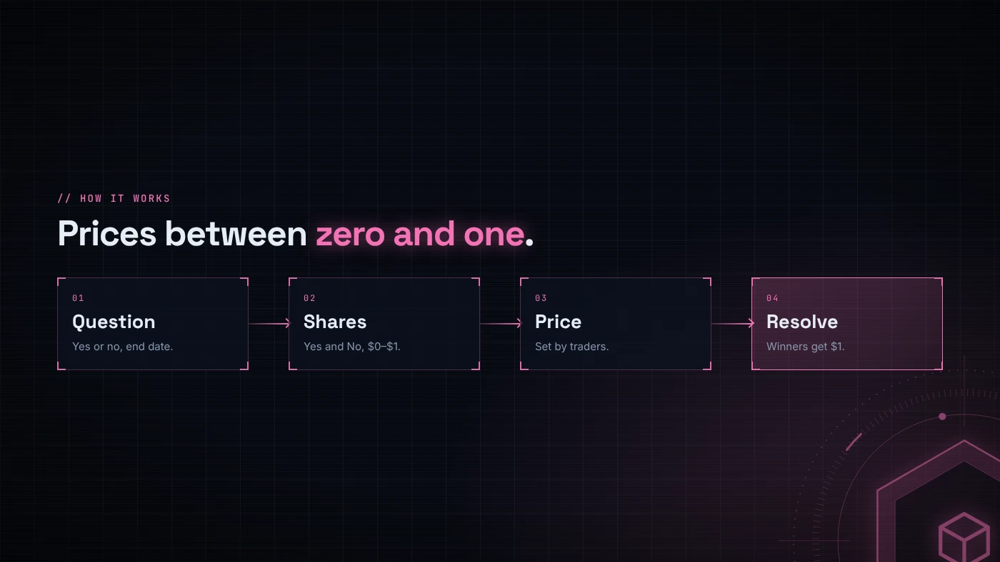
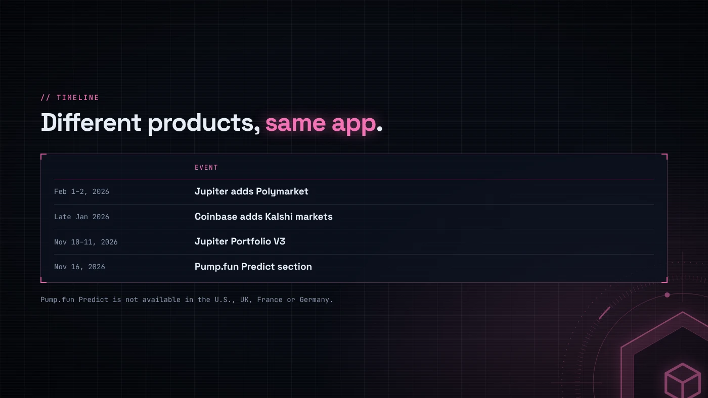

Prediction markets let you buy shares in an event's outcome, priced between 0 and 1 dollar. On Solana they arrived through existing apps: Jupiter added Polymarket in February 2026, and pump.fun added a Predict section on November 16, 2026. Both are blocked in some countries, and both now sit next to tokens in the same apps.

:::note Key facts
- **Jupiter:** Polymarket markets inside the app since **February 1–2, 2026** (The Block).
- **Pump.fun:** **Predict** section with Polymarket markets on **November 16, 2026**, not available in the U.S., UK, France or Germany (crypto.news).
- **Scale:** Polymarket **$7.66B** and Kalshi **$9.16B** volume in January 2026 (The Block).
- **Jupiter Portfolio V3** puts predictions on the same page as swaps, perps and lending.
:::

:::note Not affiliated
DegenKit is not affiliated with Jupiter, pump.fun, Polymarket or Kalshi. Availability depends on each platform's rules and your country.
:::

## How does a prediction market work?

1. A market asks a yes-or-no question with a clear end date.
2. "Yes" and "No" shares trade between $0 and $1.
3. The price reflects what traders collectively think the chance is.
4. When the event resolves, winning shares pay $1 and losing shares pay $0.

Prices are market opinions, not facts or forecasts.

## How did prediction markets come to Solana?

| Date | Event |
|---|---|
| Feb 1–2, 2026 | Jupiter adds Polymarket markets in its app |
| Late Jan 2026 | Coinbase rolls out Kalshi-powered markets in all U.S. states |
| Nov 10–11, 2026 | Jupiter Portfolio V3 puts predictions next to swaps and perps |
| Nov 16, 2026 | Pump.fun adds a Predict section with Polymarket |

Sources: The Block, crypto.news, Datawallet.

## Why are trading apps adding them?

- **More to trade** when memecoin activity is slower. See [the memecoin market in late 2026](/blog/memecoin-market-late-2026/).
- **One app for everything.** Jupiter calls it "Aggregate Everything". See [Jupiter Aggregate Everything](/blog/jupiter-aggregate-everything-release/).
- **Large volumes.** Polymarket and Kalshi each traded billions of dollars a month in early 2026.

## Who can use them?

Pump.fun's Predict section is not available in the U.S., UK, France or Germany, per crypto.news. Other apps and countries have their own rules. In the U.S., Kalshi operates as a CFTC-regulated exchange. Check local law before trading.

## Are prediction markets the same as tokens?

No. A prediction share pays $0 or $1 based on an event. A token you create has no fixed payout. Its price comes from its pool and buyers. Do not describe your token as a bet or a prediction product. See [how to market a Solana token](/blog/how-to-market-a-solana-token/).

## What does this mean for token creators?

- **Competition for attention.** Traders now split time between tokens, perps and predictions.
- **Cross-promotion.** A prediction about your project is not something you control and can attract scams.
- **Clean launches stand out** when users compare many products in one app.

## How do you read a prediction market price?

A "Yes" price of $0.30 means traders, on balance, put about a 30% chance on the outcome. It is not a forecast by the app, and it can be moved by a few large trades in a thin market. Check the volume and the resolution rules before reading much into a price, and remember that fees and spreads reduce what you get back even when you are right.

## What are the risks?

- **You can lose your whole stake** if your outcome does not happen.
- **Resolution disputes** can happen on unclear questions.
- **Legal limits** vary by country.

You can lose money in crypto. This is not financial advice.

## FAQ

### Can I trade prediction markets on Solana?

Yes, through Jupiter and pump.fun, which offer Polymarket markets, where available in your country.

### Is pump.fun Predict available in the U.S.?

No. Crypto.news reports it is not available in the U.S., UK, France or Germany.

### Are prediction markets gambling?

Rules differ by country. In the U.S., Kalshi is CFTC-regulated. Check your local law.

## Sources

- [The Block: Polymarket expands to Solana through Jupiter](https://www.theblock.co/post/387945/jupiter-polymarket-solana)
- [crypto.news: Pump.fun adds Polymarket prediction markets](https://crypto.news/pump-fun-polymarket-prediction-markets-mobile-app/)
- [Datawallet: Jupiter launches four new products](https://www.datawallet.com/news/jupiter-launches-four-new-products)

Launch a token on Solana with the [DegenKit token generator](/launch/).
