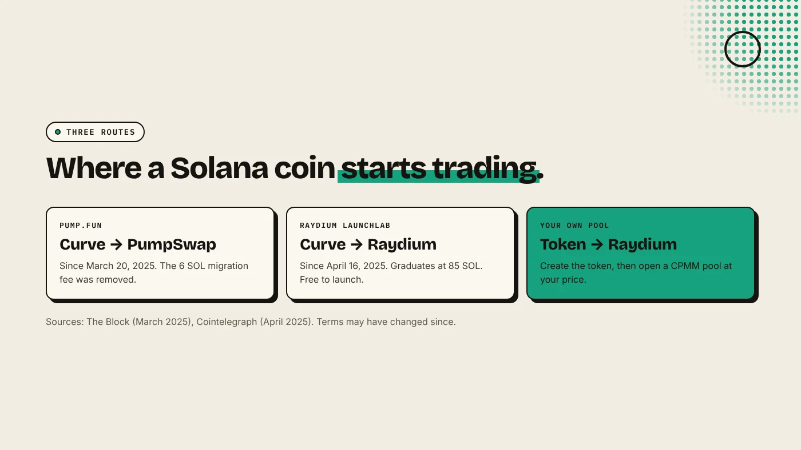
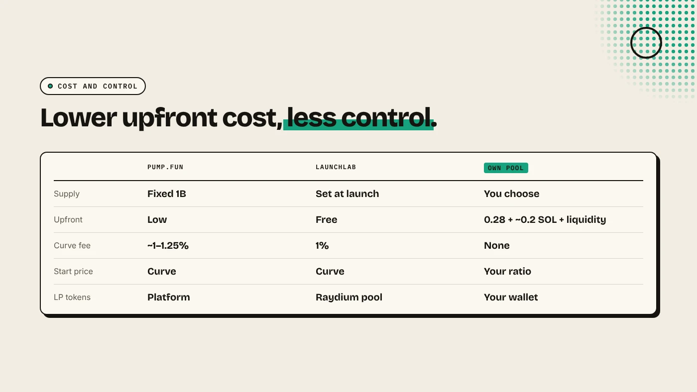

Pump.fun sells a new coin on a bonding curve and, since March 2025, graduates it to its own PumpSwap pool, not to Raydium. Raydium offers two routes: its LaunchLab bonding curve, or a standard pool you open yourself with a token creator. Pick pump.fun or LaunchLab for a fast, low-cost start, and your own Raydium pool for control.

:::note Key facts
- **Pump.fun:** graduated coins migrate to **PumpSwap** since **March 20, 2025**. The 6 SOL migration fee was removed (The Block).
- **Raydium LaunchLab:** launched **April 16, 2025**. Coins graduate at **85 SOL** to a Raydium pool (Cointelegraph).
- **Your own Raydium pool:** about **0.15 SOL** Raydium fee, plus 0.05 SOL on DegenKit and the liquidity you add.
- **Fees change.** Figures below were reported at launch of each product. Check current terms.
:::

:::note Not affiliated
DegenKit is not affiliated with pump.fun or Raydium.
:::

## What changed between pump.fun and Raydium?

Until March 2025, pump.fun coins that completed their bonding curve moved to a Raydium pool. On March 20, 2025, pump.fun launched **PumpSwap**, its own constant-product exchange, and graduated coins began moving there instead. The Block reported a PumpSwap fee of 0.25% per trade at launch, with 0.2% to liquidity providers and 0.05% to the protocol.

Raydium answered on April 16, 2025 with **LaunchLab**, its own bonding-curve launchpad. Cointelegraph reported free launches, a customizable curve, graduation at 85 SOL straight into a Raydium pool, a 1% trading fee on the curve, and an opt-in 10% share of pool fees for creators after graduation.

So "pump.fun vs Raydium" today is really three routes.

## How do the three routes compare?

| | Pump.fun | Raydium LaunchLab | Your own Raydium pool |
|---|---|---|---|
| How it starts | Bonding curve | Bonding curve | Pool with your token and SOL |
| Supply | Fixed 1 billion | Set at launch | You choose |
| Graduates to | PumpSwap | Raydium pool | Already a pool |
| Upfront cost | Low | Free to launch | Creation fee plus pool fee plus liquidity |
| Starting price | Set by the curve | Set by the curve | Set by your deposit ratio |
| Liquidity after | LP handled by the platform | Raydium pool | You hold LP tokens |

For how pump.fun's curve and fees work in detail, see [what is pump.fun](/blog/what-is-pump-fun/).

## When does a bonding curve make sense?

A curve suits a coin with no budget for liquidity. Buyers fund the pool as they buy, and the coin only gets a full pool if demand reaches the graduation point. The cost is control: the platform sets the supply and curve, and most coins never graduate. MadeOnSol counted about 1.8% of pump.fun deploys graduating between August 1 and 28, 2026.

## When does your own Raydium pool make sense?

Your own pool suits a project that wants to:

- set its own supply and keep an allocation for an airdrop or community,
- choose the starting price and pair (SOL or USDC),
- hold the LP tokens and lock or burn them on its own schedule.

The route on DegenKit is two transactions. First create the token on the [Solana launcher](/launch/solana/) (0.28 SOL service fee), with mint and freeze authority revoked. Then open a Raydium CPMM pool with **Create Liquidity**. See [how to make a meme coin on Solana](/blog/how-to-make-a-meme-coin-on-solana/) for the full walkthrough.

## What does each route cost?

- **Pump.fun:** low or no creation cost. Trading on the curve carries a fee, reported at about 1% to 1.25%.
- **LaunchLab:** free to launch. A 1% curve trading fee at launch, with 25% of it used for RAY buybacks.
- **Own pool on DegenKit:** 0.28 SOL to create, about 0.15 SOL Raydium pool fee, 0.05 SOL DegenKit fee, plus the SOL and tokens you deposit. The deposit is usually the largest amount.

## What are the risks?

- **Most launches fail** on every route.
- **Curve launches** attract snipers and bundled buys in the first seconds. See [Solana bundlers explained](/blog/solana-bundler-explained/).
- **Own pools** depend on you: a thin pool swings hard, and unlocked LP can be withdrawn.
- **Terms change.** Fees and graduation rules have changed before and may again.

You can lose money in crypto. This is not financial advice.

## FAQ

### Does pump.fun still graduate tokens to Raydium?

No. Since March 20, 2025, graduated pump.fun coins migrate to PumpSwap.

### Is Raydium LaunchLab the same as pump.fun?

It works on the same idea, a bonding curve that graduates to a pool, but graduated coins move to a Raydium pool and creators can opt in to a share of pool fees.

### Which is cheaper, pump.fun or my own Raydium pool?

Pump.fun is cheaper up front. Your own pool costs more at the start but has no curve trading fee and gives you control of the LP.

## Sources

- [The Block: Pump.fun launches PumpSwap](https://www.theblock.co/post/347360/pump-fun-launches-dex-called-pumpswap-to-instantly-migrate-graduated-tokens)
- [Cointelegraph: Raydium unveils LaunchLab](https://cointelegraph.com/news/raydium-unveils-memecoin-creator-launchlab-compete-pump-fun)
- [MadeOnSol: Pump.fun vs PumpSwap vs Raydium](https://madeonsol.com/blog/pump-fun-vs-pumpswap-vs-raydium)
- [crypto.news: Bonding curves and pump.fun](https://crypto.news/how-meme-coins-are-made-bonding-curves-pump-fun-rug-pulls/)

To set your own supply and pool, start with the [DegenKit Solana token creator](/launch/solana/).
