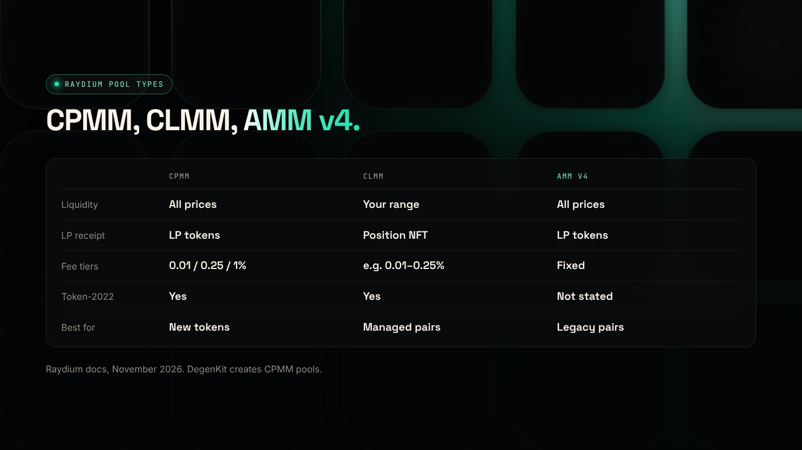
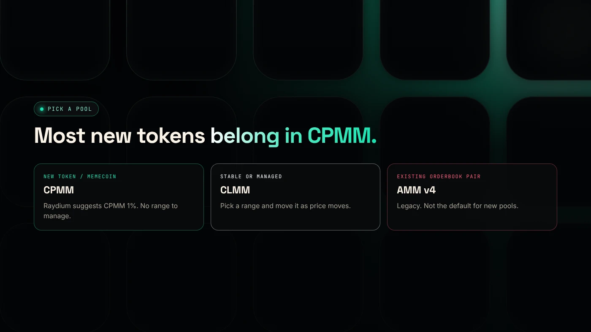

Raydium CPMM is a standard pool that spreads your liquidity across every price, while CLMM concentrates it in a price range you choose. For most new tokens and memecoins, Raydium's own documentation recommends CPMM, and DegenKit's Create Liquidity tool creates a CPMM pool.

:::note Key facts
- **CPMM:** constant product (x × y = k), LP tokens, no range to manage, supports Token-2022.
- **CLMM:** concentrated liquidity, a position NFT, earns only while price is in your range.
- **AMM v4:** legacy, linked to an OpenBook market, "no longer the default for new pools" (Raydium).
- Raydium's guide suggests **CPMM 1%** for long-tail and memecoin pairs.
:::

:::note Not affiliated
DegenKit is not affiliated with Raydium. Pool details come from Raydium's public documentation.
:::

## What is a Raydium CPMM pool?

CPMM stands for **constant product market maker**. The pool holds two tokens, and their balances multiplied together stay constant during swaps. Liquidity is spread across all prices, so the pool always has some of both tokens and keeps earning fees whatever the price.

Raydium describes CPMM as its "current standard": it supports Token-2022, multiple fee configurations and creator fees ([Raydium docs](https://docs.raydium.io/raydium/for-liquidity-providers/pool-types)). LPs receive fungible **LP tokens**, which can be locked, burned or staked in farms.

## What is a Raydium CLMM pool?

CLMM stands for **concentrated liquidity market maker**, the same idea as Uniswap v3. You choose a minimum and maximum price, and your funds only work inside that range. Inside it, you earn more fees per dollar. Outside it, you earn nothing.

Raydium notes that below your minimum price the position becomes 100% of the base token, and above the maximum it becomes 100% of the quote token. Positions are **NFTs**, and fees must be claimed manually. Impermanent loss is larger inside a narrow range.

## How do CPMM, CLMM and AMM v4 compare?

| | CPMM | CLMM | AMM v4 |
|---|---|---|---|
| Liquidity | All prices | Your chosen range | All prices |
| LP receipt | LP tokens | Position NFT | LP tokens |
| Fee tiers | 0.01%, 0.25%, 1% | e.g. 0.01%, 0.05%, 0.25% | Fixed |
| Token-2022 | Yes | Yes | Not stated |
| Management | None | Move the range as price moves | None |
| Raydium's advice | Memecoins; passive LPs | Stable or managed pairs | Existing orderbook pairs |

Fee tiers and advice are from [Raydium's pool-type guide](https://docs.raydium.io/user-flows/choosing-a-pool-type).

## Which pool should a new token use?

**Choose CPMM if** you are launching a new token or memecoin, want a pool that needs no management, or plan to lock or burn LP tokens. Raydium recommends CPMM 1% for long-tail pairs and CPMM 0.25% for passive LPs.

**Choose CLMM if** the pair is stable or closely correlated, and you will actively move your range.

**Choose AMM v4 only if** you are maintaining an existing pair that needs OpenBook integration.

DegenKit's **Create Liquidity** tool creates a **CPMM** pool using Raydium's default fee configuration, with SOL or USDC as the pair. See [how to add liquidity to a Solana token](/blog/add-liquidity-solana-token/).

## How do locks work for each type?

- **CPMM:** LP tokens can be burned or locked. Raydium's Burn & Earn locks LP while you keep claiming fees. See [locking liquidity on Solana](/blog/lock-liquidity-on-solana-burn-and-earn/).
- **CLMM:** the position NFT can be locked through Raydium's lock program.
- **AMM v4:** LP tokens can be burned.

A locked or burned LP shows buyers the liquidity cannot be pulled.

## What are the risks?

- **CLMM out of range:** no fees, and your position sits entirely in one token.
- **Impermanent loss** in any pool when prices move.
- **Wrong fee tier** can deter traders or under-pay LPs.
- **Removing liquidity** makes a token hard to trade. See [removing liquidity from a Raydium pool](/blog/how-to-remove-liquidity/).

You can lose money in crypto. This is not financial advice.

## FAQ

### What is Raydium CPMM?

Raydium's standard constant-product pool. It spreads liquidity across all prices, issues LP tokens and supports Token-2022.

### What is Raydium CLMM?

Raydium's concentrated-liquidity pool. You set a price range, receive a position NFT and earn fees only while the price is inside it.

### Is Raydium AMM v4 still used?

Yes, but Raydium describes it as legacy and no longer the default for new pools.

## Sources

- [Raydium docs: Choosing a pool type](https://docs.raydium.io/user-flows/choosing-a-pool-type)
- [Raydium docs: Pool types](https://docs.raydium.io/raydium/for-liquidity-providers/pool-types)

To create a CPMM pool for your token, use [Create Liquidity in the DegenKit Solana launcher](/launch/solana/).
