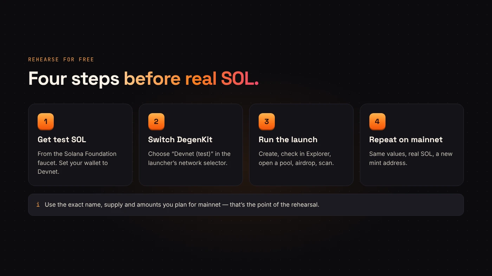
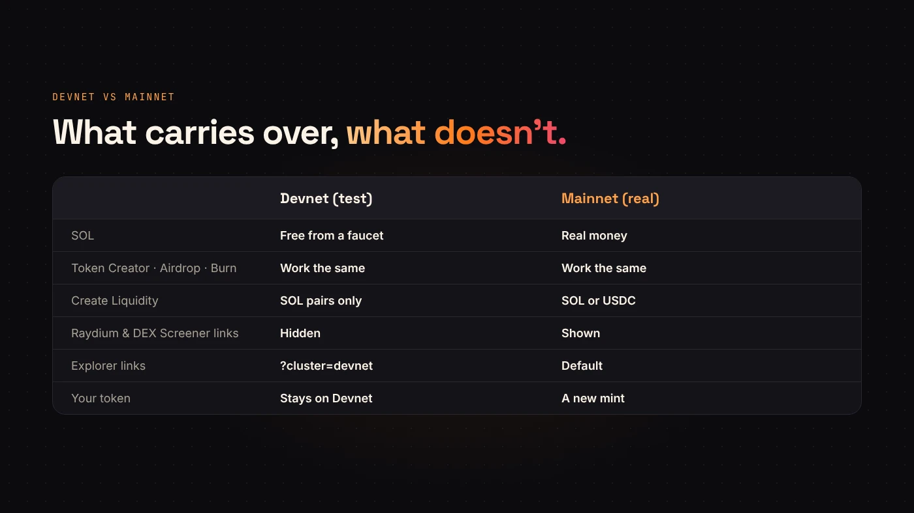

On mainnet, a typo in the supply is permanent and costs real SOL. On **Devnet**, it costs nothing. DegenKit's Solana launcher can switch to Devnet, so you can run the whole launch once as a rehearsal.

## What Devnet is

Devnet is one of Solana's test networks. It works like mainnet, but its SOL is only for testing. DegenKit's own footer says it plainly: Devnet is a free test network, while mainnet transactions spend real SOL and can't be undone.

Tokens you create on Devnet exist only on Devnet. They won't appear on mainnet explorers, DEXs or chart sites.

## Step 1: Get test SOL

[Solana's cookbook](https://solana.com/developers/cookbook/development/airdrops-and-faucets) lists the ways to get Devnet SOL, including the public web faucet at faucet.solana.com, hosted by the Solana Foundation. Airdrops can be rate limited when demand is high, so request a little more than you need.

Your wallet must be set to Devnet too. Most Solana wallets have a developer or network setting for this.

## Step 2: Switch DegenKit to Devnet

Open the [Solana launcher](https://degenkit.app/launch/solana/) and choose **Devnet (test)** in the network selector. The page shows the active network in the sidebar and the token summary.

## Step 3: Run the whole launch

Use the exact values you plan for mainnet:

1. **Create the token** with your real name, symbol, decimals, supply and image.
2. **Check it** on Solana Explorer. DegenKit's links add `?cluster=devnet` automatically.
3. **Create Liquidity** with test SOL to see the starting price and market cap your amounts produce.
4. **Airdrop or Multisender** to a few test wallets.
5. **Scanner** the result, the way buyers will on mainnet.

## What's different on Devnet

- **USDC pairing is hidden.** USDC only exists as the official mint on mainnet, so Devnet pools pair with SOL.
- **No trading links.** After creating a Devnet pool, the Raydium and DEX Screener links are hidden; those sites track mainnet.
- **Fees are paid in test SOL.** Service fees and network fees appear as they will on mainnet, but they cost nothing real.

:::tip Write down what you learn
Note the starting price, the market cap and anything that surprised you. Fix it in your plan before you switch to mainnet.
:::

## Moving to mainnet

Switch the selector back to **Mainnet (real)** and your wallet back to mainnet. Then repeat the steps with real SOL. Your Devnet token stays on Devnet; the mainnet token is a new mint with a new address.

## Questions people ask

### Can I move my Devnet token to mainnet?

No. You create it again on mainnet. That's why you rehearse with the exact values.

### Does Devnet SOL have any value?

It's meant only for testing. Never pay anyone for it.

## Wrap up

Get test SOL, switch DegenKit to Devnet, run the full launch and note what you'd change. Then [launch on mainnet](https://degenkit.app/launch/solana/) with a plan you've already seen work.
