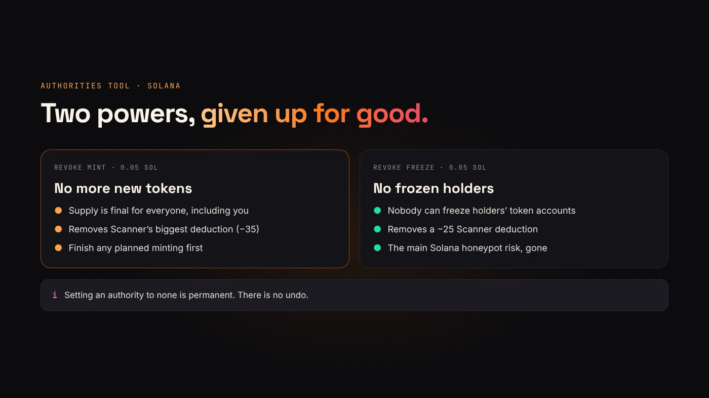
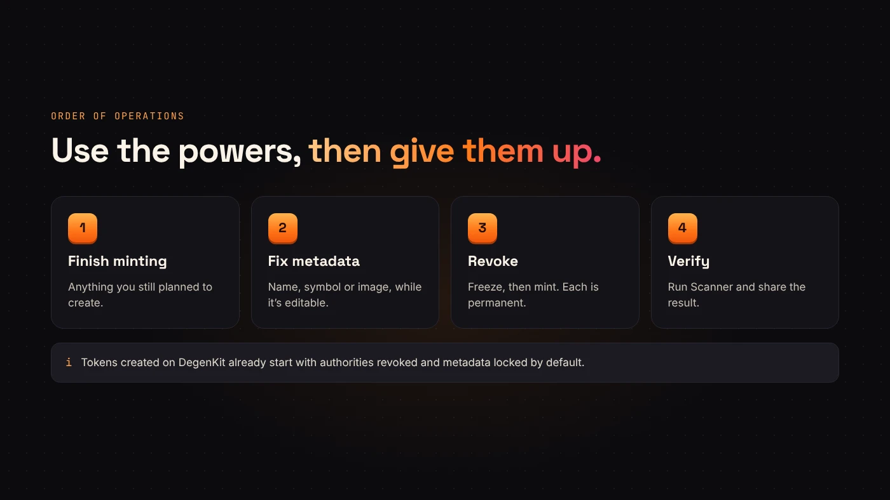

Tokens created on DegenKit start with mint and freeze authority revoked and metadata locked, unless you turned those settings off. But you may have a token created elsewhere, or one where you kept those controls on purpose. Two DegenKit tools handle that: **Authorities** and **Update Metadata**.

## When you need them

- You created a token with mint or freeze authority still active, and now want to give them up.
- You created a token elsewhere and want DegenKit to finish the job.
- Your token's metadata is still editable and you need to fix the name, symbol or image.

Both tools only work with the wallet that holds the relevant authority.

## Authorities: revoke mint or freeze

Open **Authorities** in the [Solana launcher](https://degenkit.app/launch/solana/), paste the mint address and choose **Load**. DegenKit shows the token's name and whether each authority is **active** or **revoked**.

- **Revoke mint** removes the ability to create more tokens.
- **Revoke freeze** removes the ability to freeze holders' token accounts.

[Solana's documentation](https://solana.com/docs/tokens/basics/set-authority) explains that setting an authority to none permanently removes that role. DegenKit's tool says the same: permanent, can't be undone. Each revoke has a 0.05 SOL service fee.

:::warning Revoke only when you're sure
If you still need to mint, for example to finish a planned distribution, do that first. After revoking, nobody can mint again, including you.
:::

## Update Metadata: name, symbol and image

Open **Update Metadata**, paste the mint and choose **Load**.

- If the metadata is **locked** (immutable), DegenKit says so and nothing can be changed. This is the case for tokens created on DegenKit.
- If it is **editable**, you can change the name (up to 32 characters), symbol (up to 10) and image. Leave the image empty to keep the current one.

A new image is uploaded to IPFS with a fresh metadata file. [Metaplex's documentation](https://www.metaplex.com/docs/smart-contracts/token-metadata/update) notes that only the update authority can make changes, and only while the metadata is mutable. The service fee is 0.05 SOL.

## Why editable metadata worries buyers

If metadata can change, the token's name, symbol or image can change after people buy. That is why DegenKit's Scanner subtracts 15 points for editable metadata, and why DegenKit locks it at creation. If you fix your metadata, consider making it final afterwards with a tool that can set it immutable, and tell holders.

## A good order of operations

1. Finish any minting you planned.
2. Fix the metadata while it is still editable.
3. Revoke freeze authority.
4. Revoke mint authority.
5. Run **Scanner** and share the result.

## Questions people ask

### Can I revoke authority on someone else's token?

No. Only the wallet that holds the authority can revoke it.

### Can I edit a DegenKit token's name later?

No. DegenKit creates metadata locked, so the name, symbol and image are final. Double-check them before you sign.

## Wrap up

Authorities removes mint and freeze powers for good; Update Metadata fixes editable metadata. Finish what needs an authority first, then give it up. [Open the Solana launcher](https://degenkit.app/launch/solana/) to manage your token.
