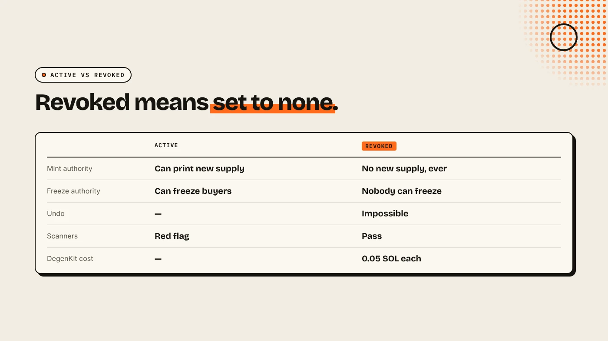
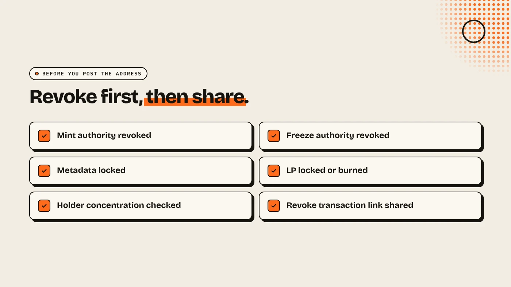

To revoke mint authority on Solana, load your token's mint address in an authorities tool, click Revoke mint and sign with the wallet that holds the authority. The mint authority is set to none, so nobody can ever create more tokens. Revoke freeze authority the same way. Both are permanent, and both are the first things buyers and scanners check.

:::note Key facts
- **Mint authority** can create new tokens. **Freeze authority** can freeze holders' token accounts.
- **Revoking sets the authority to none.** Solana's docs say this "permanently removes" the role.
- **On DegenKit:** **Revoke mint** and **Revoke freeze** cost **0.05 SOL** each in service fees, plus network fees.
- **New tokens on DegenKit** can revoke both at creation with two toggles.
:::

:::note Not affiliated
DegenKit is not affiliated with Solana Labs, RugCheck or any scanner named here.
:::

## Why revoke mint authority?

While mint authority is active, its holder can mint any amount of new tokens and sell them into the pool. Every existing holder is diluted. Buyers know this, so scanners such as RugCheck and DegenKit's own **Scanner** flag an active mint authority as a risk.

**Freeze authority** is the second check. Its holder can freeze a buyer's token account so it cannot transfer or sell. It is a common honeypot pattern. Our explainer on [mint authority vs freeze authority](/blog/mint-authority-vs-freeze-authority/) goes deeper into both.

## When should you keep mint authority?

Almost never for a meme coin. Some projects keep it for a planned emission schedule, such as staking rewards. Then they should say so publicly and ideally hand it to a multisig. If you have no written reason to mint later, revoke it.

## How do you revoke it on DegenKit?

1. Open the [Solana launcher](/launch/solana/) and connect the wallet that holds the authority.
2. Choose **Authorities** in the sidebar.
3. Paste the **Token mint address** and click **Load**. The token name and current **Mint authority** and **Freeze authority** appear.
4. Click **Revoke mint** and sign. Then click **Revoke freeze** and sign.
5. Load the mint again. Both should now show as revoked.

This works for any SPL token whose authority your wallet holds, including tokens created elsewhere. If you are creating a new token, turn on **Revoke mint authority** and **Revoke freeze authority** in the create form instead. It saves a step.

## How can buyers check it?

- **Explorer:** open the mint on Solscan or Solana Explorer. Mint authority and freeze authority should be empty or show none.
- **Scanner:** paste the mint into DegenKit's Scanner. It shows both authorities, metadata status and holder concentration.
- **Share proof:** post the revoke transaction link with your mint address.

## What else should you check?

Revoking authorities does not make a token safe on its own:

- **Liquidity** can still be withdrawn unless it is locked or burned. See [locking liquidity on Solana](/blog/lock-liquidity-on-solana-burn-and-earn/).
- **Holder concentration** matters. One wallet with half the supply can still sell. See [how to read a holder bubblemap](/blog/how-to-read-a-holder-bubblemap/).
- **Token-2022 extensions** such as a transfer fee have their own authorities. See [Solana Token-2022 transfer fee](/blog/solana-token-2022-transfer-fee/).

## What are the risks?

- **No undo.** If you later need new supply, you would have to launch a new token.
- **Wrong wallet.** Only the current authority can revoke it.
- **False comfort.** Revoked authorities do not stop rug pulls through liquidity or large holders.

You can lose money in crypto. This is not financial advice.

## FAQ

### Can I undo revoking mint authority?

No. Once it is set to none, no wallet can mint again.

### How much does it cost to revoke mint authority on Solana?

On DegenKit, 0.05 SOL in service fees for each authority, plus a small network fee.

### Does revoking mint authority affect existing holders?

No. Balances stay the same. It only stops new tokens being created.

### Should I revoke freeze authority too?

Yes, for almost every token. An active freeze authority is a common honeypot warning.

## Sources

- [Solana docs: Set authority](https://solana.com/docs/tokens/basics/set-authority)
- [DEXTools: What is mint authority on Solana](https://www.dextools.io/tutorials/what-is-mint-authority-in-crypto-guide-2026)

Revoke both authorities with the **Authorities** tool on the [DegenKit Solana launcher](/launch/solana/).
