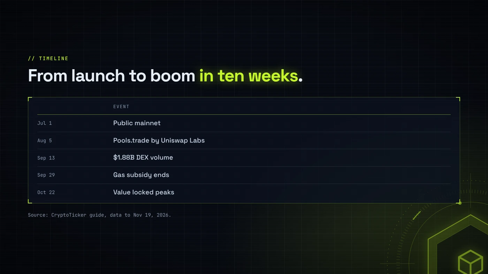
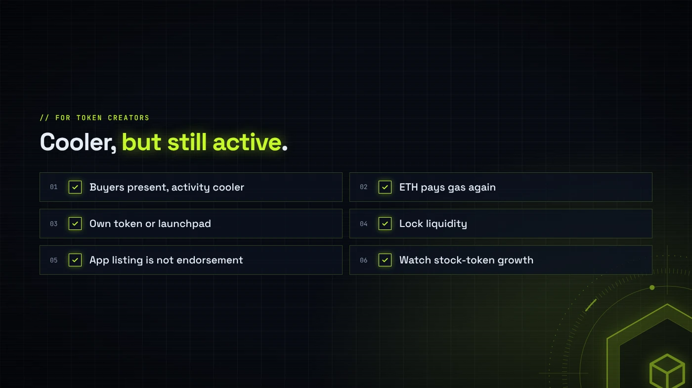

Robinhood Chain is an Ethereum layer 2 built on Arbitrum Orbit, run by Robinhood, with mainnet live since July 1, 2026. It was built for tokenized stocks, but memecoins drove its September boom, with $1.88 billion of DEX volume on September 13. By November 19, value locked was about $989 million, about 14% below its October peak, and lending and new stock tokens are arriving.

:::note Key facts
- **Mainnet:** **July 1, 2026**. Arbitrum Orbit L2, fees in **ETH** (CryptoTicker).
- **Peak day:** **$1.88B** DEX volume on **September 13, 2026**.
- **Value locked:** about **$989M** on Nov 19, about **14%** below the Oct 22 peak.
- **Pons launchpad:** about **$205.1M** in all-time fees as of Nov 19.
:::

:::note Not affiliated
DegenKit is not affiliated with Robinhood, Pons, Uniswap Labs, Lista or any token named here. Figures are as reported by the sources listed.
:::

## What happened on Robinhood Chain in 2026?

| Date | Event |
|---|---|
| Jul 1 | Public mainnet live |
| Jul 13 | Noxa launchpad shuts down |
| Aug 5 | Uniswap Labs launches Pools.trade, no launch fee |
| Aug 6 | Robinhood opens CASHCAT for trading in its U.S. app |
| Sep 2 | Chain revenue $4.01M in one day |
| Sep 13 | $1.88B DEX volume in one day |
| ~Sep 22–24 | Value locked passes $1B |
| Sep 29 | 90-day gas subsidy ends |
| Oct 22 | Value locked peaks |

All per CryptoTicker's October and November guide.

## How did memecoins take over a stock-token chain?

Launchpads made token creation cheap and fast, Robinhood's own app listed one memecoin, and gas was subsidized for 90 days. CASHCAT launched days after mainnet with a fixed one-billion supply and no team. On November 19 it traded about 86% below its high. The launchpad Pons became the main venue. See [what is Pons](/blog/what-is-pons-launchpad-robinhood-chain/).

Robinhood Chain tokens were trading about 50% below recent highs in early November, as the wider market fell (Gokhshtein Media, November 5).

## What is happening with stock tokens?

Robinhood began issuing 200+ U.S. stock and ETF tokens to EU customers in 2025, first on Arbitrum One, with plans to move them to its own chain. In mid-August, tokenized assets on the chain were about $32 million on a narrow measure, held by 420,000+ wallets. In November, KuCoin and The Defiant reported an Anthropic-linked stock token launching on Robinhood Chain, with Lighter listing it.

See [Robinhood tokenized stocks vs your own token](/blog/robinhood-tokenized-stocks-vs-your-own-token/).

## What is new in DeFi on the chain?

- **Lista Lending** launched with USDG deposits and ETH, BTC and tokenized ETFs as collateral (KuCoin).
- **Uniswap v4** is the largest single fee line, about $2.6 million over seven days to November 19.
- **Weekly chain fees** were about $7.5 million, down about 26% week on week.

## What comes next for Robinhood Chain?

Robinhood named the chain on its latest earnings call and committed to regular updates. Things to watch:

- **More stock tokens** moving onto the chain.
- **Lending markets** using tokenized assets as collateral.
- **Whether memecoin activity holds** without the gas subsidy.

These are developments to watch, not predictions.

## What does it mean for token creators?

- **Buyers are there,** but activity has cooled from September.
- **ETH pays gas** again since the subsidy ended. See [bridge ETH to Robinhood Chain](/blog/bridge-eth-to-robinhood-chain/).
- **Own your token or use a launchpad.** See [Pons vs creating your own token](/blog/pons-vs-create-your-own-token-robinhood-chain/).
- **Lock liquidity** to stand out from quick flips. See [Robinhood Chain liquidity lock](/blog/robinhood-chain-liquidity-lock/).

## What are the risks?

- **Fast boom, fast cool-down.** Many September tokens are far below their highs.
- **Launchpad risk.** Noxa shut down in July, and its tokens fell.
- **No endorsement.** A token listed in the Robinhood app is not issued or endorsed by Robinhood.

You can lose money in crypto. This is not financial advice.

## FAQ

### When did Robinhood Chain launch?

Its public mainnet went live on July 1, 2026.

### Is there a Robinhood Chain token?

The chain uses ETH for gas. Memecoins and stock tokens trade on it, but those are separate tokens.

### Can I create my own token on Robinhood Chain?

Yes. See [launch a token on Robinhood Chain](/blog/launch-a-token-on-robinhood-chain/).

## Sources

- [CryptoTicker: Robinhood Chain and the memecoins](https://cryptoticker.io/en/robinhood-chain-memecoins-explained/)
- [KuCoin: Lista Lending on Robinhood Chain](https://kucoin.com/news/flash/lista-lending-launches-on-robinhood-chain-supporting-usdg-deposits-and-eth-btc-and-tokenized-etfs-as-collateral)
- [The Defiant: Lighter lists Anthropic-linked token](https://thedefiant.io/news/defi/lighter-lists-anthropic-linked-token-on-robinhood-chain)
- [Gokhshtein Media: Robinhood Chain tokens down 50%](https://gokhshtein.com/news/2026-11-05-robinhood-chain-tokens-down-50-despite-corporate-push)

Create a token on Robinhood Chain with the [DegenKit token generator](/launch/).
