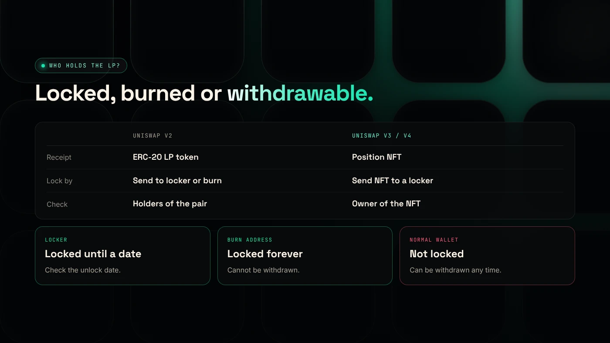
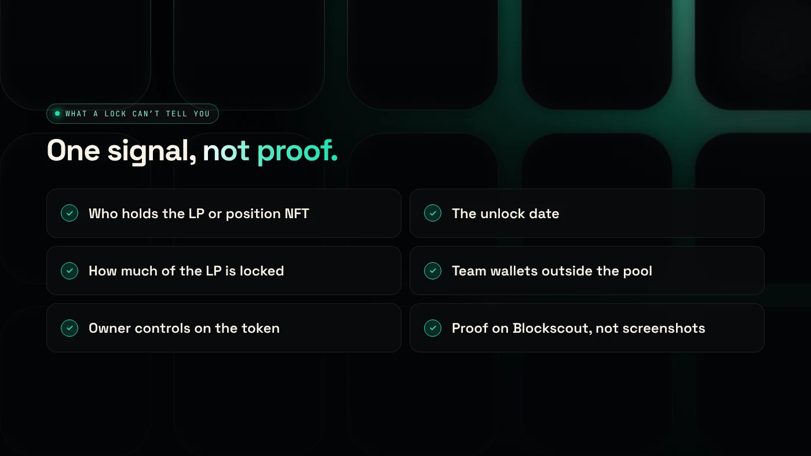

A liquidity lock on Robinhood Chain means the LP tokens or LP position for a token's Uniswap pool are held by a time-lock contract, or burned, so nobody can withdraw the pool's funds before a set date. You can check any token's lock on Blockscout by finding who holds its LP.

:::note Key facts
- **Uniswap v2** liquidity is an ERC-20 **LP token**. **Uniswap v3 and v4** liquidity is a **position NFT**.
- A lock is only as strong as its holder: a **locker contract** with an end date, a **burn address**, or a **wallet** (not locked).
- Pons V1 locked each launch's position NFT after pool creation, according to BingX Learn.
- DegenKit creates the token. You add liquidity on Uniswap and choose how to lock it.
:::

:::note Not affiliated
DegenKit is not affiliated with Pons, TrustSwap or Team Finance. They are named here for reference.
:::

## What is locked liquidity?

When you add liquidity to a Uniswap pool, you receive a receipt for your share. Whoever holds that receipt can withdraw the token and ETH from the pool at any time. If the creator withdraws it all after people have bought, buyers are left holding a token they cannot sell. That is the classic **rug pull**.

Locking the receipt removes that option. There are two common ways:

- **Time-lock:** the receipt is sent to a locker contract that releases it only after a set date.
- **Burn:** the receipt is sent to an address nobody controls, such as `0x000…dEaD`. The liquidity can never be withdrawn.

Buyers read a lock as a trust signal. Our guide to [spotting rug pull risk](/blog/how-to-spot-rug-pull-risk/) covers the other signals.

## How do locks differ on Uniswap v2, v3 and v4?

| | Uniswap v2 | Uniswap v3 | Uniswap v4 |
|---|---|---|---|
| Receipt | ERC-20 LP token | Position NFT | Position NFT |
| How it is locked | LP token sent to locker or burn address | NFT sent to a locker contract | NFT sent to a locker contract |
| Where to check | Holders of the pair contract | Owner of the position NFT | Owner of the position NFT |
| Fee-on-transfer (tax) tokens | Supported | Not supported by Uniswap's routers | Not documented in our sources |

Uniswap's own documentation says fee-on-transfer tokens "will not function" with its v3 router contracts ([Uniswap](https://developers.uniswap.org/docs/protocols/v3/concepts/unsupported-tokens)). That is why a tax token belongs in a v2 pool.

## How do you lock liquidity for your own token?

1. **Create the token** with the [Robinhood Chain token generator](/launch/robinhood/). Result: the full supply is in your wallet.
2. **Add liquidity on Uniswap** with your token and ETH. Result: you receive an LP token (v2) or a position NFT (v3 or v4).
3. **Choose a lock method.** A locker service sends the receipt to its contract with an end date you choose. To burn instead, send the receipt to a burn address. Result: the receipt leaves your wallet.
4. **Publish the proof.** Share the locker link or the burn transaction on Blockscout with your contract address.

As far as we know, TrustSwap says its MintPlus token creator locks LP tokens in a Team Finance vault on Robinhood Chain ([TrustSwap](https://trustswap.com/robinhood/pons)). Check that any locker you use is live on Robinhood Chain, chain ID 4663, before sending anything.

Burning is permanent. You lose the right to withdraw your share of the pool and its trading fees.

## How do you check if a token's liquidity is locked?

1. Open the token on the [Robinhood Chain explorer](https://robinhoodchain.blockscout.com) and find its Uniswap pool in the transactions or on DEX Screener.
2. **For v2:** open the pair contract and look at its **holders**. If most LP sits in a locker contract or a burn address, it is locked or burned. If it sits in a normal wallet, it is not locked.
3. **For v3 or v4:** find the position NFT and check its **owner**. A locker contract or burn address means locked.
4. **For a locker:** open the lock and check the **unlock date** and the amount.

## What can a lock not tell you?

- **It does not cover the supply.** A team can still sell its own tokens into the pool.
- **It expires.** A lock ending next week protects buyers for a week.
- **Partial locks.** Only part of the LP may be locked.
- **Token contract risks.** A tax token's owner may still be able to change rates. Check the contract too, as in [how to check a launchpad token for rug risk](/blog/check-pons-launchpad-token-rug-risk/).

## What are the risks?

- **Locker risk.** A lock depends on the locker contract working as described.
- **Burned is final.** You cannot recover burned liquidity or its fees.
- **Fake proof.** Screenshots can be faked. Only trust what you can see on Blockscout.

You can lose money in crypto. This is not financial advice.

## FAQ

### How do I check if liquidity is locked?

Find the token's pool on Blockscout and check who holds the LP tokens (v2) or position NFT (v3, v4). A locker contract or burn address means locked. A normal wallet means not locked.

### How can I check how long liquidity is locked?

Open the lock on the locker's page or contract and read the unlock date. A burn has no end date because it is permanent.

### Does Pons lock liquidity?

BingX Learn says Pons V1 locked each position NFT after pool creation and describes V2 as graduating to a locked Uniswap v4 pool. Check each coin's pool on Blockscout to confirm.

### How do I lock liquidity?

Add liquidity on Uniswap, then send the LP token or position NFT to a locker contract with an end date, or to a burn address.

## Sources

- [Uniswap: Token integration issues (v3)](https://developers.uniswap.org/docs/protocols/v3/concepts/unsupported-tokens)
- [BingX Learn: How the Pons launchpad works](https://bingx.com/en/learn/article/what-is-pons-crypto-and-how-does-pons-robinhood-launchpad-work)
- [TrustSwap: PONS launchpad on Robinhood Chain](https://trustswap.com/robinhood/pons)
- [Robinhood Chain Blockscout explorer](https://robinhoodchain.blockscout.com)

To start with a token you fully control, use the [DegenKit token generator for Robinhood Chain](/launch/robinhood/).
