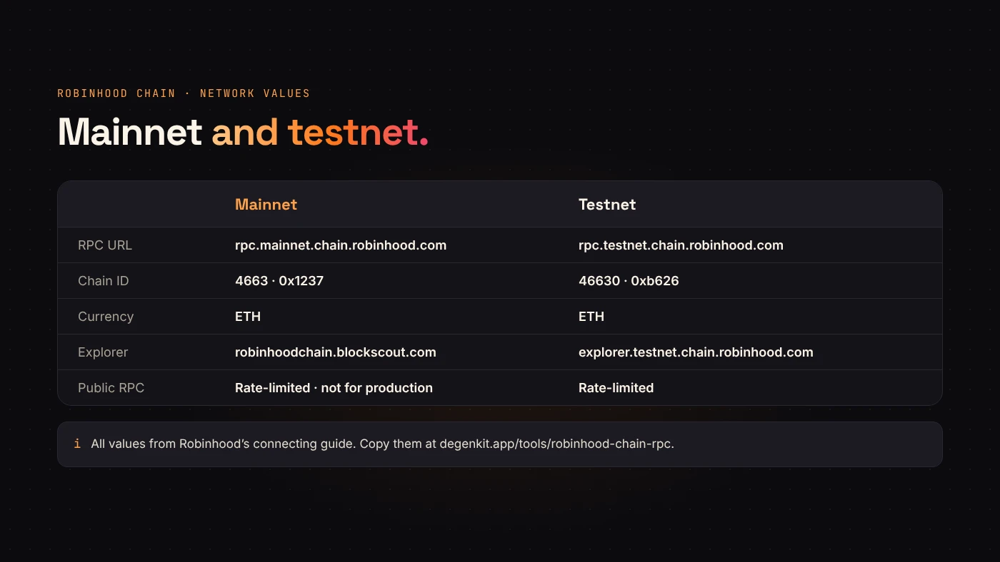
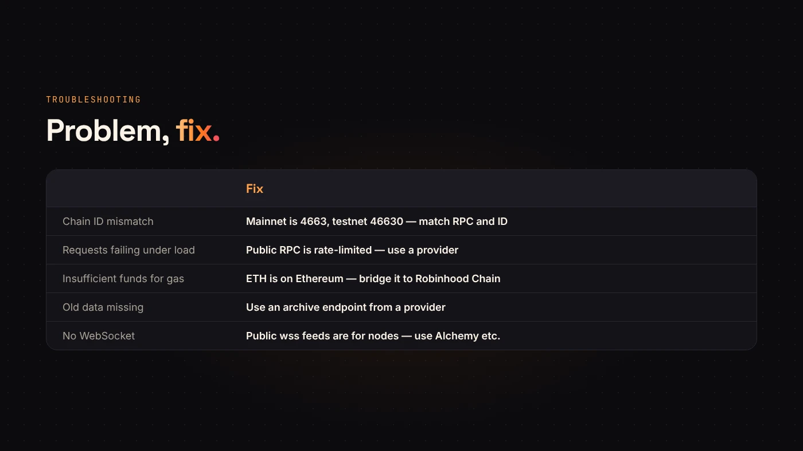

An **RPC endpoint** is the address your wallet or app talks to when it reads from or sends to a blockchain. To use Robinhood Chain, you need its RPC URL, its chain ID and its gas token. This page has all of them, from [Robinhood's own connecting guide](https://docs.robinhood.com/chain/connecting).

If you just want to copy the values or add the network with one click, use our [Robinhood Chain RPC tool](/tools/robinhood-chain-rpc/). It also checks the public RPC live from your browser.

## Robinhood Chain mainnet

- **RPC URL:** `https://rpc.mainnet.chain.robinhood.com`
- **Chain ID:** 4663 (hex `0x1237`)
- **Currency:** ETH
- **Block explorer:** `https://robinhoodchain.blockscout.com`

## Robinhood Chain testnet

- **RPC URL:** `https://rpc.testnet.chain.robinhood.com`
- **Chain ID:** 46630
- **Currency:** ETH
- **Block explorer:** `https://explorer.testnet.chain.robinhood.com`



## Public RPC vs. a provider

Robinhood's public endpoints are free, but Robinhood describes them as **rate-limited and not recommended for production use**. They're fine for a wallet, a quick test or a small script.

For an app, bot, indexer or anything that sends many requests, use a provider. Robinhood's guide lists:

- **Alchemy** — HTTP and WebSocket, `https://robinhood-mainnet.g.alchemy.com/v2/{API_KEY}`
- **Chainstack** — `https://robinhood-mainnet.core.chainstack.com/{ENDPOINT}`
- **QuickNode** — `https://{ENDPOINT}.robinhood-mainnet.quiknode.pro/{TOKEN}`
- **Blockdaemon, dRPC, Validation Cloud, GlobalStake and Pinax**

Historical reads and indexing need an **archive** endpoint, which providers offer. Or you can [run your own Robinhood Chain node](/blog/run-a-robinhood-chain-node/).

:::note What about WebSocket?
The public `wss://feed…` addresses in Robinhood's docs are **sequencer feeds** for nodes, not a general WebSocket RPC. For WebSocket subscriptions, use a provider such as Alchemy.
:::


## Test the RPC in one command

Ask the endpoint for its chain ID. A healthy mainnet RPC answers `0x1237`, which is 4663.

```
curl -s https://rpc.mainnet.chain.robinhood.com \
  -H 'content-type: application/json' \
  -d '{"jsonrpc":"2.0","id":1,"method":"eth_chainId","params":[]}'
```

Swap the method for `eth_blockNumber` to see the latest block.

## Add Robinhood Chain to your wallet

1. Open our [RPC tool](/tools/robinhood-chain-rpc/) and choose **Add Robinhood Chain to wallet**, or open DegenKit's [Robinhood Chain launcher](/launch/robinhood/), which asks your wallet to add it when you connect.
2. Check the request shows chain ID **4663** and the RPC URL above.
3. Approve. The network appears in your wallet's list.

You'll need **ETH on Robinhood Chain** for gas. ETH on Ethereum must be bridged first; deposits take about 10 minutes and withdrawals back take about 7 days. See [Ethereum or Robinhood Chain](/blog/ethereum-vs-robinhood-chain/).



## Troubleshooting

- **"Chain ID mismatch."** The RPC and chain ID don't match. Mainnet is 4663, testnet is 46630.
- **Requests failing under load.** You're hitting the public RPC's rate limit. Switch to a provider.
- **"Insufficient funds for gas."** Your ETH is on Ethereum, not Robinhood Chain. Bridge it.
- **Old data missing.** Use an archive endpoint from a provider.

## Questions people ask

### Is the Robinhood Chain RPC free?

The public one is, with rate limits. Providers have free and paid tiers.

### Is Robinhood Chain EVM-compatible?

Yes. It's an Arbitrum chain, so MetaMask, ethers, viem and other EVM tools work with the values above.

## Wrap up

Mainnet RPC `https://rpc.mainnet.chain.robinhood.com`, chain ID 4663, gas in ETH. Use the public RPC for wallets and tests, a provider for production. [Copy the values or add the network](/tools/robinhood-chain-rpc/), then [launch a token on Robinhood Chain](https://degenkit.app/launch/robinhood/).
