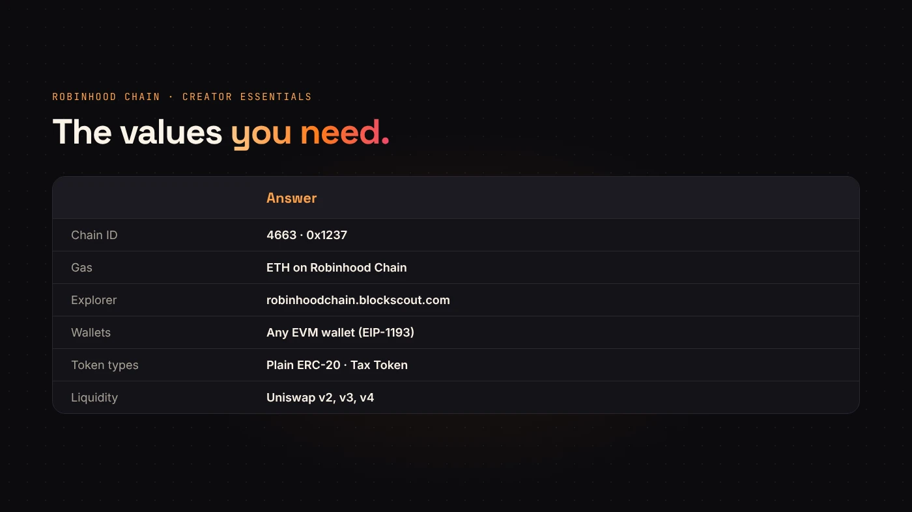
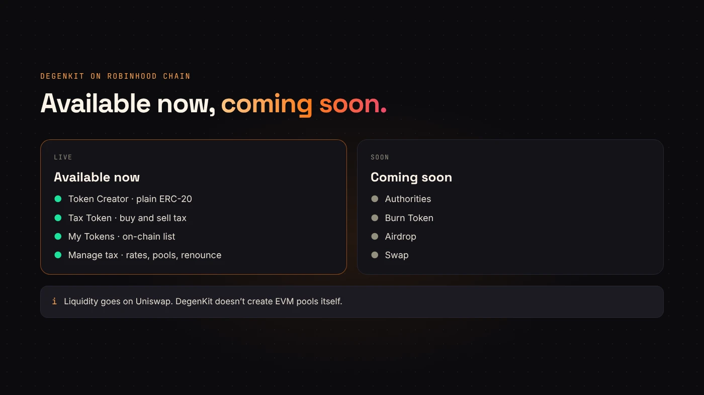

Robinhood Chain is new, so creators have a lot of questions before their first launch there. Here are short answers to the ones we hear most, based on how DegenKit's [Robinhood Chain launcher](https://degenkit.app/launch/robinhood/) works today.

## Network and wallet

### What is Robinhood Chain?

A permissionless layer 2 built on Arbitrum, with Ethereum underneath. It uses ETH for gas, chain ID **4663**, and the [Blockscout explorer](https://robinhoodchain.blockscout.com).

### Which wallets work?

Any EVM wallet that supports EIP-1193. DegenKit detects installed wallets such as MetaMask, Coinbase Wallet, Rabby, Trust, Phantom, Rainbow, Bitget, Binance and OKX. See [supported wallets](/blog/degenkit-supported-wallets/).

### Do I have to add the network by hand?

No. When you connect, DegenKit asks your wallet to add and switch to Robinhood Chain. You can also use our [RPC tool](/tools/robinhood-chain-rpc/). Check that the prompt says chain ID 4663.

### What do I pay gas in?

ETH on Robinhood Chain. ETH on Ethereum has to be [bridged first](/blog/bridge-eth-to-robinhood-chain/).

## Creating the token

### What can I create on Robinhood Chain?

Two types: a plain fixed-supply ERC-20 (**Token Creator**) or one with buy and sell taxes (**Tax Token**). Compare them in [plain token or tax token](/blog/plain-or-tax-token-robinhood-chain/).

### Can I mint more tokens later?

No. Neither contract has a mint function. The supply is final for everyone, including DegenKit.

### Can I change the name or symbol after creation?

No. Name, symbol, supply and decimals (18) are set once. Check them before you sign.

### How much does it cost?

A service fee, read from the factory contract and shown on the form before you sign, plus network gas. See [DegenKit fees explained](/blog/degenkit-fees-explained/).

### Does DegenKit hold my tokens or keys?

No. DegenKit is non-custodial. You sign every transaction in your own wallet, and the supply goes straight to it.

:::note Coming soon on Robinhood Chain
Authorities, Burn, Airdrop and Swap show as **coming soon** in the Robinhood Chain sidebar. Today you can create tokens and manage tax tokens there.
:::

## Taxes and liquidity

### When does the tax start?

Only after you add liquidity and mark the pool in **My Tokens → Manage tax**. Until then, no trade is taxed. Wallet-to-wallet transfers are never taxed. See [creating a tax token on Robinhood Chain](/blog/create-tax-token-on-robinhood-chain/).

### Where do I add liquidity?

On Uniswap, which runs v2, v3 and v4 on Robinhood Chain. Use v2 for a tax token. DegenKit doesn't create EVM pools itself. See [adding liquidity on Uniswap](/blog/add-liquidity-uniswap-erc20/).

## After launch

### Where do I find my tokens?

Open **My Tokens** on the launcher, connect the creator wallet and choose **Load my tokens**. DegenKit reads them from on-chain records, not a third-party balance scan. If a tax token you own was created elsewhere in DegenKit, paste its address under **Add**.

### Can I renounce ownership of a tax token?

Yes, from **Manage tax**. It freezes the rates, tax wallet and pools forever. A plain token has no owner to renounce.

### Can I check a token's approvals or risk?

Use our free [token approval checker](/tools/token-approval-checker/), which scans Robinhood Chain wallets. Blockscout shows holders and transfers.

## Launchpads and alternatives

### Is DegenKit the same as Pons?

No. Pons is a launchpad that creates a token and its trading pool together, under its own rules. DegenKit is a token generator: it deploys the token to your wallet and you add liquidity yourself. Read [Pons launchpad vs a token generator](/blog/pons-launchpad-vs-token-generator/) for the full comparison.

### Is DegenKit affiliated with Robinhood?

No. DegenKit is an independent tool that works on Robinhood Chain. It is not owned, issued or endorsed by Robinhood Markets.

### What should I check before I announce my token?

Confirm the contract on the explorer, add liquidity, test a small buy and a small sell, and write down the contract address you will share. The [token launch checklist](/blog/token-launch-checklist/) lists every step.

## Wrap up

Bring ETH on Robinhood Chain, choose a plain or tax token, sign once, check it on Blockscout, then add a Uniswap pool. [Launch on Robinhood Chain with DegenKit](https://degenkit.app/launch/robinhood/).
