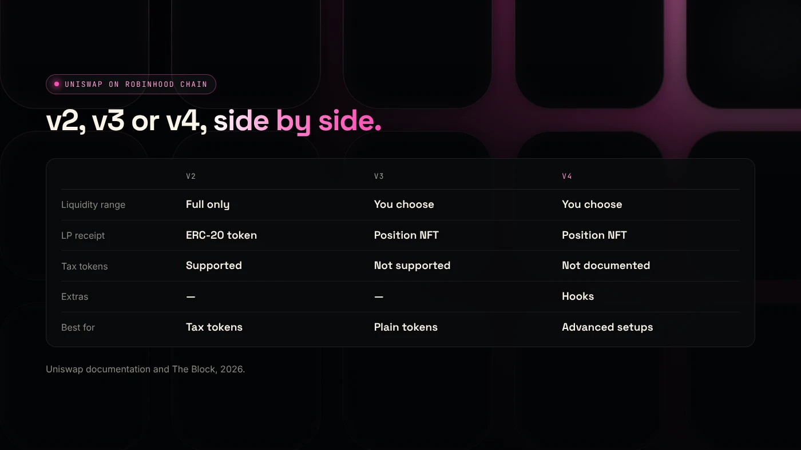
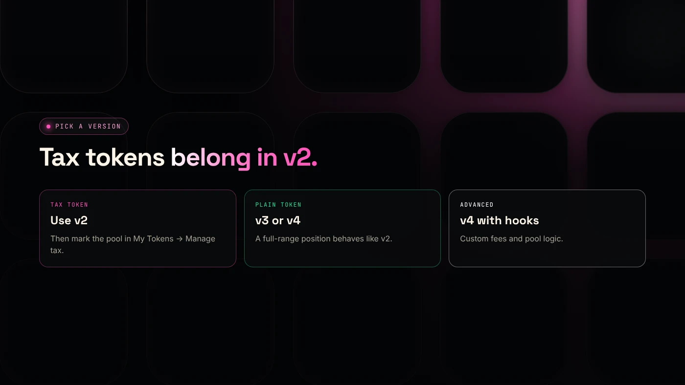

On Robinhood Chain, Uniswap runs v2, v3 and v4, and for most new tokens the choice comes down to this: v2 for tax tokens and simple full-range pools, v3 or v4 for plain tokens where you want to set a price range. Uniswap is the main public exchange on the network.

:::note Key facts
- Uniswap launched on Robinhood Chain on day one as its primary public liquidity protocol, according to The Block.
- **v2:** full-range pools, ERC-20 LP tokens, works with fee-on-transfer (tax) tokens.
- **v3:** concentrated liquidity, position NFTs. Uniswap's routers do not support fee-on-transfer tokens.
- **v4:** one contract for all pools, optional **hooks**, position NFTs. Pons coins graduate to v4 (Bitquery).
:::

:::note Not affiliated
DegenKit is not affiliated with Uniswap or Pons. DegenKit creates tokens; you add liquidity on Uniswap.
:::

## Which Uniswap versions run on Robinhood Chain?

Robinhood Chain's mainnet launched on July 1, 2026 with Uniswap as a day-one partner and its **primary public liquidity protocol** ([The Block](https://www.theblock.co/news/business/2026-07-01-robinhood-chain-goes-live-mainnet-alongside-24-7-tokenized-stocks-lighter-perps-planned-crypto-agentic-trading-406918)). Robinhood's tokenized stocks also trade on Uniswap there, alongside other venues.

Uniswap v4 is busy on the chain. Bitquery found that coins graduating from the Pons launchpad trade on v4 and made up about a quarter of all v4 trades during its study ([Bitquery](https://bitquery.io/investigations/pons-launchpad)).

All three versions use ETH on Robinhood Chain for gas. To add the network, use the [Robinhood Chain RPC tool](/tools/robinhood-chain-rpc/).

## How do v2, v3 and v4 differ?

| | Uniswap v2 | Uniswap v3 | Uniswap v4 |
|---|---|---|---|
| Liquidity range | Full range only | You choose a price range | You choose a price range |
| LP receipt | ERC-20 LP token | Position NFT | Position NFT |
| Fee tiers | Fixed | Several to choose from | Flexible, set per pool |
| Tax (fee-on-transfer) tokens | Supported | Not supported by routers | Not covered by our sources |
| Extra features | None | None | Hooks: custom pool logic |
| Best for | Tax tokens, simple launches | Plain tokens, active LPs | Plain tokens, advanced setups |

**Concentrated liquidity** in v3 and v4 means your funds only work inside the price range you choose. That earns more fees per dollar while the price stays in range, but none once it leaves.

## Why do tax tokens need v2?

A tax token, also called a fee-on-transfer token, sends a small share of each transfer to a tax wallet. That means the pool receives slightly fewer tokens than the trade expected.

Uniswap's documentation says fee-on-transfer tokens "will not function" with its v3 router contracts, and that it will not build a router that supports them ([Uniswap](https://developers.uniswap.org/docs/protocols/v3/concepts/unsupported-tokens)). Uniswap v2's router includes swap functions for these tokens, which is why DegenKit recommends a **v2** pool for any [tax token on Robinhood Chain](/blog/create-tax-token-on-robinhood-chain/).

After adding the v2 pool, mark it in **My Tokens → Manage tax** so the tax applies.

## Which version should you choose?

**Choose v2 if** your token has a buy or sell tax, you want the simplest setup, or you plan to burn or lock an ERC-20 LP token.

**Choose v3 if** your token is a plain ERC-20, you understand price ranges and will move your range as the price changes.

**Choose v4 if** your token is plain, you want flexible fees, or you are using a tool built on v4 hooks.

For a first launch of a plain token, a **full-range** position on v3 or v4 behaves much like v2 and needs no range management.

## How do you add liquidity?

1. Create your token with the [Robinhood Chain token generator](/launch/robinhood/).
2. Open Uniswap, switch the network to Robinhood Chain and start a new position with your token and ETH.
3. Pick the version, fee tier and range, approve your token and confirm.
4. Lock or burn the receipt if you plan to. See [Robinhood Chain liquidity locks](/blog/robinhood-chain-liquidity-lock/).

The full walkthrough is in [adding liquidity on Uniswap](/blog/add-liquidity-uniswap-erc20/).

## What are the risks?

- **Out-of-range positions** in v3 and v4 earn nothing and can end up all in one token.
- **Impermanent loss.** If the price moves, you end up with more of the falling asset.
- **Wrong starting price.** The first deposit ratio sets the price. Check the zeros.
- **Unsupported tokens.** A tax token in a v3 pool may fail to trade.

You can lose money in crypto. This is not financial advice.

## FAQ

### What is Uniswap v4?

The fourth version of Uniswap. All pools live in one contract, and pools can add **hooks**, small contracts that run custom logic around swaps and liquidity.

### What are hooks in Uniswap v4?

Hooks let a pool run extra code, for example dynamic fees or limit orders. A pool without hooks behaves like a normal pool.

### Can I move liquidity from v2 to v3 later?

Yes. You withdraw from v2 and add to v3 or v4. If your LP is locked or burned, you cannot.

## Sources

- [The Block: Robinhood Chain goes live on mainnet](https://www.theblock.co/news/business/2026-07-01-robinhood-chain-goes-live-mainnet-alongside-24-7-tokenized-stocks-lighter-perps-planned-crypto-agentic-trading-406918)
- [Uniswap: Token integration issues (v3)](https://developers.uniswap.org/docs/protocols/v3/concepts/unsupported-tokens)
- [Bitquery: Pons Launchpad growth on Robinhood Chain](https://bitquery.io/investigations/pons-launchpad)
- [Uniswap support: Migrating liquidity from v2 to v3](https://support.uniswap.org/hc/en-us/articles/7423351004173-How-to-migrate-liquidity-from-Uniswap-v2-to-v3)

Before you add liquidity, create your token with the [DegenKit token generator for Robinhood Chain](/launch/robinhood/).
