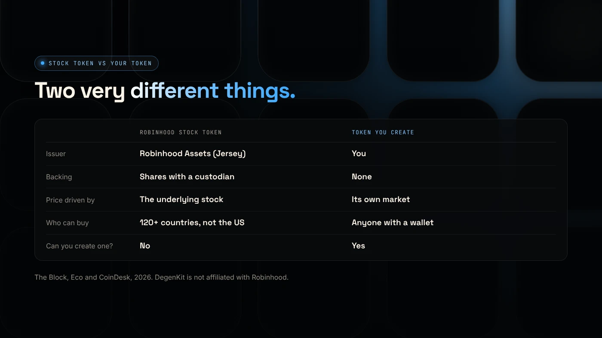
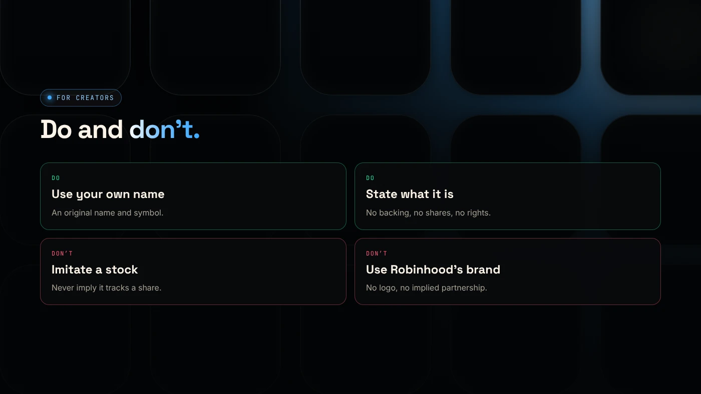

Robinhood tokenized stocks are tokens on Robinhood Chain that track US-listed shares and ETFs, issued by a Robinhood entity and backed by shares held with a custodian. They are not available to US persons. A token you create with a token generator is something else: an ERC-20 with no link to any stock, whose value depends only on its own market.

:::note Key facts
- **Stock Tokens** launched with Robinhood Chain's mainnet on **July 1, 2026**, issued by Robinhood Assets (Jersey) Limited.
- They are available to eligible users in **120+ countries**, but **not** in the US, Canada, the UK, Switzerland or the UAE.
- Holders get **no legal or beneficial rights** in the underlying shares.
- You cannot create a stock token. Anyone can create an ordinary ERC-20 on Robinhood Chain.
:::

:::note Not affiliated
DegenKit is not affiliated with Robinhood. This post describes public information as of November 2026.
:::

## What are Robinhood tokenized stocks?

Robinhood runs two products, according to an [Eco support article](https://eco.com/support/en/articles/15083160-robinhood-tokenized-stocks-what-s-live-and-how-it-works) checked on October 8, 2026:

- **Stock Tokens** on Robinhood Chain: 190+ stocks and ETFs, backed 1:1 by shares held by a US custodian, tradable 24/7, transferable to self-custody wallets and usable in DeFi.
- **Classic Stock Tokens** in the Robinhood Europe app: 2,000+ stocks and ETPs as derivative contracts. They launched in June 2025 on Arbitrum and cannot leave the app.

The Block describes the new Stock Tokens as **tokenized debt securities** that give economic exposure to the underlying stocks but no legal or beneficial rights in them ([The Block](https://www.theblock.co/news/business/2026-07-01-robinhood-chain-goes-live-mainnet-alongside-24-7-tokenized-stocks-lighter-perps-planned-crypto-agentic-trading-406918)).

## How do they trade on Robinhood Chain?

Stock Tokens trade on decentralized exchanges including Uniswap, Rialto, Lighter, 1inch and Arcus, and can be used in lending pools or as collateral. Dividends are reinvested, which raises the token's multiplier.

In July 2026, CoinDesk reported about $55 million a day in tokenized stock volume, less than a tenth of the chain's total DEX trading. GameStop, Nvidia and SpaceX tokens led. Memecoins still dominated the most-traded list ([CoinDesk](https://www.coindesk.com/business/2026/07/25/robinhood-chain-s-real-world-assets-jump-fivefold-as-tokenized-stocks-start-trading-in-bigger-size)).

## How is a token you create different?

| | Robinhood Stock Token | Token you create |
|---|---|---|
| Issuer | Robinhood Assets (Jersey) Limited | You |
| Backing | Shares held by a custodian | None |
| Price driven by | The underlying stock | Its own market only |
| Who can buy | Eligible users outside the US and other restricted places | Anyone with a wallet |
| Legal rights | None in the underlying shares | None |
| Can you create one? | No | Yes, with a token generator |

A token you create is a standard ERC-20. Its supply is whatever you set, and its price comes only from trading in the pools you create. See [the Robinhood Chain token generator guide](/blog/token-generator-robinhood-chain/).

## Can you pair your token with a stock token?

Technically, a Uniswap pool can pair any two ERC-20 tokens. Bitquery found that more than a third of coins on the Pons launchpad were backed by tokenized assets such as stocks, with Nvidia the largest at $40.5 million ([Bitquery](https://bitquery.io/investigations/pons-launchpad)).

Before you do this, consider:

- Your token's price would move with the stock as well as with demand.
- Stock tokens are restricted in some countries, so some buyers may not be able to hold them.
- Most new tokens on Robinhood Chain pair with **ETH**, which every user holds for gas. See [which Uniswap version to use on Robinhood Chain](/blog/robinhood-chain-uniswap-v2-v3-v4/).

## What must you never do with a token you create?

- **Do not name it like a stock** or imply it tracks one. That misleads buyers and may break securities and consumer rules.
- **Do not use Robinhood's name or logo** or suggest a partnership.
- **Do not promise returns.** Describe what the token is and what it is not. Our guide on [how to make a memecoin on Robinhood Chain](/blog/how-to-make-a-memecoin-robinhood-chain/) covers honest positioning.

## What are the risks?

- **Stock tokens:** no rights in the underlying shares, issuer risk and regional limits.
- **Tokens you create:** no backing, so the price can fall to zero.
- **Pairing with a stock token** adds the stock's price risk to your pool.

You can lose money in crypto. This is not financial advice.

## FAQ

### What are tokenized stocks?

Blockchain tokens that track the price of a listed share or ETF. Robinhood's Stock Tokens on Robinhood Chain are issued by a Robinhood entity and backed by shares held with a custodian.

### Do tokenized stocks pay dividends?

Robinhood's Stock Tokens reinvest dividends by raising the token's multiplier. Classic Stock Tokens in the Europe app pay dividends as cash.

### Where can I buy tokenized stocks?

Eligible users outside the US and other restricted countries can buy Stock Tokens through Robinhood Wallet and trade them on DEXs such as Uniswap on Robinhood Chain.

### Are tokenized stocks legal?

Robinhood issues them under specific regulatory frameworks and limits who can buy. Availability depends on your country.

## Sources

- [The Block: Robinhood Chain goes live on mainnet](https://www.theblock.co/news/business/2026-07-01-robinhood-chain-goes-live-mainnet-alongside-24-7-tokenized-stocks-lighter-perps-planned-crypto-agentic-trading-406918)
- [Eco: Robinhood tokenized stocks, what's live and how it works](https://eco.com/support/en/articles/15083160-robinhood-tokenized-stocks-what-s-live-and-how-it-works)
- [CoinDesk: Robinhood Chain's real-world assets jump fivefold](https://www.coindesk.com/business/2026/07/25/robinhood-chain-s-real-world-assets-jump-fivefold-as-tokenized-stocks-start-trading-in-bigger-size)
- [Bitquery: Pons Launchpad growth on Robinhood Chain](https://bitquery.io/investigations/pons-launchpad)

To create an ordinary ERC-20 on the same network, use the [Robinhood Chain token generator](/launch/robinhood/).
