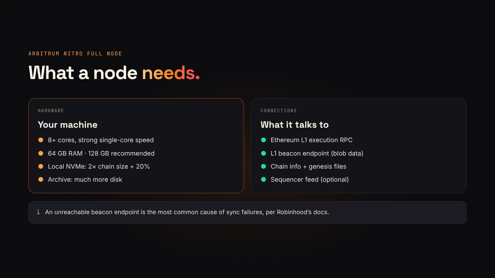
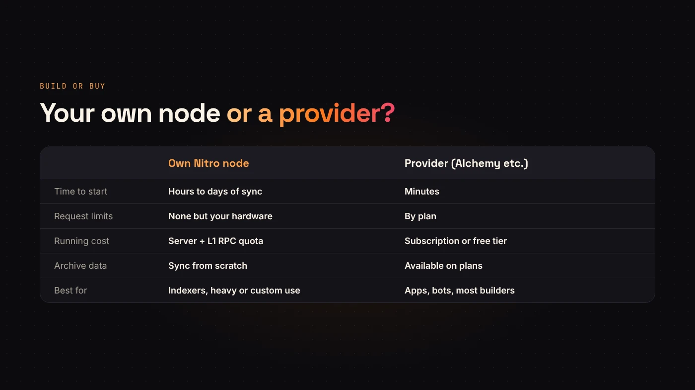

Most people never need their own node: a wallet or a token launch works fine with a [public RPC or a provider](/blog/robinhood-chain-rpc/). You run a **Robinhood Chain node** when you want your own unrestricted RPC, independent data, or an indexer that doesn't depend on someone else's limits.

This guide summarises [Robinhood's full node documentation](https://docs.robinhood.com/chain/run-a-full-node/). Check it for the current versions before you start.

## What the node is

Robinhood Chain is an **Arbitrum chain running Arbitrum Nitro**. A node runs the official `offchainlabs/nitro-node` Docker image. At the time of writing, Robinhood's docs list `v3.11.2-3599aca` and ArbOS 61, and tell you to confirm the current version first.

## Hardware

- **CPU:** 8+ modern cores with strong single-core speed.
- **RAM:** 64 GB minimum, 128 GB recommended.
- **Disk:** locally attached **NVMe SSD**, about twice the current chain size plus 20%. Networked storage slows sync a lot.
- **Archive nodes** need substantially more disk than full nodes.



## What it connects to

A Robinhood Chain node reads from Ethereum, because that's where the chain settles. You need:

1. An **Ethereum (L1) execution RPC** — your own synced node or a provider.
2. An **L1 beacon endpoint** for blob data. Robinhood's docs say an unreachable beacon endpoint is the most common cause of sync failures.
3. The **chain info file** (`robinhood-chain-info.json`) and, for mainnet, the **genesis file** (`robinhood-genesis.json`) from Robinhood's docs.
4. Optionally, the **sequencer feed** (`wss://feed.mainnet.chain.robinhood.com`) for low-latency updates, with the delayed feed as backup.

:::warning Initial sync uses a lot of L1 requests
Robinhood warns that the first sync can take a long time and consume significant L1 request quota. Check your Ethereum provider's limits before you start.
:::

## Starting the node

The shape of the command, from Robinhood's docs:

```
docker run --rm -it \
  -v "$DATA_DIR":/home/nitro/.arbitrum \
  -v "$HOME/rh/config":/home/nitro/config \
  -p 8547:8547 -p 8548:8548 \
  offchainlabs/nitro-node:v3.11.2-3599aca \
  --chain.info-files=/home/nitro/config/robinhood-chain-info.json \
  --parent-chain.connection.url=<L1_RPC> \
  --parent-chain.blob-client.beacon-url=<L1_BEACON> \
  --init.genesis-json-file=/home/nitro/config/robinhood-genesis.json \
  --http.addr=0.0.0.0 --http.port=8547 \
  --http.api=net,web3,eth
```

- Data must be mounted at `/home/nitro/.arbitrum`.
- Port **8547** is HTTP RPC, **8548** is WebSocket.
- Add `--init.url=<snapshot-url>` on first start to begin from a recent pruned snapshot instead of genesis. Archive nodes have to sync from scratch.


## Checking it's synced

Call `eth_syncing` on your node. A fully synced node returns `false`. Then `eth_chainId` should return `0x1237`.

```
curl -s http://localhost:8547 -H 'content-type: application/json' \
  -d '{"jsonrpc":"2.0","id":1,"method":"eth_syncing","params":[]}'
```



## Node or provider?

- **Use a provider** if you need an endpoint today, don't want to manage hardware, or only need recent data.
- **Run a node** if you make heavy or unusual requests, need full independence, or are building an indexer.

## Questions people ask

### Can I run a testnet node?

Yes. Use the testnet chain info file and leave out the genesis flag, as Robinhood's docs describe.

### Do I need a node to launch a token?

No. DegenKit's [Robinhood Chain launcher](/launch/robinhood/) works through your wallet and the public network. A node is for builders who need their own RPC.

## Wrap up

A Robinhood Chain node is a Nitro container with fast NVMe storage, an Ethereum RPC and a beacon endpoint. Start from a snapshot, wait for `eth_syncing` to return false, and you have your own RPC on port 8547. For quick access instead, see our [Robinhood Chain RPC tool](/tools/robinhood-chain-rpc/).
