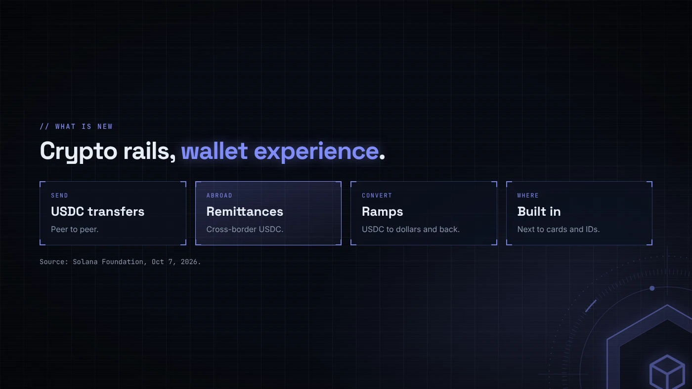
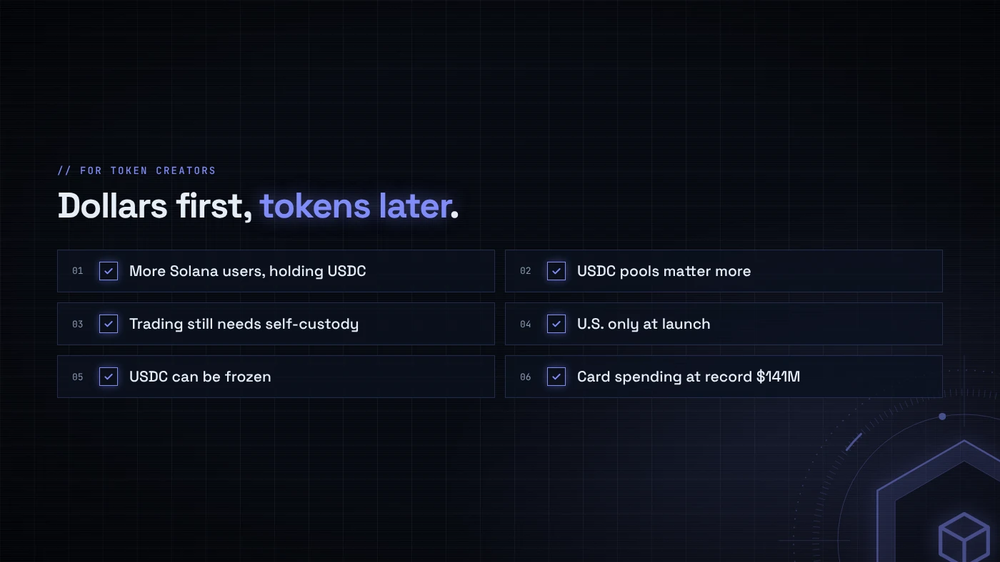

Samsung Wallet and Samsung Pay added stablecoin support on Solana in the last week of October 2026, starting with USDC transfers and cross-border remittances for U.S. users. It reaches about 82 million Galaxy devices in the U.S., with built-in on- and off-ramps to dollars. Solana runs in the background, so users do not need a separate crypto wallet. Other countries will follow, subject to local rules.

:::note Key facts
- **Announced:** **October 7, 2026**. Launch in the **last week of October** (Solana Foundation).
- **Reach:** about **82 million** U.S. Galaxy devices.
- **Features:** USDC transfers and remittances, fiat on- and off-ramps, inside Samsung Wallet.
- **Context:** Solana card spending hit a record **$141M** in October (AMBCrypto).
:::

:::note Not affiliated
DegenKit is not affiliated with Samsung, Circle or the Solana Foundation. Details are from the sources listed.
:::

## What did Samsung add?

Per the Solana Foundation's announcement:

- **Stablecoin support on Solana** in Samsung Wallet and Samsung Pay.
- **Cross-border remittances in USDC** for U.S. users.
- **On- and off-ramps** that convert between stablecoins and local currency.
- **No separate app.** Stablecoins sit next to cards, boarding passes and IDs in the existing wallet.

Woncheol Chai, who leads Samsung's Digital Wallet team, said stablecoins could make moving money worldwide "faster and easier".

## Who can use it?

U.S. users only at launch. The Foundation says more markets will follow, subject to local regulation, but names none. Samsung has separately discussed wider stablecoin support for its wallet. Check availability in your country before relying on it.

## Why does this matter for Solana?

- **Distribution:** tens of millions of phones get Solana-based dollars without a crypto wallet.
- **Payments use:** Solana stablecoin supply rose nearly 20% year on year, and the network processed over $5.25 trillion of stablecoin volume in 2026 through early October, per the Foundation.
- **Card spending:** a record $141 million in October 2026, about seven times October 2025.

Lily Liu, president of the Solana Foundation, said stablecoins "lacked a way to reach the mainstream".

## Is this a crypto wallet?

Not in the usual sense. Samsung handles the experience, and Solana settles in the background. Users send USDC, not SOL, and may never see a Solana address. That is different from self-custody wallets like Phantom or Solflare, where you hold your own keys. See [DegenKit supported wallets](/blog/degenkit-supported-wallets/).

## What does it mean for token creators?

- **More Solana users,** but most will hold USDC, not new tokens.
- **USDC pools** may matter more as more people hold dollars on Solana. See [SOL or USDC liquidity pair](/blog/sol-or-usdc-liquidity-pair/).
- **Samsung Wallet is not a trading wallet.** Buyers of new tokens still need a self-custody wallet and a DEX.

## How does it fit the stablecoin market?

Total stablecoin supply fell to $284.44 billion by November 23, with Solana holding about $13.14 billion. See [stablecoin supply in November 2026](/blog/stablecoin-supply-november-2026/).

## How is this different from a crypto card?

Crypto cards let you spend stablecoins or tokens at shops through a card network. Samsung Wallet's launch focuses on holding and sending USDC, including across borders, with on- and off-ramps to dollars. Both use Solana in the background, and both count toward the payments activity that pushed Solana card spending to a record in October. The difference is the entry point: a card is a payment method, Samsung Wallet is the phone's built-in wallet.

## What are the risks?

- **Regional limits:** U.S. only at launch.
- **Issuer controls:** USDC can be frozen by its issuer.
- **Fees and limits** on ramps depend on the provider.

You can lose money in crypto. This is not financial advice.

## FAQ

### Does Samsung Wallet support Solana?

Yes, for USDC stablecoin transfers and remittances for U.S. users since late October 2026.

### How many devices can use it?

About 82 million Galaxy devices in the U.S. at launch.

### Can I buy meme coins in Samsung Wallet?

The feature covers stablecoins. Trading other tokens still needs a self-custody wallet and a DEX.

## Sources

- [Solana: Samsung Wallet](https://solana.com/news/samsung-wallet)
- [CryptoBriefing: Samsung Wallet adds USDC transfers on Solana](https://cryptobriefing.com/samsung-wallet-usdc-solana-transfers/)
- [AMBCrypto: Solana card spending hits $141M](https://ambcrypto.com/stablecoin-supply-falls-17b-as-solana-card-spending-hits-141m/)

Create a Solana token with a USDC pool on the [DegenKit token generator](/launch/).
