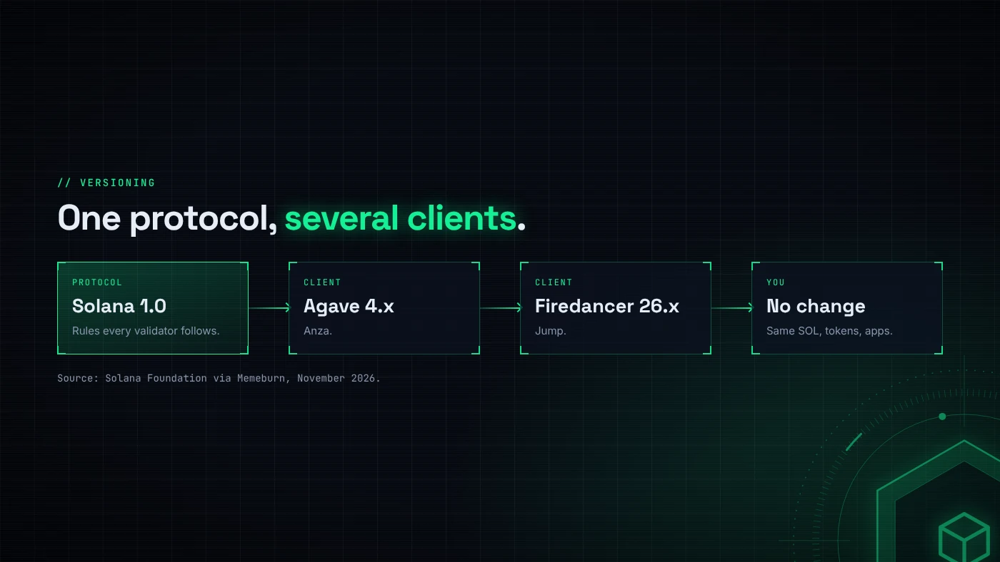
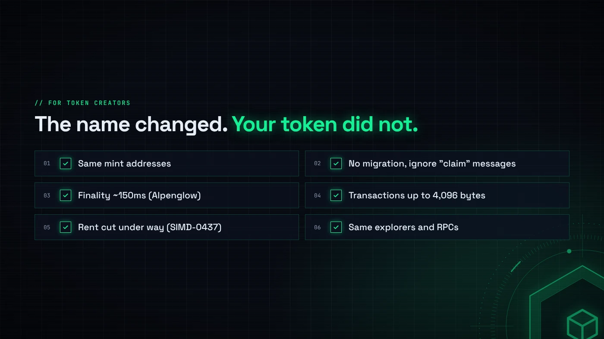

Solana 1.0 is the new name for Solana's shared protocol version. On November 16, 2026, the Solana Foundation retired the "Mainnet Beta" label the network had used since March 2020. Nothing moves for users: SOL, accounts, tokens, history and apps stay the same. The change separates the protocol version from client software versions such as Agave and Firedancer.

:::note Key facts
- **Announced:** November 16, 2026, by the Solana Foundation, during Breakpoint in London.
- **Retired:** the "Mainnet Beta" label, in use since **March 2020**.
- **New:** Solana 1.0 as a **protocol version**, separate from client versions.
- **User action needed:** **none**. Wallets, balances and tokens are unchanged (Memeburn, citing the Foundation).
:::

## What exactly changed?

Two things changed, and both are about naming and versioning:

1. **The label.** The main network is no longer called "Mainnet Beta". The "beta" tag dated from the 2020 launch.
2. **The version number.** Solana now has a protocol version, Solana 1.0, that describes the rules every validator follows. Client software keeps its own numbers. Anza's Agave is on the 4.x line, and Jump's Firedancer uses release numbers such as 26.10.

Before, people often treated the Agave version as "the Solana version". With more than one client on mainnet, that no longer worked.

## Why did Solana drop the beta label now?

The announcement came weeks after Solana's largest consensus change. **Alpenglow** went live on mainnet on October 21, 2026, replacing TowerBFT and targeting about 150ms finality. See [Solana Alpenglow explained](/blog/solana-alpenglow-explained/). Slot times were cut from 400ms to 200ms in August.

With a new consensus, faster slots and an independent second client, the Foundation chose this point to call the network 1.0. The timing also lined up with Breakpoint 2026 in London (November 15 to 17). See the [Breakpoint 2026 recap](/blog/solana-breakpoint-2026-recap/).

## Does anything change for wallets and tokens?

No. The Foundation's announcement, as reported by Memeburn, says users "keep the same SOL, accounts, assets, transaction history and apps". In practice:

- **No migration.** Ignore any message asking you to "move funds to Solana 1.0". That is a scam pattern.
- **Same token addresses.** SPL tokens and their mint addresses do not change.
- **Same explorers and RPCs.** Solscan, Solana Explorer and RPC providers keep working.
- **Same tools.** Tokens created on DegenKit, and the [launcher](/launch/) itself, work exactly as before.

## What changes for developers and validators?

Developers and validators still need to follow **client** releases and **feature activations**. Under Solana 1.0, a feature gate is part of the protocol, while the code that turns it on ships in client releases. For example, Anza asked validators to run Agave 4.4.1 or Firedancer 26.10.6 before epoch 1079 on November 6, when a loaded-data rule switched on.

Useful habits:

- Track the [Solana upgrades page](https://solana.com/upgrades) for what is live and what is planned.
- Test on devnet first. See [how to rehearse a launch on devnet](/blog/rehearse-solana-launch-on-devnet/).
- Read the weekly Solana changelog for new SIMDs and client releases.

## What does Solana 1.0 mean for token creators?

Mostly reassurance. The chain your token lives on did not fork or move. What does matter for creators is the set of protocol changes around it:

- **Cheaper accounts over time.** A five-step rent cut (SIMD-0437) is under way. See [the Solana rent cut](/blog/solana-rent-cut-simd-0437/).
- **Faster finality** under Alpenglow, so trades and transfers settle sooner.
- **Bigger transactions.** The size limit went from 1,232 to 4,096 bytes in August.

## What are the risks?

- **Scams** using "Solana 1.0 migration" or "claim" messages. There is no migration.
- **Client upgrade gaps.** Validators and RPC providers that miss a release can serve stale data for a while.
- **Stake concentration.** Memeburn cites Fidelity data showing stake is still concentrated among a handful of operators and regions.

You can lose money in crypto. This is not financial advice.

## FAQ

### What is Solana 1.0?

The name for Solana's shared protocol version, introduced on November 16, 2026 when the "Mainnet Beta" label was retired.

### Do I need to do anything with my SOL or tokens?

No. Balances, tokens and history are unchanged. No migration is needed.

### Is Solana 1.0 a new blockchain?

No. It is the same network, ledger and accounts with a new version label.

## Sources

- [Memeburn: Solana 1.0 explained](https://memeburn.com/solana-1-0-mainnet-beta-explained/)
- [Solana: Network upgrades](https://solana.com/upgrades)
- [Solana: Alpenglow](https://solana.com/upgrades/alpenglow)
- [crypto.news: Validators and the Agave 4.4.1 upgrade](https://crypto.news/what-happens-to-solana-validators-that-miss-the-agave-4-4-1-upgrade/)

Create an SPL token on Solana 1.0 with the [DegenKit token generator](/launch/).
