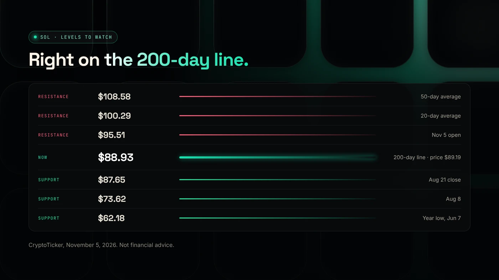
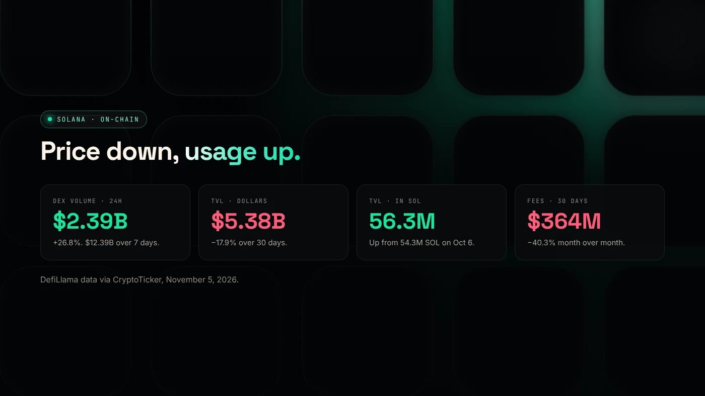

Solana is down because the whole crypto market sold off after the Binance hack, a hawkish Fed and a tech-stock rout, and SOL usually falls further than Bitcoin. SOL dropped 6.5% on November 5, 2026 to about $89.19, and now sits almost exactly on its 200-day moving average of $88.93.

:::note Key facts
- SOL was about **$89.19** on November 5, 2026: down 12.5% on the week and 26% on the month.
- That is about **70% below** its all-time high of $293.31.
- The **200-day moving average** was **$88.93**, and the August 21 close of **$87.65** is the next support.
- DEX trading volume on Solana **rose 26.8%** in 24 hours to $2.39 billion.
- This is news, not financial advice.
:::

## Why did SOL fall more than Bitcoin?

Solana fell 6.5% on November 5 while Bitcoin fell 5.3%. Smaller, more volatile coins usually move further than Bitcoin in both directions, because more of their trading is speculative and leveraged.

The causes were market-wide: the record Binance hack on October 29, two Fed officials voting for a rate hike on October 28, and a 5.5% drop in the Nasdaq on November 5 on doubts about AI spending. About $1.26 billion of crypto positions were liquidated in 24 hours. For the full timeline, see [why crypto is crashing](/blog/crypto-crash-november-2026/).

Fees on the network also fell. Solana generated $364.2 million in fees over 30 days, down 40.3% month over month, according to DefiLlama data cited by [CryptoTicker](https://cryptoticker.io/en/solana-price-prediction-200-day-line-dex-volume-november-2026/). Fewer fees usually means less speculative activity.

## What is the 200-day moving average?

The 200-day moving average is the average closing price over the last 200 days. It changes slowly, so traders use it to separate long-term uptrends from downtrends.

On November 5, SOL closed at $89.19 against a 200-day average of $88.93, a gap of less than 0.3%. When price sits this close to the line, buyers and sellers are evenly matched. A clear daily close below it often brings more selling. A bounce from it is often read as a sign that long-term buyers are stepping in.

Neither outcome is certain. The line is a reference point that many traders watch, which is why it can matter.

## Which SOL price levels are analysts watching?

These levels come from CryptoTicker's analysis on November 5, 2026. They are past turning points, not targets.

- **Support:** **$87.65** (the August 21 close), then **$73.62**, then **$62.18**, the year's low on June 7.
- **Resistance:** **$95.51** (the November 5 open), **$98.74** (the 100-day average), **$100.29** (the 20-day average), **$108.58** (the 50-day average) and **$120.76**, the October 6 high.

The $87.65–$88.93 zone is the area to watch. Holding it would keep the long-term trend intact. A break would put $73.62 in view.

## What does on-chain data show?

The price fell, but activity on the network did not fall the same way. DefiLlama data via CryptoTicker, November 5, 2026:

- **DEX volume** was $2.39 billion in 24 hours, up 26.8%, and $12.39 billion over seven days, up 37.6%. Sell-offs bring heavy trading.
- **TVL in dollars**, the value deposited in Solana apps, fell 17.9% over 30 days to $5.38 billion. Most of that is because SOL itself got cheaper.
- **TVL counted in SOL** rose from 54.29 million SOL on October 6 to 56.32 million on November 5. Deposits grew while prices fell.

## What does it mean for Solana token launches?

- **Costs in dollars are lower.** DegenKit's token creation fee is 0.28 SOL, so it costs fewer dollars when SOL is cheaper. Network fees stay small either way. See [Solana fees and rent explained](/blog/solana-fees-and-rent-explained/).
- **Your pair matters more.** In a SOL/token pool, a falling SOL drags your token's dollar price down too. Some creators use USDC in volatile weeks. Read [SOL or USDC for your liquidity pair](/blog/sol-or-usdc-liquidity-pair/).
- **Traders are still active,** but more careful. Revoked authorities and locked liquidity matter more. The [DegenKit scanner docs](/docs/scanner/) show what buyers check.

## What are the risks?

- **A break below the 200-day line** could bring more selling toward $73.62.
- **Pair exposure.** Pools paired with SOL lose dollar value when SOL falls.
- **Thin liquidity.** New tokens can swing sharply when fewer buyers are active.

You can lose money in crypto. This is not financial advice.

## FAQ

### Why is Solana going down?

SOL is falling with the whole crypto market after the Binance hack, a hawkish Fed and a tech-stock sell-off in early November 2026. It fell 26% in a month to about $89.

### How much is 1 Solana right now?

SOL closed November 5, 2026 at about $89.19. Prices change every minute, so check a live source before you act.

### Is Solana a good investment?

We don't give investment advice. The facts here are that SOL is about 70% below its all-time high, sits on its 200-day average, and on-chain activity has held up better than the price.

### Will Solana go up?

No one knows. Analysts in our source watch the $87.65–$88.93 zone. A hold there is read as strength, and a break as weakness.

## Sources

- [CryptoTicker: Solana price at the 200-day line, DEX volume, November 2026](https://cryptoticker.io/en/solana-price-prediction-200-day-line-dex-volume-november-2026/)
- [crypto.news: Bitcoin price today and liquidations](https://crypto.news/bitcoin-price-today-rebounds-76000-etf-outflows/)
- [DefiLlama: Solana chain data](https://defillama.com/chain/Solana)

If you are building on Solana, the [DegenKit Solana launcher](/launch/solana/) creates SPL tokens from your own wallet, with no code.
