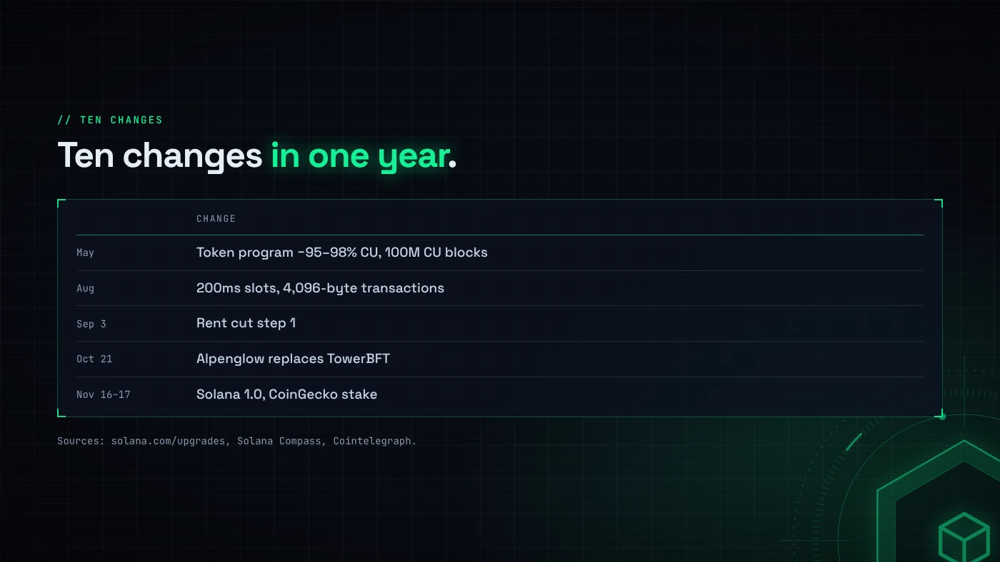
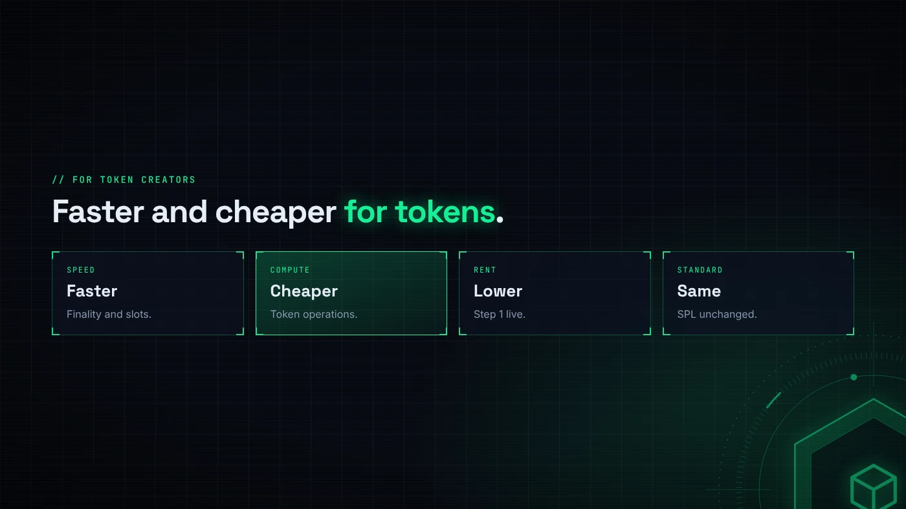

2026 was Solana's biggest protocol year. Blocks grew to 100 million compute units, slots fell to 200 milliseconds, transactions grew to 4,096 bytes, Alpenglow replaced TowerBFT with about 150ms target finality, and the network dropped "Mainnet Beta" for Solana 1.0. A five-step rent cut began. At the same time, SOL fell about 75% from its January 2025 high as the market sold off.

:::note Key facts
- **Protocol:** 100M CU blocks (May), 200ms slots and 4,096-byte transactions (August), Alpenglow (Oct 21), Solana 1.0 (Nov 16).
- **Costs:** rent cut step 1 live Sept 3, toward **90%** lower rent.
- **Clients:** Firedancer back in consensus after the Alpenglow switch.
- **Market:** SOL about **75%** below its **$293.31** January 2025 high on Nov 21 (CryptoTicker).
:::

## What were the 10 biggest changes?

| # | Change | When |
|---|---|---|
| 1 | Optimized Token Program cuts token compute 95–98% | May |
| 2 | Blocks raised to 100M compute units (Agave 4.1) | May |
| 3 | Slot time 400 → 200ms | August |
| 4 | Transaction size 1,232 → 4,096 bytes | August |
| 5 | Rent cut step 1 (SIMD-0437) | Sept 3 |
| 6 | Alpenglow replaces TowerBFT | Oct 21 |
| 7 | Firedancer rejoins consensus on Alpenglow | October |
| 8 | Solana 1.0 replaces "Mainnet Beta" | Nov 16 |
| 9 | Solana Foundation takes majority of CoinGecko | Nov 17 |
| 10 | Anza publishes 2027 roadmap | November |

Sources: Solana's upgrades page, Solana Compass, Cointelegraph, The Coin Republic.

## What changed for speed?

Three upgrades stacked: 200ms slots, bigger blocks and Alpenglow's faster finality. Solana's target is about 150ms finality. A TokenPost sample of 357,000 slots right after the switch measured a 404ms median from a public RPC node, per Coincub. See [Solana Alpenglow explained](/blog/solana-alpenglow-explained/).

## What changed for costs?

- **Token operations** got far cheaper in compute after the Optimized Token Program.
- **Rent** began a five-step, 90% cut. See [the Solana rent cut](/blog/solana-rent-cut-simd-0437/).
- **DegenKit's Solana Token Creator** stayed at 0.28 SOL, with authorities revoked and metadata locked in one transaction.

## What happened in the market?

- **SOL price:** from a high of $293.31 (January 19, 2025) to about $72.55 on November 21, 2026, per CryptoTicker. It rose from about $62 in June to about $122 in late September, then fell again.
- **ETFs:** six U.S. spot funds hold about 13.4 million SOL. See [Solana ETFs explained](/blog/solana-etf-flows-explained/).
- **Memecoins:** the category ended the year far below its 2024 peak. See [the memecoin market in late 2026](/blog/memecoin-market-late-2026/).
- **Tokenized stocks:** tokenized equities on Solana reached $1.22 billion in circulating value during Breakpoint week.

## What happened in the ecosystem?

- **Breakpoint 2026** in London drew 7,000+ people. See the [Breakpoint 2026 recap](/blog/solana-breakpoint-2026-recap/).
- **Pump.fun** kept about 92% of launchpad launches and added perps and prediction markets.
- **Real-world assets:** Mitsui chose Solana for commodity tokenization, and Ondo added products.

## What carries into 2027?

Agave 4.5 with 96 accounts per transaction, rent cut steps 2–5, durable nonce deprecation, Rotor and Anza's 2027 roadmap. See [Solana's 2027 roadmap](/blog/solana-2027-roadmap/) and [what to watch in crypto in 2027](/blog/crypto-to-watch-2027/).

## What are the risks?

- **Technical progress did not lift the price** in late 2026.
- **Client concentration** remains high despite Firedancer.
- **Memecoin activity** depends on new buyers that have thinned out.

You can lose money in crypto. This is not financial advice.

## FAQ

### What was Solana's biggest upgrade in 2026?

Alpenglow, which replaced TowerBFT on October 21 and targets about 150ms finality.

### Is Solana still in beta?

No. It dropped the "Mainnet Beta" label for Solana 1.0 on November 16, 2026.

### Did Solana get cheaper to use in 2026?

Token operations and rent got cheaper. Fees still depend on demand and priority fees.

## Sources

- [Solana: Network upgrades](https://solana.com/upgrades)
- [CryptoTicker: Solana ETFs shed $122.7M](https://cryptoticker.io/en/solana-price-etf-monthly-outflow/)
- [Coincub: Alpenglow is live](https://coincub.com/price-prediction/solanas-alpenglow-upgrade-is-live/)
- [Memeburn: Solana 1.0 explained](https://memeburn.com/solana-1-0-mainnet-beta-explained/)

Create a Solana token for 0.28 SOL with the [DegenKit token generator](/launch/).
