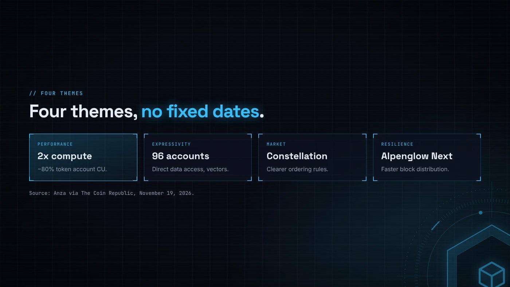
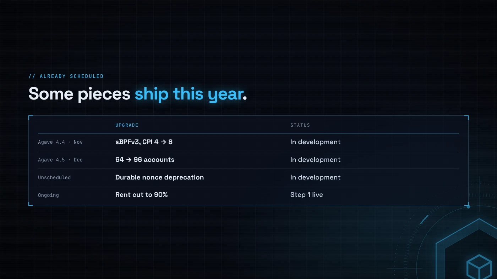

Solana's 2027 roadmap, shared by Anza in November 2026, has four themes: performance, expressivity, market structure and resilience. Headline goals are doubling compute capacity, cutting the compute used by token account transactions by 80%, raising accounts per transaction from 64 to 96, Alpenglow Next and Constellation. None of the items has a confirmed date yet.

:::note Key facts
- **Shared by:** Anza (bw_solana), on X, reported November 19, 2026 (The Coin Republic).
- **Compute:** **2x** network compute capacity.
- **Token accounts:** **80% fewer compute units** for token account transactions. This is not a promise of lower user fees.
- **Accounts per transaction:** **64 → 96**. Solana lists this for Agave 4.5 in December 2026.
:::

## What are the four themes?

1. **Performance:** more compute per block, cheaper token account work.
2. **Expressivity:** more accounts per transaction, direct account data access, vector processing.
3. **Market structure:** Constellation, clearer ordering rules and more validator competition.
4. **Resilience:** Alpenglow Next and a simpler protocol.

## What is planned for performance?

- **Double compute capacity.** Solana raised blocks to 100M compute units in May 2026 (Agave 4.1). The 2027 goal is to double capacity again.
- **80% cheaper token account work.** Transactions that touch token accounts should use 80% fewer compute units. The Optimized Token Program, live since May, already cut token program compute by 95–98% per Solana's upgrades page.

The Coin Republic notes the 80% figure is about compute units, not a promised cut in user fees.

## What is planned for developers?

- **96 accounts per transaction,** up from 64. Solana's upgrades page lists this for Agave 4.5, expected December 2026.
- **Direct account data access.** Programs read account data directly instead of copying it, reducing data moved per transaction. Solana lists "Account Data Direct Mapping" as pending feature activation.
- **Vector processing** to support AI models that run fully on-chain.

## What are Alpenglow Next and Constellation?

- **Alpenglow Next** focuses on faster block distribution, building on Alpenglow, which went live in October 2026. See [Solana Alpenglow explained](/blog/solana-alpenglow-explained/).
- **Constellation** is about market structure: clearer transaction-ordering rules and more competition among validators. That matters for traders worried about sandwich attacks and bundles. See [Solana bundlers explained](/blog/solana-bundler-explained/).
- **Protocol simplification** removes special cases, which developers say makes future changes safer.

## What is already scheduled before 2027?

| Release | Upgrade | Status |
|---|---|---|
| Agave 4.4 (Nov 2026) | sBPFv3 programs, deeper CPI nesting (4 → 8) | In development |
| Agave 4.5 (Dec 2026) | 96 accounts per v1 transaction | In development |
| Unscheduled | Durable nonce deprecation, about 6-month migration | In development |
| Ongoing | Rent cut to 90% in five steps | Step 1 live |

See [upcoming Solana upgrades](/blog/upcoming-solana-upgrades/) and [the Solana rent cut](/blog/solana-rent-cut-simd-0437/).

## What does the roadmap mean for token creators?

- **SPL tokens keep working.** None of the items changes the token standard.
- **Cheaper token operations** help airdrops, multisends and holder growth.
- **Bigger transactions** help complex swaps and launch flows fit in one transaction.

## How should builders prepare?

Follow the [Solana upgrades page](https://solana.com/upgrades) and the weekly changelog, test each Agave release on devnet, and avoid hard-coding limits such as 64 accounts or four CPI levels in your code.

## What are the risks?

- **Roadmaps slip.** None of the 2027 items has a confirmed date.
- **New features bring new bugs,** which is why they go through testnet and devnet first.
- **Compute is not fees.** Cheaper compute does not automatically mean lower priority fees in busy periods.

You can lose money in crypto. This is not financial advice.

## FAQ

### What is on Solana's 2027 roadmap?

Double compute, 80% fewer compute units for token account transactions, 96 accounts per transaction, direct account data access, on-chain AI support, Alpenglow Next and Constellation.

### When will the 2027 upgrades go live?

No dates are confirmed. Some pieces, like 96 accounts per transaction, are listed for Agave 4.5 in December 2026.

### Will Solana fees go down in 2027?

The roadmap targets compute units, not user fees. Fees also depend on demand.

## Sources

- [The Coin Republic: Solana 2027 development plans](https://www.thecoinrepublic.com/2026/11/19/solana-developer-lays-out-key-developmental-plans-for-2027-heres-what-to-expect/)
- [Solana: Network upgrades](https://solana.com/upgrades)
- [Solana Changelog: November 12, 2026](https://solana.com/news/solana-changelog-november-12-2026)

Build on today's Solana with the [DegenKit token generator](/launch/).
