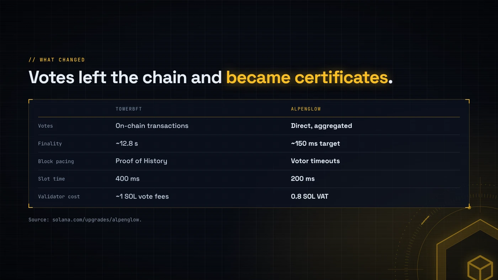
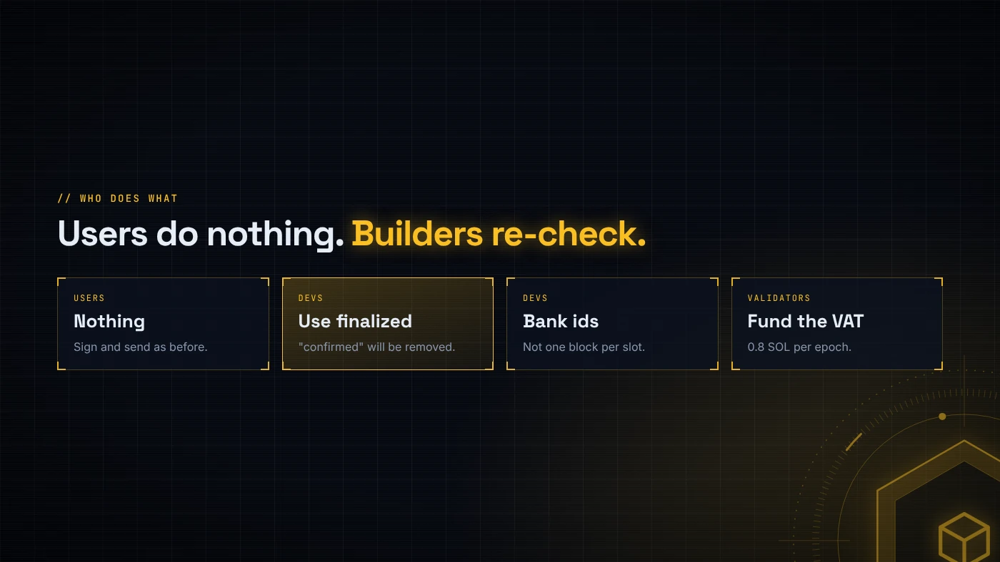

Alpenglow is Solana's new consensus protocol. It went live on mainnet on October 21, 2026, replacing TowerBFT, and targets transaction finality of about 150 milliseconds, down from roughly 12.8 seconds. Users do not need to change anything. Developers who read raw block data, and validators, do. The second phase, Rotor, is not yet scheduled.

:::note Key facts
- **Live:** epoch **1064**, October 21, 2026, about 13:36 UTC. Alpenglow began at slot **459,653,000** (Solana).
- **Finality:** about **12.8 s** under TowerBFT → target **~150 ms**.
- **Phase 1, Votor:** live. **Phase 2, Rotor:** replaces Turbine, not yet scheduled.
- **Validators:** pay a flat **0.8 SOL per epoch** Validator Admission Ticket instead of about 1 SOL in vote fees.
:::

## What does Alpenglow replace?

Under **TowerBFT**, validators voted by sending vote transactions, and Proof of History paced block production. Alpenglow changes both:

- **Votes leave the chain.** Validators send votes directly to each other and aggregate them into certificates.
- **Votor** finalizes a block in one or two voting rounds. Solana says it tolerates 20% malicious plus 20% offline stake.
- **Proof of History no longer paces blocks.** Votor's timeouts and certificates do that job.

Transaction execution is unchanged. The SVM, transaction formats, programs and fees work as before.

## How fast is finality now?

Solana's target is about 150ms finality, compared with about 12.8 seconds before. Two separate numbers are often mixed up:

| Metric | Before | After |
|---|---|---|
| Finality (target) | ~12.8 s | ~150 ms |
| Slot time | 400 ms | 200 ms (cut in August) |
| Vote transactions in blocks | Yes | No |

Finality is when a transaction cannot be reversed. Slot time is how often a leader produces a block. Both got faster, through different upgrades.

## What do users need to do?

Nothing. Signing, sending and approving transactions work as before. Wallets such as Phantom and Solflare did not need new accounts. The visible effect is that "finalized" now arrives much sooner.

## What changes for developers?

Solana's Alpenglow page lists the changes for apps that stream or read block data:

- **Commitment levels:** `processed`, `confirmed` and `finalized` still work. `confirmed` and `finalized` now describe the same state, and `confirmed` will be removed later, so new code should use `finalized`.
- **One block per slot is no longer safe to assume.** Key buffers on slot and bank id.
- **TPS numbers need re-baselining,** because vote transactions are no longer in blocks.
- **Time inside a slot:** stop counting ticks. `Clock.unix_timestamp` now comes from the leader, within bounds.
- **Check migration** with the `getAgGenesisCert` RPC method.

If you only create tokens and add liquidity through a front end, none of this applies to you. See [why Solana transactions fail](/blog/solana-transaction-failed/) for the issues that still do.

## What changes for validators?

- **Run a supported client.** The migration required Agave, Jito-Solana or Harmonic Salsa v4.3.2.
- **Fund the vote account.** Keep at least 0.8 SOL above the rent-exempt minimum every epoch for the Validator Admission Ticket, which is burned. Miss it and the validator sits out the next epoch.
- **Vote fees are gone.** TowerBFT voting cost about 1 SOL per epoch from the identity account.

A SIMD discussed in November proposes halving vote costs again to help new validators.

## What comes after Alpenglow?

- **Rotor:** phase two, replacing Turbine block propagation with a single relay layer. Not yet scheduled.
- **Alpenglow Next:** listed on Anza's 2027 roadmap, focused on faster block distribution. See [Solana's 2027 roadmap](/blog/solana-2027-roadmap/).

## What are the risks?

- **New code paths.** A large consensus change can surface bugs that testnets missed.
- **Indexers and bots** that assumed one block per slot can report wrong data.
- **Faster finality is not lower risk.** A bad trade settles faster too.

You can lose money in crypto. This is not financial advice.

## FAQ

### When did Alpenglow go live?

On October 21, 2026, at epoch 1064. Alpenglow consensus began at slot 459,653,000.

### Is Solana finality really 150ms?

That is Solana's target for transaction finality under Alpenglow. Real results vary with network conditions.

### Do I need to update my wallet?

No. Users do not need to do anything.

## Sources

- [Solana: Alpenglow upgrade](https://solana.com/upgrades/alpenglow)
- [Solana: Network upgrades](https://solana.com/upgrades)
- [Crowdfund Insider: Anza activates Alpenglow](https://www.crowdfundinsider.com/2026/10/319911-anza-activates-alpenglow-on-solana-sol-mainnet-slashing-finality-to-150-milliseconds)
- [Solana Changelog: November 12, 2026](https://solana.com/news/solana-changelog-november-12-2026)

Launch a token on post-Alpenglow Solana with the [DegenKit token generator](/launch/).
