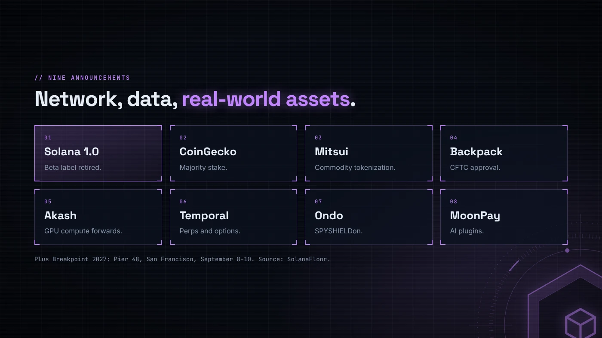
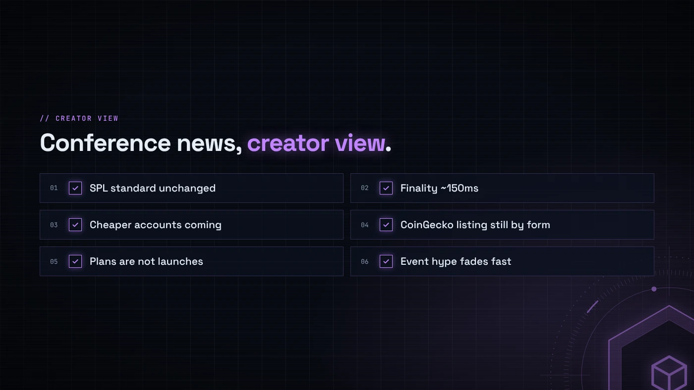

Solana Breakpoint 2026 ran November 15 to 17 in London with more than 7,000 attendees. The biggest news: Solana dropped its "Mainnet Beta" label for Solana 1.0, the Solana Foundation took a majority stake in CoinGecko, Mitsui chose Solana for commodity tokenization, and Backpack got CFTC approval for a U.S. derivatives exchange. Breakpoint 2027 moves to San Francisco.

:::note Key facts
- **Where and when:** Olympia, London, **November 15–17, 2026**, 7,000+ attendees from 100+ countries (SolanaFloor).
- **Network:** Solana 1.0 replaced the "Mainnet Beta" label on **November 16**.
- **Data:** the Solana Foundation now holds a **majority interest in CoinGecko**.
- **Next:** Breakpoint 2027, **September 8–10**, Pier 48, San Francisco.
:::

:::note Not affiliated
DegenKit is not affiliated with the Solana Foundation, CoinGecko or any company named below. Details are as reported by the sources listed.
:::

## What happened to the network itself?

**Solana 1.0.** The Foundation retired the "Mainnet Beta" label used since March 2020 and introduced a shared protocol version, separate from client versions. Nothing changes for users. See [Solana 1.0 explained](/blog/solana-1-0-explained/).

This came a month after **Alpenglow** cut target finality to about 150ms. See [Solana Alpenglow explained](/blog/solana-alpenglow-explained/).

## What were the nine announcements?

| # | Announcement | Why it matters |
|---|---|---|
| 1 | Solana 1.0 | Protocol version separate from clients |
| 2 | Foundation majority stake in CoinGecko | Data, RWA coverage, trading tools |
| 3 | Mitsui commodity tokenization | Japanese trading giant (about $130B assets) |
| 4 | Backpack CFTC approval | U.S. derivatives exchange plan |
| 5 | Akash Compute Forwards | GPU hours on an on-chain order book, pilot Q1 2027 |
| 6 | Temporal Supermassive | New perps and options protocol |
| 7 | Ondo SPYSHIELDon | Defined-outcome S&P 500 product |
| 8 | MoonPay AI plugins | Integrations incl. Meteora and Fomo |
| 9 | Breakpoint 2027 | San Francisco, September 8–10 |

## Why does the CoinGecko deal matter?

CoinGecko is one of the two big token data sites, alongside CoinMarketCap. Vibhu Norby, the Foundation's chief product officer, confirmed on November 17 that it "now has a majority interest in CoinGecko". CoinGecko says its methodologies stay public and its site, app and API keep running as usual. Deal terms were not disclosed. See [what the CoinGecko deal means for token listings](/blog/solana-foundation-coingecko-stake/).

## What was the real-world asset news?

- **Mitsui** will use Solana for commodity tokenization, citing global distribution, fast finality, low costs and high throughput.
- **Ondo** launched SPYSHIELDon, its first defined-outcome strategy, bringing its Intelligent Portfolios to eight products.
- **Tokenized equities** on Solana reached $1.22 billion in circulating value, nearly double the end-of-October figure, per The Coin Republic.

## What was announced for trading and AI?

- **Backpack** received CFTC approval for what it calls the first U.S. derivatives exchange with a single order book and unified global liquidity.
- **Temporal Supermassive** launched a perps and options protocol that combines propAMMs with smart order routing.
- **Akash Compute Forwards** puts future GPU hours on an on-chain order book, with physical delivery of compute.
- **MoonPay** added AI plugin integrations for Phoenix, Maple, Meteora and Fomo. See [what is Fomo](/blog/what-is-fomo-app/).

## What does Breakpoint 2026 mean for token creators?

- **Same chain, faster settlement.** Solana 1.0 and Alpenglow change nothing about how SPL tokens work.
- **Cheaper accounts are coming.** See [the Solana rent cut](/blog/solana-rent-cut-simd-0437/).
- **Listings.** CoinGecko is still a key step after DexScreener. See [DexScreener and CoinGecko listings](/blog/dexscreener-and-coingecko-listing/).

## What are the risks?

- **Event-week hype** rarely changes how a new token trades.
- **Announcements are not launches.** Several products are pilots or plans.
- **Market backdrop:** SOL fell sharply in the days before the event, as part of a broad sell-off.

You can lose money in crypto. This is not financial advice.

## FAQ

### When and where was Breakpoint 2026?

November 15 to 17, 2026, at Olympia in London.

### What was the biggest Breakpoint 2026 announcement?

For the network, Solana 1.0. For the wider market, the Foundation's majority stake in CoinGecko.

### Where is Breakpoint 2027?

Pier 48 in San Francisco, September 8 to 10, 2027.

## Sources

- [SolanaFloor: Breakpoint 2026 Day 2 brief](https://solanafloor.com/news/solana-breakpoint-2026-day-2-brief)
- [Cointelegraph: CoinGecko majority stake](https://cointelegraph.com/news/coingecko-solana-foundation-majority-stake)
- [Memeburn: Solana 1.0 explained](https://memeburn.com/solana-1-0-mainnet-beta-explained/)
- [The Coin Republic: Solana 2027 plans](https://www.thecoinrepublic.com/2026/11/19/solana-developer-lays-out-key-developmental-plans-for-2027-heres-what-to-expect/)

Create a Solana token in one transaction with the [DegenKit token generator](/launch/).
