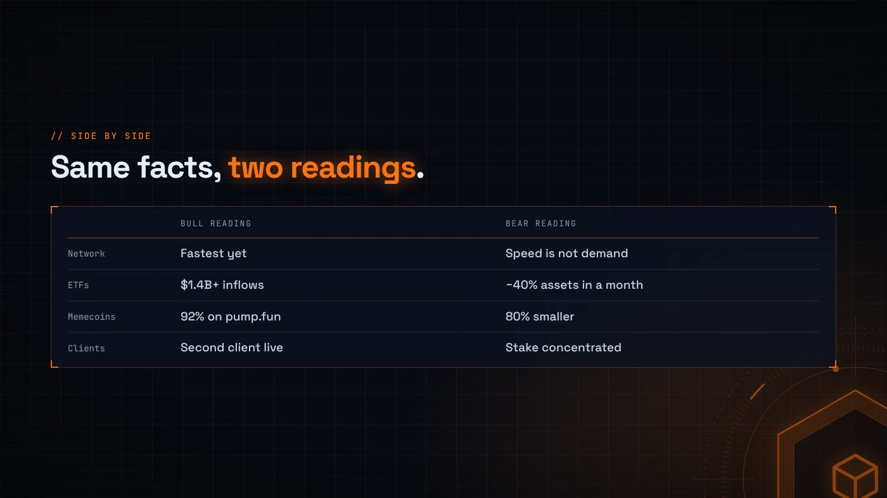
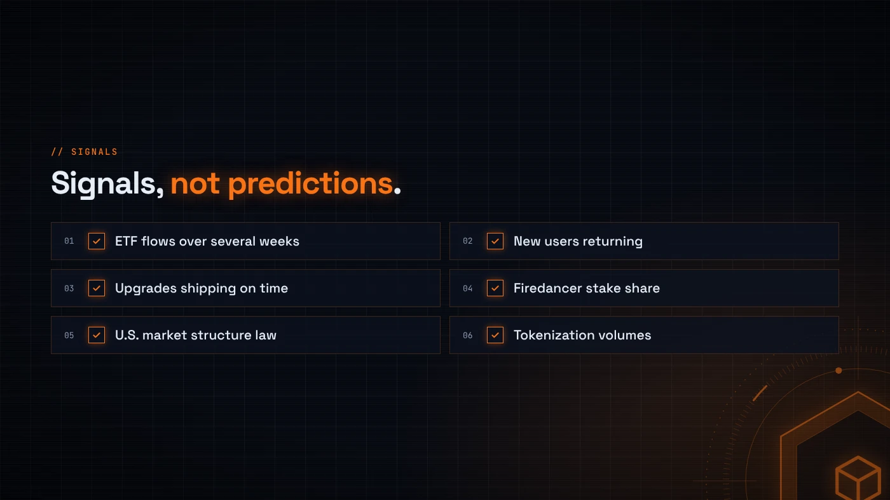

The bull case for Solana in 2027 rests on a faster, cheaper network, growing tokenization and over $1.4 billion of cumulative ETF inflows. The bear case points to SOL about 75% below its high, shrinking ETF assets, fewer memecoin buyers and concentrated client stake. This post compares both, with no price predictions.

:::note Key facts
- **Network:** ~150ms target finality, 200ms slots, rent cut under way, 2x compute targeted for 2027.
- **ETFs:** about **$1.41–1.65B** cumulative net inflows, but **−$122.7M** in the 30 days to Nov 20.
- **Price context:** SOL about **75%** below its **$293.31** January 2025 high (CryptoTicker, Nov 21).
- **Activity vs price:** over **$80M** of tokenized Anthropic share trading on Solana did not lift SOL (24/7 Wall St.).
:::

## What is the bull case?

Arguments supporters make, with sources:

- **Technology delivered.** Alpenglow, 200ms slots, bigger blocks and Solana 1.0 all shipped in 2026. See [Solana's 2026 year in review](/blog/solana-2026-year-in-review/).
- **Costs keep falling.** The rent cut and cheaper token account work help apps with many users. See [the Solana rent cut](/blog/solana-rent-cut-simd-0437/).
- **Tokenization pipeline.** Mitsui chose Solana for commodities, tokenized equities hit $1.22 billion, and Formation Securities plans a tokenized stock platform by early 2027.
- **Institutional access.** Six U.S. spot ETFs hold about 13.4 million SOL, with cumulative inflows above $1.4 billion. See [Solana ETFs explained](/blog/solana-etf-flows-explained/).
- **Ecosystem ownership.** The Solana Foundation's majority stake in CoinGecko gives it a data and distribution channel.

## What is the bear case?

Arguments critics make, with sources:

- **Price has not followed activity.** SOL fell 27.9% from its October 31 close to November 20 (24/7 Wall St.), despite busy network use.
- **ETF demand faded.** Net assets fell about 40% from October 23 to November 20, and the funds saw 24 days without inflows.
- **Memecoin demand thinned.** The memecoin category is about 80% below its peak, and pump.fun's new users fell sharply. See [the memecoin market in late 2026](/blog/memecoin-market-late-2026/).
- **Client concentration.** Most stake still runs Agave-based clients. See [Firedancer explained](/blog/firedancer-explained/).
- **Competition.** Base runs 200ms blocks, BNB Chain is adding payment lanes, and Robinhood Chain targets tokenized stocks.

## How do the two cases compare?

| Topic | Bull reading | Bear reading |
|---|---|---|
| Network | Fastest it has been | Speed is not demand |
| ETFs | $1.4B+ cumulative | −40% net assets in a month |
| Memecoins | Still 92% of launches on pump.fun | 80% smaller category |
| Tokenization | Big names arriving | Small next to traditional markets |
| Decentralization | Second client live | Stake concentrated |

## What would change the picture?

Signals both sides watch, not predictions:

- **ETF flows** turning steadily positive or negative over several weeks.
- **New users** returning to apps and launchpads.
- **Rent cut steps 2–5** and Agave 4.5 shipping on time.
- **Firedancer's stake share** rising.
- **Regulation,** such as U.S. market structure law. See [the CLARITY Act status](/blog/clarity-act-status/).

## What does this mean for token creators?

Your token's success depends far more on its community than on SOL's price. Practical points:

- **Costs are low and falling** for Solana launches whatever the market does.
- **Buyers are scarcer** than in 2024, so distribution matters more. See [how to market a Solana token](/blog/how-to-market-a-solana-token/).
- **Choose the chain your buyers use.** See [which blockchain to launch a token on](/blog/which-blockchain-to-launch-token/).

## What are the risks?

- **Both cases can be wrong.** Markets often move for reasons neither side names.
- **Data sources disagree,** especially on ETF figures.
- **Narratives change fast** in crypto.

You can lose money in crypto. This is not financial advice.

## FAQ

### What is the bull case for Solana in 2027?

Faster, cheaper network after the 2026 upgrades, growing tokenization, ETF access and ecosystem reach.

### What is the bear case for Solana in 2027?

Price not following activity, fading ETF demand, thinner memecoin buyers, client concentration and competition.

### Does DegenKit predict SOL's price?

No. This post compares published arguments and data only.

## Sources

- [24/7 Wall St.: Buy the Solana dip or DCA into 2027](https://247wallst.com/investing/cryptocurrency/2026/11/21/should-you-buy-the-solana-dip-now-or-dollar-cost-average-into-2027/)
- [CryptoTicker: Solana ETFs shed $122.7M](https://cryptoticker.io/en/solana-price-etf-monthly-outflow/)
- [Memeburn: Memecoin market running out of buyers](https://memeburn.com/memecoin-market-is-running-out-of-buyers-not-coins/)
- [SolanaFloor: Breakpoint 2026 Day 2](https://solanafloor.com/news/solana-breakpoint-2026-day-2-brief)

Build on Solana whatever the cycle with the [DegenKit token generator](/launch/).
