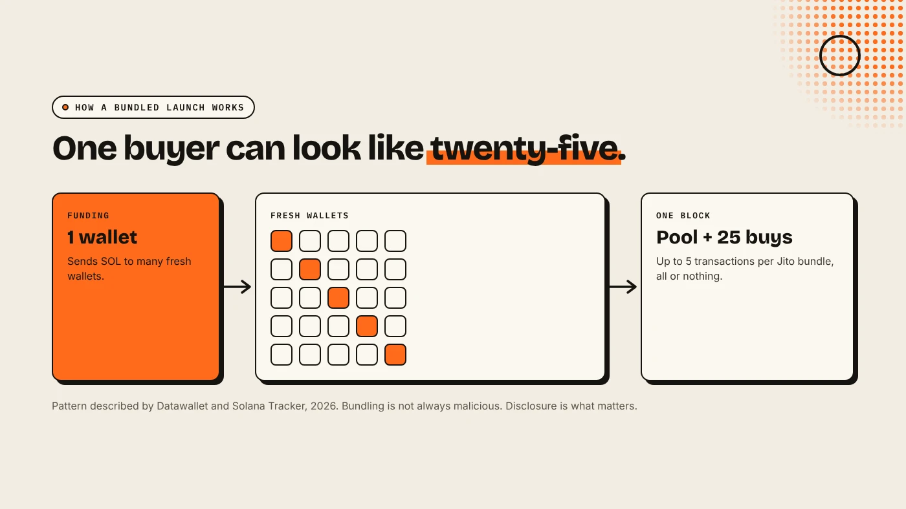
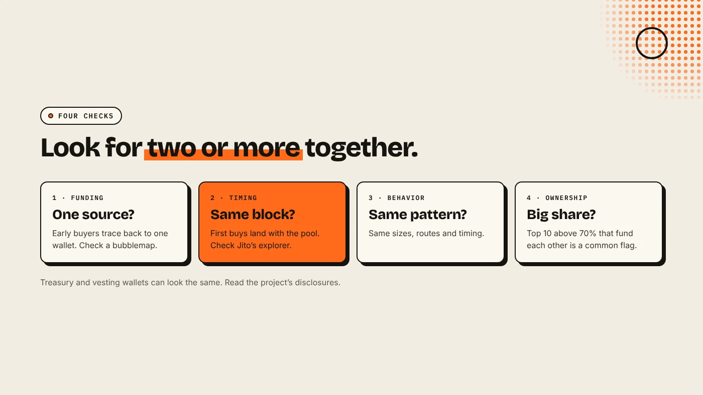

A Solana bundler groups several transactions so they run together in one block, usually as a Jito bundle of up to five transactions that all succeed or all fail. In token launches, it is often used to add liquidity and buy from many wallets in the same instant. That is not always a scam, but it can hide who really holds the supply.

:::note Key facts
- **Bundle size:** up to **5** transactions, executed in order and all-or-nothing (Solana Tracker).
- **Tips:** bundles compete with tips, with a minimum of **1,000 lamports**.
- **Launch pattern:** pool creation and early buys from 20 to 30 fresh wallets in one block (Datawallet).
- **No single proof:** check funding, timing, behavior and ownership together.
:::

:::note Not affiliated
DegenKit is not affiliated with Jito, Solana Tracker, Datawallet or RugCheck. This guide explains how to recognize bundles. It does not explain how to build one.
:::

## What is a bundle on Solana?

A bundle is a small, ordered package of signed transactions sent to validators that run Jito's software. The package lands in a single block, in order, or not at all. If one transaction fails, the whole bundle fails. Datawallet reports that Jito-Solana runs on more than 95% of active stake, so bundles can land almost anywhere on the network.

Bundles have ordinary uses. Arbitrage traders use them so a two-step trade never half-completes. Teams use them to make several steps of a launch atomic.

## How are bundles used in token launches?

In a launch, a **bundler tool** can put the liquidity deposit and a series of buys into the same bundle. The buys come from many wallets, often freshly created and funded from one source. The effect:

- outside snipers get no window before the first buys,
- the creator group gets a large share of supply at the lowest price,
- the holder list looks spread across many unrelated wallets.

Solana Tracker notes that intent, not the bundle itself, decides whether this is harmful. A team that discloses its allocation is different from one that hides 40% of supply in 25 wallets and sells into later buyers.

## How can you spot a bundled token?

Solana Tracker suggests checking four relationships, because no single signal is conclusive:

1. **Funding.** Do the early buyers trace back to one wallet? A bubblemap shows funding links. See [how to read a holder bubblemap](/blog/how-to-read-a-holder-bubblemap/).
2. **Timing.** Did the first large buys land in the same block as the pool? Open the earliest liquidity transaction on Solscan, then check it on Jito's explorer to see whether it ran as a bundle.
3. **Behavior.** Do the wallets use the same trade sizes, routes or timing?
4. **Ownership.** Together, do they hold an unusually large share? A common screening rule flags tokens where the top 10 wallets hold more than 70% and fund each other. Treasury and vesting wallets can trigger the same pattern, so read the project's disclosures.

## What can DegenKit's Scanner show?

The Scanner on the [Solana launcher](/launch/solana/) takes a mint address and shows mint and freeze authority, metadata status, the top holder's share, the top 10 holders' share and a bubblemap of the top 10. It does not label a token as bundled, and it does not check liquidity locks or intent. Use it as a first pass, then follow the funding trail on an explorer. Our [rug pull risk checklist](/blog/how-to-spot-rug-pull-risk/) covers the other checks.

## What should creators do instead?

If you are launching, transparency beats hidden wallets:

- **Disclose any team allocation** and the wallets that hold it.
- **Revoke mint and freeze authority**, so the supply cannot grow or be frozen.
- **Lock or burn the LP** and say which you did. See [locking liquidity on Solana](/blog/lock-liquidity-on-solana-burn-and-earn/).
- **Expect snipers.** Starting with a deeper pool makes a sniper's first buy move the price less.

## What are the risks?

- **Coordinated exits:** grouped wallets can sell together once demand peaks.
- **Fake breadth:** many small holders can be one person.
- **False positives:** treasury, market-maker and vesting wallets can look like a bundle.
- **Tools disagree:** scanners use different rules, so compare more than one.

You can lose money in crypto. This is not financial advice.

## FAQ

### Is bundling illegal or a scam?

Bundling is a technical feature. Whether a bundled launch harms buyers depends on whether the holdings are disclosed and how they are sold.

### How many transactions can a Jito bundle hold?

Up to five, executed in order, and all of them succeed or none do.

### What share of supply is too much for bundled wallets?

There is no official threshold. Some screeners flag a top 10 above 70% that fund each other, but lower is generally safer.

## Sources

- [Solana Tracker: Bundlers](https://www.solanatracker.io/blog/bundlers)
- [Datawallet: Solana bundles explained and how to check for risks](https://datawallet.com/crypto/solana-bundles-explained-and-checking-risks)

Check any mint address with the Scanner on the [DegenKit Solana launcher](/launch/solana/).
