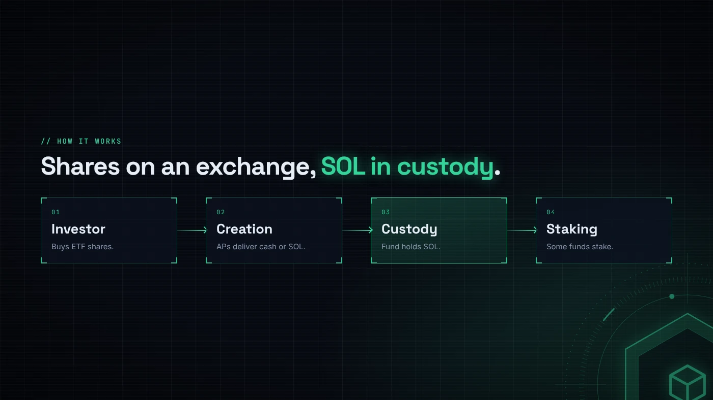
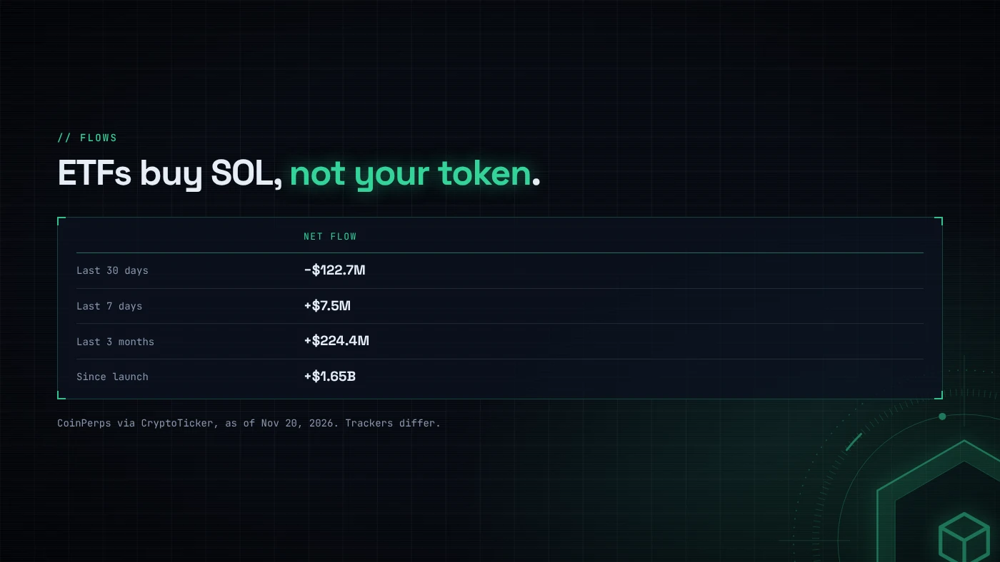

Solana ETFs are exchange-traded funds that hold SOL, so investors can get exposure through a brokerage account. Six U.S. spot Solana ETFs held about 13.41 million SOL, around 2.27% of supply, on November 20, 2026. They have taken in about $1.4–1.65 billion net since launch, depending on the tracker, but saw $122.7 million of net outflows in the 30 days to November 20.

:::note Key facts
- **Funds:** six U.S. spot Solana ETFs from Grayscale, Bitwise, Fidelity, VanEck, Franklin Templeton and 21Shares (CryptoTicker, citing CoinPerps).
- **Held:** about **13.41 million SOL**, **2.27%** of supply, worth about **$987 million**.
- **30 days to Nov 20:** **−$122.7 million** net. **3 months:** **+$224.4 million**.
- **Staking:** Bitwise's BSOL is a staking ETF. It took about $10.8 million on November 17.
:::

## How does a Solana ETF work?

1. An investor buys ETF shares on a stock exchange.
2. Authorized participants create new shares by delivering cash or SOL to the fund.
3. The fund holds the SOL with a custodian. Staking ETFs stake part of it and pass on rewards, minus fees.
4. When investors sell, shares are redeemed and the fund can sell SOL.

"Inflows" mean new shares were created. "Outflows" mean shares were redeemed.

## What happened to flows in November 2026?

Per CryptoTicker, citing CoinPerps data as of November 20:

| Period | Net flow |
|---|---|
| Last 30 days | −$122.7 million |
| Last 7 days | +$7.5 million |
| Last 3 months | +$224.4 million |
| Since launch | +$1.65 billion |

The funds broke a 24-day run without inflows on November 17, taking about $11.6 million, mostly into BSOL (about $10.8 million) and VanEck's VSOL (about $0.9 million), per a CryptoBriefing report. On November 20, funds saw $5.9 million of net outflows, per 24/7 Wall St.

Trackers disagree. Cumulative inflows are reported between $1.41 billion and $1.65 billion, and net assets between about $965 million and $1.05 billion. Always check which source and date a figure uses.

## Why did net assets fall?

Two things move an ETF's net assets: flows and the SOL price. Net assets in U.S. spot Solana ETFs fell about 40%, from roughly $1.61 billion on October 23 to about $965 million on November 20, per 24/7 Wall St. Most of that came from SOL's price fall, which was part of a wider crypto sell-off in November.

## Do ETFs affect the Solana network?

- **Staking:** staking ETFs delegate SOL to validators, which adds stake to the network.
- **Supply held:** 2.27% of supply sits in funds.
- **No change to apps or tokens.** ETFs hold SOL. They do not touch SPL tokens or the programs that run on Solana. See [Solana fees and rent explained](/blog/solana-fees-and-rent-explained/) and [how to create a Solana token for free](/blog/create-solana-token-free/).

## What do Solana ETFs mean for token creators?

Very little directly. ETF money buys SOL, not new SPL tokens. Indirectly, ETF demand and SOL's price affect how much SOL traders hold, which shapes demand for new tokens and the dollar cost of fees and liquidity. See [what a launch costs on each network](/blog/token-launch-costs-by-network/).

## Where can you track Solana ETF flows?

- ETF trackers such as Datawallet, SoSoValue and CoinPerps, which publish daily flows per fund.
- Each issuer's own fund page, for holdings and fees.
- Weekly fund-flow reports from asset managers.

## What are the risks?

- **Flows swing.** A month of inflows can follow a month of outflows.
- **Data differs** between trackers and dates.
- **ETF fees and staking terms** vary by fund.

You can lose money in crypto. This is not financial advice.

## FAQ

### How many Solana ETFs are there in the U.S.?

Six spot Solana ETFs, from Grayscale, Bitwise, Fidelity, VanEck, Franklin Templeton and 21Shares.

### How much SOL do Solana ETFs hold?

About 13.41 million SOL, or 2.27% of supply, as of November 20, 2026.

### Do Solana ETFs stake?

Some do. Bitwise's BSOL is a staking ETF.

## Sources

- [CryptoTicker: Solana ETFs shed $122.7M in 30 days](https://cryptoticker.io/en/solana-price-etf-monthly-outflow/)
- [KuCoin / CryptoBriefing: Solana ETFs end 24-day drought](https://www.kucoin.com/news/flash/solana-etfs-end-24-day-drought-with-11-6m-inflows-on-nov-17)
- [24/7 Wall St.: Solana dip or DCA into 2027](https://247wallst.com/investing/cryptocurrency/2026/11/21/should-you-buy-the-solana-dip-now-or-dollar-cost-average-into-2027/)
- [Datawallet: Solana ETF tracker](https://www.datawallet.com/solana-etf-tracker)

Create an SPL token on Solana with the [DegenKit token generator](/launch/).
