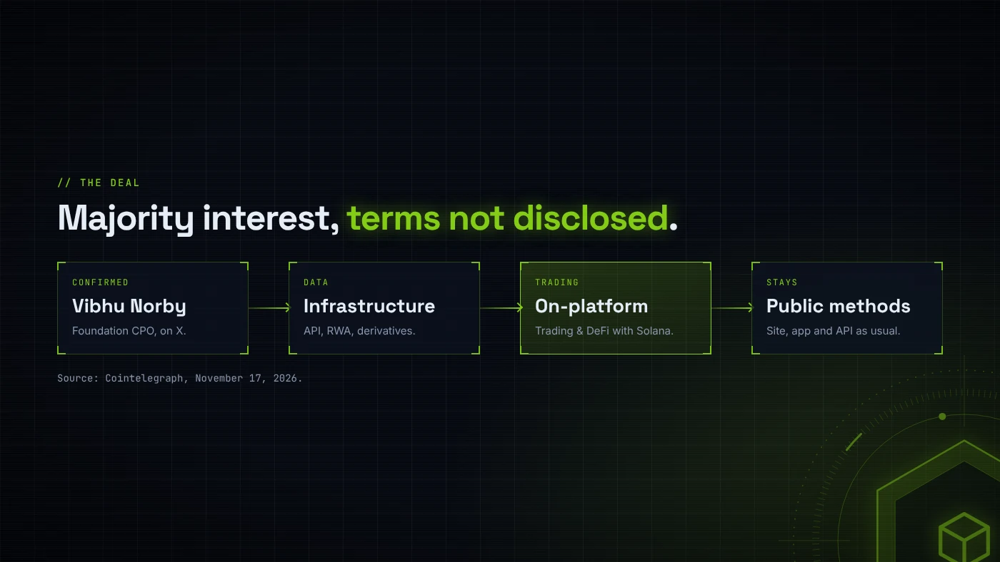
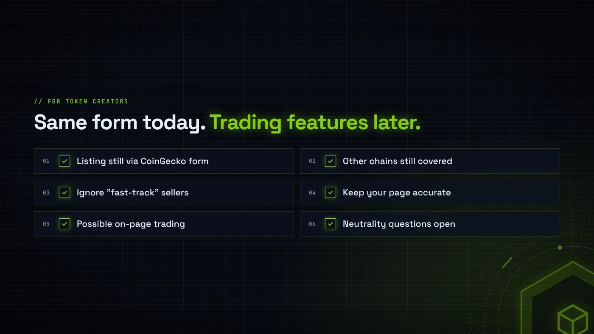

The Solana Foundation now holds a majority interest in CoinGecko, the crypto data site founded in 2014. Vibhu Norby, the Foundation's chief product officer, confirmed it on November 17, 2026, during Breakpoint. Terms were not disclosed. CoinGecko says its methodologies stay public and its site, app and API keep running as usual. Nothing has been announced about changes to listing rules.

:::note Key facts
- **Confirmed:** November 17, 2026, by Vibhu Norby, Solana Foundation CPO, on X (Cointelegraph).
- **Terms:** not disclosed.
- **Plans:** data infrastructure, coverage of tokenized real-world assets and derivatives, on-chain trading and DeFi features with Solana.
- **CoinGecko scale:** over **10 million** monthly users and **200 million** monthly page views (CoinGecko).
:::

:::note Not affiliated
DegenKit is not affiliated with the Solana Foundation or CoinGecko. This summary is based on the sources listed below.
:::

## What was announced?

At Breakpoint 2026 in London, the Solana Foundation said it had invested in CoinGecko, and Norby wrote that the foundation "now has a majority interest in CoinGecko". CoinGecko announced the backing on its own site. Neither side disclosed the price. See the [Breakpoint 2026 recap](/blog/solana-breakpoint-2026-recap/).

The stated uses:

- **Data infrastructure** and API capacity.
- **More coverage** of on-chain assets, tokenized real-world assets and derivatives.
- **Trading:** Norby said the two will work on "new on-platform trading & DeFi experiences with Solana".

## What does CoinGecko say stays the same?

- **Methodologies** stay transparent and publicly accessible.
- **Coverage** continues across the broader crypto ecosystem, not only Solana.
- **The website, app and API** keep operating as usual.

Cointelegraph notes the announcements say nothing specific about how token listings are decided.

## Why are people debating it?

CoinGecko has been independent for about 12 years, and many treat it as a neutral scoreboard. A blockchain foundation owning a majority of a data site raises questions:

- **Neutrality:** will Solana tokens get better placement?
- **Data use:** CoinGecko's API feeds many other apps and wallets.
- **Competition:** CoinMarketCap is owned by Binance, so both big data sites now have ecosystem owners.

So far these are open questions, not documented changes.

## Does this change how you list a token on CoinGecko?

Nothing has been announced. Listing still goes through CoinGecko's request form and review. The usual steps:

1. **Trade on a tracked DEX** with real liquidity.
2. **Show up on DexScreener first.** See [DexScreener and CoinGecko listings](/blog/dexscreener-and-coingecko-listing/).
3. **Keep a clean contract** and published wallets. See [how to spot rug pull risk](/blog/how-to-spot-rug-pull-risk/).
4. **Submit once** with matching name, logo and links.

Tokens on Ethereum, Base, BNB Chain and other chains are still covered.

## What could change for Solana tokens?

The planned trading and DeFi features suggest CoinGecko may add ways to swap tokens on its pages, possibly starting with Solana. That could bring more buyers to small Solana tokens that are already listed. No product or date has been announced.

## What should token creators do now?

- **Keep your CoinGecko page accurate:** logo, links, contract address and supply.
- **Watch for official product news** from CoinGecko and the Solana Foundation, not from DMs.
- **Do not change chains because of a headline.** Pick the network where your buyers already are. See [which blockchain to launch a token on](/blog/which-blockchain-to-launch-token/).
- **Track both data sites.** CoinMarketCap and CoinGecko each drive their own traffic.

## What are the risks?

- **Listing scams** may use the news to sell "fast-track" CoinGecko listings. Use only CoinGecko's own form.
- **Neutrality concerns** could affect how buyers trust CoinGecko data.
- **Plans may change.** Trading features are announced, not launched.

You can lose money in crypto. This is not financial advice.

## FAQ

### Does the Solana Foundation own CoinGecko?

It holds a majority interest, confirmed on November 17, 2026. The terms were not disclosed.

### Will CoinGecko only list Solana tokens now?

No. CoinGecko says it will keep serving the broader crypto ecosystem.

### Is CoinGecko listing still free?

Nothing announced changes the standard request process.

## Sources

- [Cointelegraph: Solana Foundation majority stake in CoinGecko](https://cointelegraph.com/news/coingecko-solana-foundation-majority-stake)
- [SolanaFloor: Breakpoint 2026 Day 2 brief](https://solanafloor.com/news/solana-breakpoint-2026-day-2-brief)
- [CoinGecko: About](https://www.coingecko.com/en/about)

Create a token on any of six chains with the [DegenKit token generator](/launch/).
