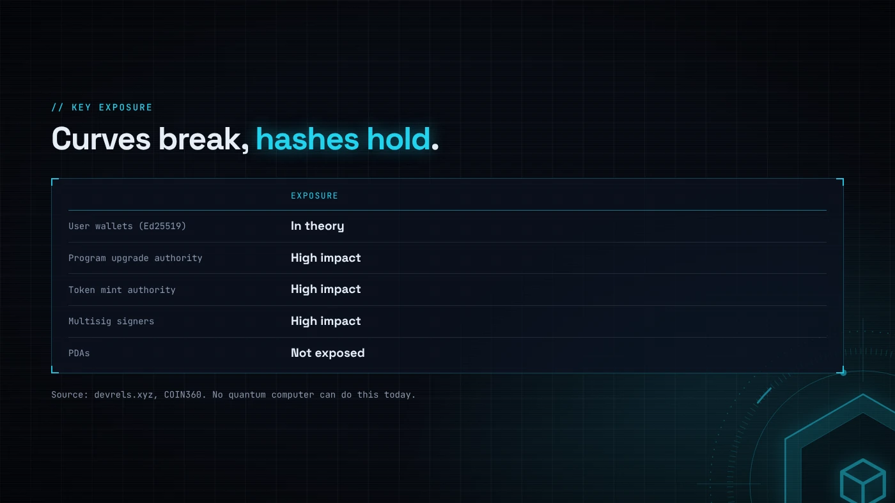
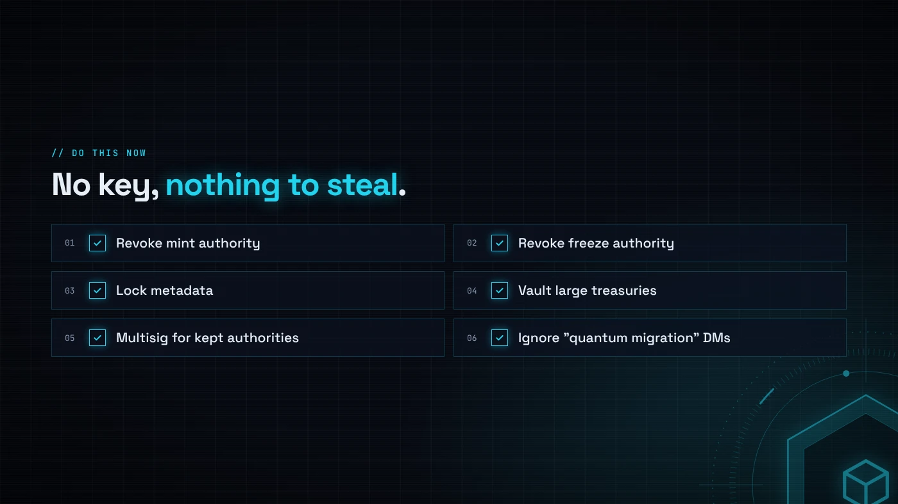

Solana's quantum plan picks Falcon, a lattice-based signature scheme selected by NIST, to replace today's Ed25519 keys if quantum computers become a real threat. The Solana Foundation, Anza and Firedancer outlined it in April 2026. No protocol change is needed yet. New wallets would switch first and existing wallets later. Winternitz vaults already offer quantum-resistant storage on Solana today.

:::note Key facts
- **Chosen scheme:** **Falcon** (NIST FN-DSA). Anza and Firedancer both built prototypes (COIN360).
- **Order:** research → **new wallets** adopt post-quantum keys → **existing wallets** migrate if threats become credible.
- **Live today:** **Winternitz vaults** (Blueshift, since January 2025), now the open-source Winterwallet.
- **Not at risk:** PDAs, because they have no private key (devrels.xyz).
:::

## Why is quantum computing a risk for Solana?

Solana accounts sign with Ed25519, an elliptic-curve scheme. A large enough quantum computer running Shor's algorithm could derive a private key from a public key. Hash functions are much less affected. In 2026, Google's resource estimates put breaking a 256-bit curve at well under 1,200 logical qubits, per devrels.xyz. No such machine exists today. The Solana Foundation's own words: "Quantum is still years away".

## What is in the roadmap?

Per COIN360 and CryptoBriefing, the Foundation, Anza and Firedancer agreed on three stages:

1. **Keep researching** Falcon and alternatives.
2. **New wallets adopt** a post-quantum scheme if threats become credible.
3. **Existing wallets migrate** later.

Milestones to watch: testnet deployments, mainnet feature gates and third-party audits of the Falcon code. No dates are set.

## Why Falcon?

- **Compact for post-quantum:** a Falcon-512 public key is about 897 bytes and a signature about 666 bytes. Ed25519 uses 32 and 64.
- **Fast to verify:** roughly 3x faster than Ed25519, per devrels.xyz.
- **Standardized:** selected by NIST as FN-DSA.

Bigger signatures need bigger transactions. Solana's 4,096-byte limit, live since August, makes room for them.

## Which keys matter most?

| Key | Exposure | Note |
|---|---|---|
| User wallets (Ed25519) | Exposed in theory | Migrate when tools exist |
| Program upgrade authority | High impact | One key controls a program |
| Token mint authority | High impact | Could mint new supply |
| Multisig signers | High impact | Each signer is Ed25519 |
| PDAs | Not exposed | No private key |

Devrels.xyz calls moving signing authorities off bare Ed25519 keys the highest-leverage step teams can take now.

## What can token creators do today?

- **Revoke mint and freeze authority.** A revoked authority has no key to steal, quantum or not. DegenKit's Solana Token Creator does this in the launch transaction. See [mint authority vs freeze authority](/blog/mint-authority-vs-freeze-authority/).
- **Lock metadata,** so no update authority remains.
- **Use a vault for large treasuries.** Winterwallet signs each key once and moves change into a fresh vault.
- **Use multisig for any authority you keep.** See [wallet security for token creators](/blog/wallet-security-for-token-creators/).

## How do other chains compare?

Ethereum's Vitalik Buterin published a quantum roadmap on February 26, 2026, and Ethereum's Hegota fork discussions include quantum-resistant cryptography work. Ripple and TRON also advanced plans in 2026. Solana's distinction is that a quantum-resistant vault already runs on mainnet. See [what to watch in crypto in 2027](/blog/crypto-to-watch-2027/).

## What are the risks?

- **Timing is unknown.** Migration could be needed faster than planned.
- **Bigger signatures** use more transaction space.
- **Scams** may offer fake "quantum-safe migration". There is no official migration yet.

You can lose money in crypto. This is not financial advice.

## FAQ

### Is Solana quantum resistant?

Not yet for regular wallets. Winternitz vaults are, and the network has a plan to adopt Falcon signatures when needed.

### Do I need to move my SOL now?

No official migration exists. Large holders can use a Winternitz vault.

### Are revoked tokens safe from quantum attacks?

A revoked mint authority has no key, so there is nothing for an attacker to derive.

## Sources

- [COIN360: Solana plans Falcon upgrade](https://coin360.com/news/solana-falcon-post-quantum-upgrade)
- [CryptoBriefing: Solana quantum readiness roadmap](https://cryptobriefing.com/solana-quantum-readiness-roadmap/)
- [devrels.xyz: Quantum-proofing Solana](https://devrels.xyz/articles/solana-post-quantum-cryptography)

Launch with authorities revoked on the [DegenKit token generator](/launch/).
