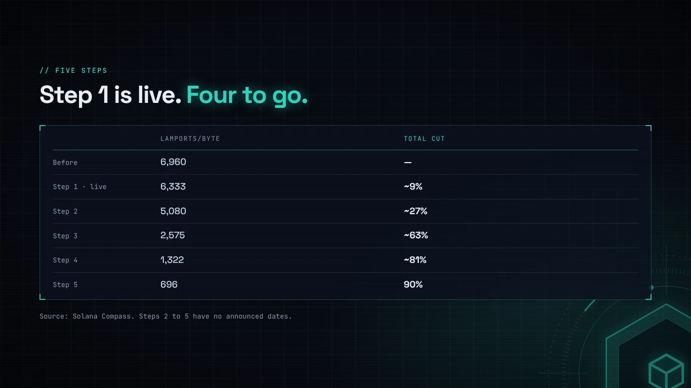
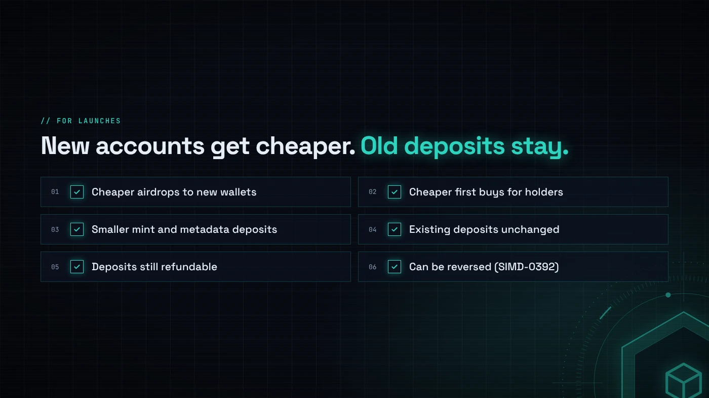

SIMD-0437 cuts Solana's rent, the refundable deposit every account must hold, by 90% in five steps. Step 1 went live on mainnet on September 3, 2026, lowering rent about 9%. When all five steps are done, a standard SPL token account deposit falls from about $0.16 to about $0.016. Existing accounts keep their deposits, and rent stays refundable when an account closes.

:::note Key facts
- **Proposal:** SIMD-0437, authored by Anza engineer Igor Durovic.
- **Step 1:** live on mainnet **September 3, 2026**. lamports per byte **6,960 → 6,333** (about 9%).
- **End state:** **696** lamports per byte, a **90%** cut. Steps 2–5 have no announced dates.
- **Token account deposit:** about **$0.16 → $0.016** at full completion (Solana Compass).
:::

## What is rent on Solana?

Every Solana account holds a small SOL deposit so it is "rent-exempt". The deposit scales with the account's size in bytes. It is not a fee you lose: you get it back when the account closes. For token creators it shows up in three places:

- the **mint account** created with your token,
- each holder's **token account** (paid by whoever creates it, often the buyer or the airdrop sender),
- the **metadata account**.

See [Solana fees and rent explained](/blog/solana-fees-and-rent-explained/).

## What are the five steps?

| Step | Lamports per byte | Total cut | Status |
|---|---|---|---|
| Before step 1 | 6,960 | — | — |
| 1 | 6,333 | ~9% | Live, Sept 3 |
| 2 | 5,080 | ~27% | Not dated |
| 3 | 2,575 | ~63% | Not dated |
| 4 | 1,322 | ~81% | Not dated |
| 5 | 696 | 90% | Not dated |

Each step is its own feature gate, with a fallback gate. A separate proposal, SIMD-0392, allows rent to be raised back if state growth calls for it.

## How much cheaper do token accounts get?

Solana Compass, citing Anza's Agave 4.2 overview, puts the standard token account deposit at about $0.159 today and about $0.0159 after step 5. For one million token accounts, that is about $159,000 in deposits before, and about $15,900 after. Dollar values move with the SOL price.

## What does this mean for token launches?

- **Airdrops get cheaper.** Sending to new wallets means creating token accounts. See [airdrop vs multisender](/blog/airdrop-vs-multisender/).
- **Buying is cheaper for first-time holders,** because their token account deposit is smaller.
- **Mint and metadata accounts** also need less SOL.
- **DegenKit's 0.28 SOL Solana Token Creator fee** is a service fee and is separate from rent. See [DegenKit fees explained](/blog/degenkit-fees-explained/).

## What happens to existing accounts?

Nothing. The new rate applies to accounts created after each step activates. Accounts created earlier keep their deposit, and you still get the full deposit back when you close them. Closing empty token accounts is a common way to reclaim SOL. See [burning Solana tokens](/blog/burn-solana-tokens/).

## Why is Solana cutting rent now?

Solana has cut slot times, raised block compute and widened transactions during 2026. Rent was one of the last fixed costs that grew with SOL's price. The cut is phased so validators can watch state growth after each step, and SIMD-0392 is the brake if storage grows too fast.

## What are the risks?

- **Spam:** cheaper accounts make account spam cheaper too, which is why the cut is phased.
- **Reversal:** rent can be raised again under SIMD-0392.
- **No dates:** steps 2 to 5 have no announced schedule.

You can lose money in crypto. This is not financial advice.

## FAQ

### What is SIMD-0437?

A Solana proposal that cuts rent per byte by 90% in five steps. Step 1 went live on September 3, 2026.

### Do I get money back from my old token accounts?

You always get the deposit back when you close an account. The rent cut does not change deposits on existing accounts.

### When will Solana rent be cut by 90%?

After step 5. Steps 2 to 5 have no announced dates yet.

## Sources

- [Solana Compass: SIMD-0437 step 1 live on mainnet](https://solanacompass.com/news/simd-0437-step-1-goes-live-on-solana-mainnet-beginning-a-five-phase-rent-reduction)
- [Solana: Network upgrades](https://solana.com/upgrades)
- [Solana docs: Accounts and rent](https://solana.com/docs/core/accounts)

Create a Solana token at today's lower rent with the [DegenKit token generator](/launch/).
