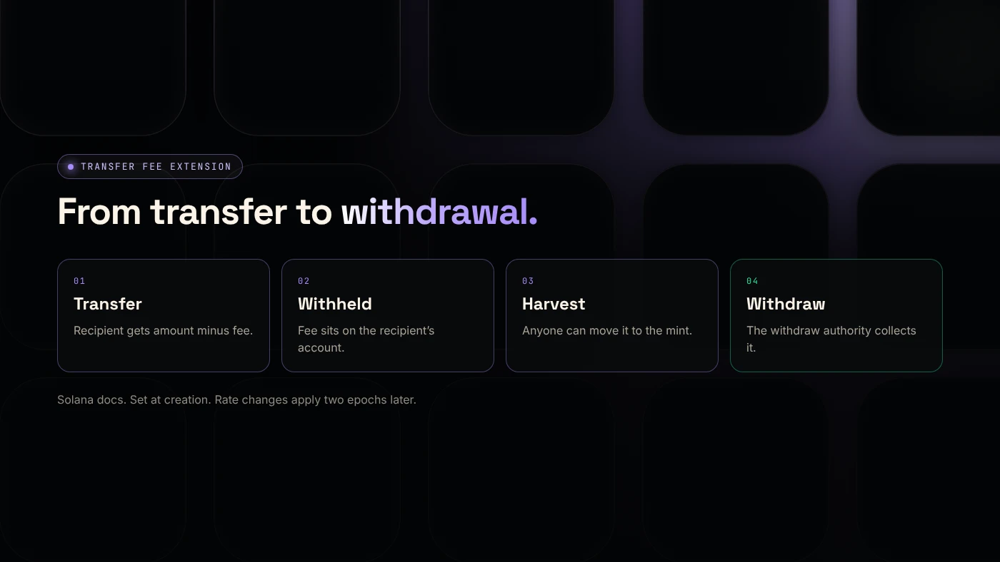
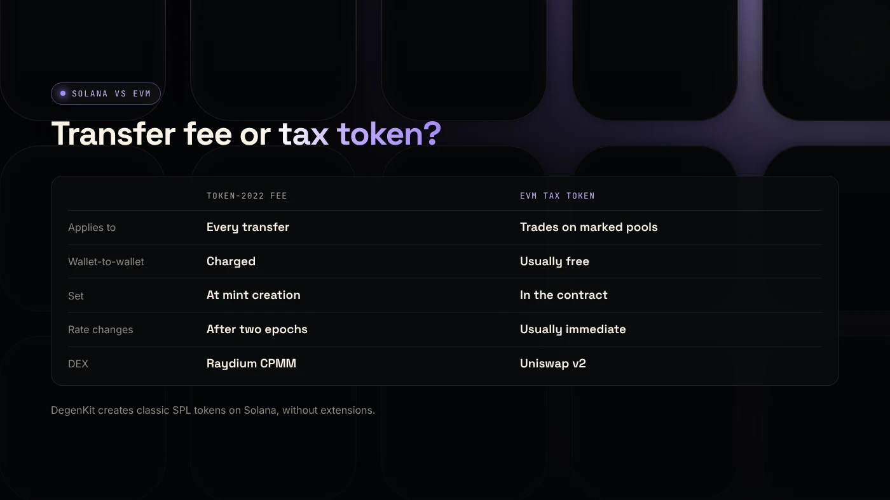

The Solana Token-2022 transfer fee extension makes a token charge a fee, in basis points with a maximum per transfer, on every transfer: the recipient receives less, and the fee is held on their account until an authority withdraws it. It must be set when the token is created and only works on the Token-2022 program.

:::note Key facts
- Part of **Token-2022** (the Token Extensions Program), not the classic Token Program.
- Set with a **fee in basis points** and a **maximum fee** per transfer (Solana's example: 150 and 10).
- Fees are **withheld** on the recipient's token account and collected by the **withdraw authority**.
- Fee changes take effect **two epochs** later. Raydium CPMM handles transfer-fee tokens natively.
:::

## How does the transfer fee extension work?

Solana's documentation describes the **TransferFeeConfig** extension: it "applies a fee to every transfer of the mint", and the amount the recipient receives is reduced by the fee ([Solana docs](https://solana.com/docs/tokens/extensions/transfer-fees)).

Each config has a **fee rate in basis points** (100 basis points = 1%) and a **maximum fee** per transfer. In Solana's example, the rate is 150 basis points (1.5%) with a maximum of 10 tokens.

The extension must be added **when the mint is created**, in the same transaction. You cannot add it to an existing token.

## Where do the fees go?

Fees are not sent anywhere at the moment of transfer. They are **withheld** on each recipient's token account. Then:

- Anyone can **harvest** withheld fees from accounts into the mint, which needs no permission.
- The **withdraw authority** moves them from accounts or the mint to a fee-receiver account.

The **transfer fee config authority** can change the rate with SetTransferFee. The new fee only applies **two epochs** later, so holders get notice.

## How does it compare to an EVM buy and sell tax?

| | Token-2022 transfer fee | EVM tax token |
|---|---|---|
| Applies to | Every transfer | Usually buys and sells against marked pools |
| Wallet-to-wallet | Charged | Usually not charged |
| Where it is set | At mint creation | In the token contract |
| Changes | Take effect after two epochs | Usually immediate |
| DEX support | Raydium CPMM handles it natively | Usually Uniswap v2 only |

On Robinhood Chain and other EVM networks, DegenKit's Tax Token only taxes trades against pools you mark. See [how buy and sell taxes work](/blog/how-token-buy-sell-tax-works/).

## Does Raydium support transfer-fee tokens?

Raydium's guide says CPMM supports Token-2022 and handles mints with transfer fees natively through **SwapV2**. CLMM also supports Token-2022 ([Raydium docs](https://docs.raydium.io/user-flows/choosing-a-pool-type)). Some wallets, aggregators and older pools may not handle transfer fees well, so test before launch.

## Can you create a transfer-fee token on DegenKit?

Not today. DegenKit's Solana token creator makes **classic SPL tokens**, which do not have extensions. Its liquidity and wallet tools can read Token-2022 balances, but creation of Token-2022 mints is not offered as of November 2026.

If you need a transfer fee, you can create a Token-2022 mint with Solana's CLI or SDK. If you do not, a classic SPL token with revoked authorities is simpler and works everywhere. See the [Solana token creator guide](/blog/create-solana-token-without-coding/).

## What are the risks?

- **Authority power.** Whoever controls the fee authority can raise the rate, with two epochs of notice.
- **Compatibility.** Some apps may show wrong amounts or fail transfers.
- **Buyer trust.** Fees on every transfer, including wallet-to-wallet, are unpopular.
- **Permanent setup.** The extension cannot be removed later.

You can lose money in crypto. This is not financial advice.

## FAQ

### What is the Token-2022 transfer fee extension?

A Solana token extension that charges a fee on every transfer, set at creation, with a rate in basis points and a maximum per transfer.

### Who receives Token-2022 transfer fees?

The fee is withheld on recipients' accounts. The withdraw authority can move it to its chosen fee-receiver account.

### Can I add a transfer fee to an existing token?

No. The extension must be set when the mint is created.

## Sources

- [Solana docs: Transfer fees](https://solana.com/docs/tokens/extensions/transfer-fees)
- [Raydium docs: Choosing a pool type](https://docs.raydium.io/user-flows/choosing-a-pool-type)

For a classic SPL token with authorities revoked, use the [DegenKit Solana token creator](/launch/solana/).
