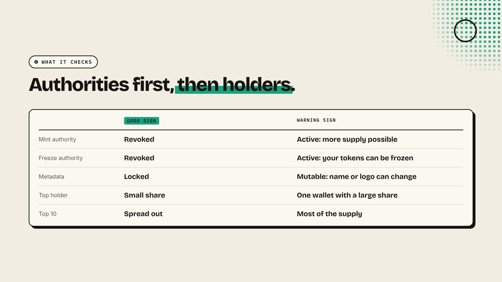
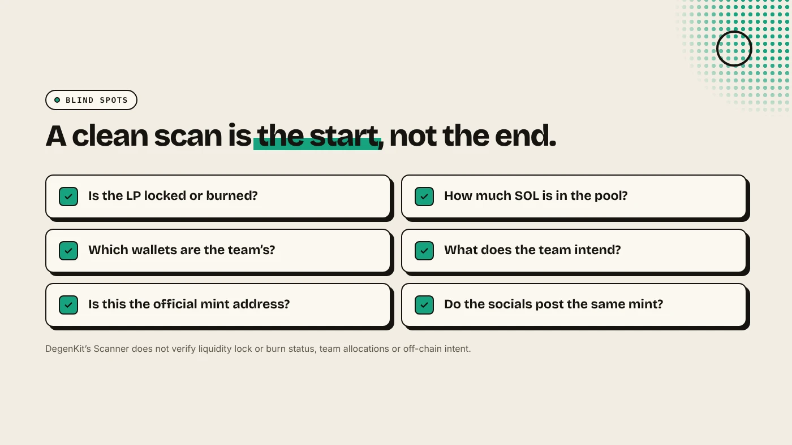

A Solana token scanner reads a token's mint address and shows the on-chain facts that matter before you buy: whether new tokens can be minted, whether wallets can be frozen, whether the metadata can change, and how much of the supply a few wallets hold. It takes seconds. It cannot see intent, team plans or whether liquidity is locked, so treat it as a first check.

:::note Key facts
- **Input:** the token's **mint address**, not its name.
- **DegenKit's Scanner shows:** mint authority, freeze authority, metadata status, top holder share, top 10 share, liquidity (for information), a heuristic score and a **bubblemap of the top 10**.
- **Not checked:** liquidity lock or burn status, team allocations and off-chain intent.
- **No scanner is a guarantee.** It is one input to your own research.
:::

:::note Not affiliated
DegenKit is not affiliated with Solscan, RugCheck, DexScreener or any other scanner named here.
:::

## How do you scan a token?

1. Copy the **mint address** from the project's official X account, website or DexScreener page. Never search by name alone. Copies use the same name.
2. Open the [Solana launcher](/launch/solana/) and choose **Scanner**.
3. Paste the address into **Token mint address** and click **Scan**.
4. Read each line, then open the bubblemap.

The scan reads public on-chain data only. It does not need your wallet.

## What does each check mean?

| Check | Good sign | Warning sign |
|---|---|---|
| Mint authority | Revoked | Active: the holder can print more supply |
| Freeze authority | Revoked | Active: the holder can freeze your tokens |
| Metadata | Locked | Mutable: the name or logo can change |
| Top holder | A small share | One wallet with a large share |
| Top 10 holders | Spread out | Most of the supply in ten wallets |

**Mint and freeze authority** are the first things to check. An active freeze authority is a common honeypot pattern: you can buy, but your account can be frozen before you sell. See [mint authority vs freeze authority](/blog/mint-authority-vs-freeze-authority/).

**Top holders** need context. A pool account or a burn address can be the largest holder and is not a risk. A fresh wallet holding 30% is.

## How do you read the bubblemap?

The bubblemap draws the top 10 holders as circles sized by their share. Lines between circles mean the wallets have sent tokens or SOL to each other. A cluster of linked wallets can be one person holding more than any single wallet shows. That is a pattern often seen in bundled launches. Our guides to [reading a holder bubblemap](/blog/how-to-read-a-holder-bubblemap/) and [Solana bundlers](/blog/solana-bundler-explained/) explain what to look for.

## What can a scanner not tell you?

DegenKit's Scanner states that its score "does not verify liquidity lock/burn status, team allocations, or off-chain intent". Check these yourself:

- **Liquidity:** is the LP locked or burned? See [locking liquidity on Solana](/blog/lock-liquidity-on-solana-burn-and-earn/).
- **Pool depth:** how much SOL backs the price? A thin pool moves hard on small trades.
- **Team wallets:** does the project say which wallets are the team's?
- **Socials:** is the X account real, and does it post the same mint address?

## How should you use the result?

- **Two warning signs together** (for example, active freeze authority and a top holder with 40%) are a strong reason to stay away.
- **A clean scan** means the obvious traps are absent. It does not mean the price will hold.
- **Scan again later.** Holder shares change as people buy and sell.

For the full checklist, see [how to spot rug pull risk](/blog/how-to-spot-rug-pull-risk/).

## What are the risks?

- **False comfort.** A token with revoked authorities can still be rugged by pulling liquidity or dumping a large holding.
- **Wrong address.** Scanning a copycat token gives you a clean report on the wrong coin.
- **Heuristic scores.** Different scanners weigh signals differently and can disagree.

You can lose money in crypto. This is not financial advice.

## FAQ

### Is a Solana token scanner free?

Most scanners, including DegenKit's, only read public data and do not need your wallet.

### What is the most important check?

Mint and freeze authority. If either is active, the creator keeps a power that can hurt holders.

### Can a scanner detect a rug pull?

It can flag common warning signs. It cannot predict what the team will do or check whether liquidity is locked.

## Sources

- [Solana docs: Set authority](https://solana.com/docs/tokens/basics/set-authority)
- [DEXTools: What is mint authority](https://www.dextools.io/tutorials/what-is-mint-authority-in-crypto-guide-2026)
- [Solana Tracker: Bundlers](https://www.solanatracker.io/blog/bundlers)

Check any mint address with the **Scanner** on the [DegenKit Solana launcher](/launch/solana/).
