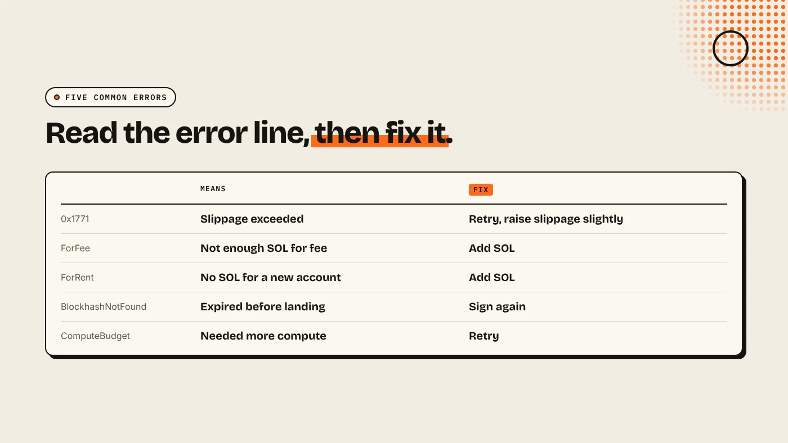
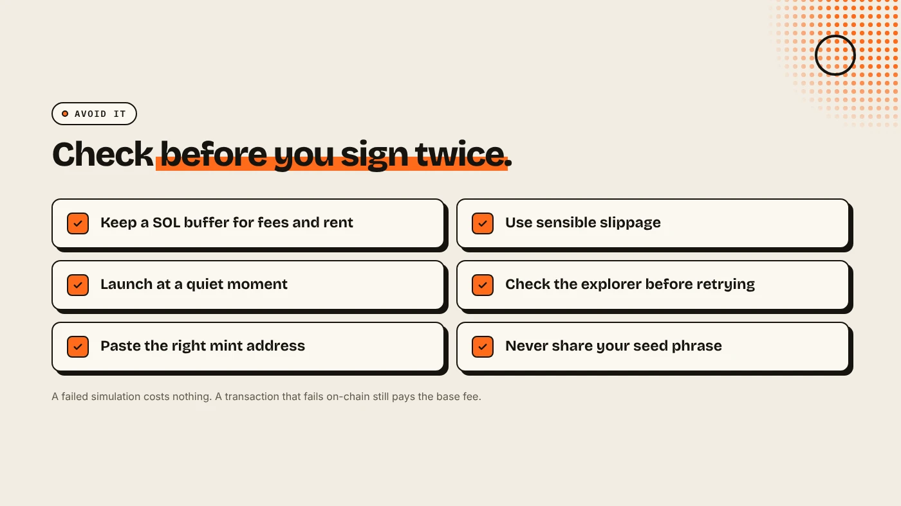

When a Solana transaction fails, open it on an explorer such as Solscan and read the error. Most failures have one of five causes: slippage exceeded, not enough SOL for fees or rent, an expired blockhash, a compute limit that was too low, or an account that does not exist yet. Each has a simple fix. The network fee is still charged when a transaction fails on-chain.

:::note Key facts
- **Find the cause:** paste the transaction ID into Solscan and read the **Result** line (Solscan).
- **Slippage exceeded** shows as **Custom(6001) / 0x1771** on many DEX programs (RPC Fast).
- **Failed on-chain still costs** the base fee of 5,000 lamports per signature. A failed simulation costs nothing.
- **Keep a SOL buffer** for fees and new token accounts.
:::

:::note Not affiliated
DegenKit is not affiliated with Solscan, RPC Fast or Jupiter.
:::

## How do you find out why it failed?

1. Copy the transaction ID from your wallet or the app.
2. Paste it into Solscan or Solana Explorer.
3. Read the **Result** or error line, shown in red.

If your wallet showed an error *before* you signed, the transaction was only simulated and nothing was charged. The fix is the same.

## What do the common errors mean?

| Error | What it means | Fix |
|---|---|---|
| Custom(6001) / 0x1771 | Slippage tolerance exceeded | Retry, or raise slippage slightly |
| Custom(6000) / 0x1770 | Minimum output not met | Same as above |
| InsufficientFundsForFee | Not enough SOL for the fee | Add SOL |
| InsufficientFundsForRent | Not enough SOL to open a new account | Add SOL |
| InsufficientFunds (token) | Not enough of the token | Lower the amount |
| BlockhashNotFound | The transaction expired before landing | Sign again |
| ComputationalBudgetExceeded | It needed more compute than its limit | Retry, or use an app that sizes compute |
| AccountNotFound | An account does not exist yet | Wait a moment, or check the address |

Error names and meanings follow RPC Fast's error reference.

## Why does slippage cause so many failures?

On a swap, you set how far the price may move before you accept the result. If the price moves further before your transaction lands, the DEX program rejects it on purpose to protect you. This happens most on new tokens with thin pools and during busy launches. Raise slippage a little and retry, but never above the loss you would accept. See [slippage vs price impact](/blog/slippage-vs-price-impact/).

## Why do you need SOL for rent?

Every token you hold lives in its own token account, and opening one needs a small, refundable SOL deposit called rent. If you receive a new token or create one with almost no SOL left, the transaction fails with **InsufficientFundsForRent**. Keep a buffer. Our guide to [Solana fees and rent](/blog/solana-fees-and-rent-explained/) shows the amounts.

## What about dropped or expired transactions?

Each transaction includes a recent blockhash and is only valid for a short window. During congestion, it may not land in time and expires as **BlockhashNotFound**. Solana's fee docs explain that a **priority fee**, set as a compute unit price, helps a transaction get scheduled sooner. Most wallets and apps set it automatically. Signing again with a fresh blockhash is usually enough.

## How do you avoid failures when launching a token?

- Keep at least a few tenths of a SOL above the fees you plan to pay.
- Create the token and the pool on a quiet moment, not in the middle of a market spike.
- If a launch transaction fails, **check the explorer before retrying**, so you do not create a second token by accident.

DegenKit creates the mint, metadata and supply in one transaction on the [Solana launcher](/launch/solana/), so a failure leaves nothing half-created.

## What are the risks?

- **Raising slippage too far** can fill your trade at a much worse price.
- **Retrying blindly** can repeat a payment that actually succeeded.
- **Fake support.** Nobody legitimate will ask for your seed phrase to "fix" a transaction.

You can lose money in crypto. This is not financial advice.

## FAQ

### Do I pay a fee if my Solana transaction fails?

Yes, if it failed on-chain. Solana's docs say the fee is still charged. A failed simulation before signing costs nothing.

### What does 0x1771 mean on Solana?

On many DEX programs it means slippage tolerance was exceeded.

### Why does Solana say insufficient funds when I have SOL?

You may have enough for the fee but not for the rent to open a new token account.

## Sources

- [RPC Fast: Solana transaction error codes](https://rpcfast.com/blog/solana-transaction-error-code)
- [Solscan: Why did my transaction fail?](https://info.solscan.io/why-did-my-transaction-fail)
- [Solana docs: Fee structure](https://solana.com/docs/core/fees/fee-structure)

Create a token in one transaction on the [DegenKit Solana launcher](/launch/solana/).
