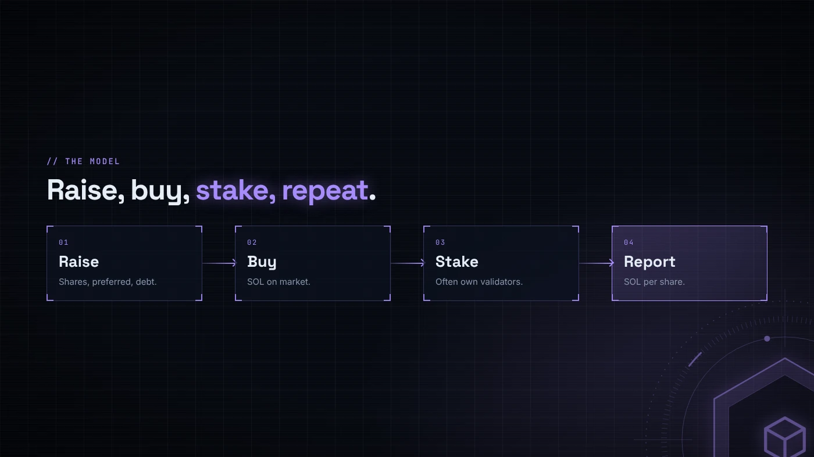
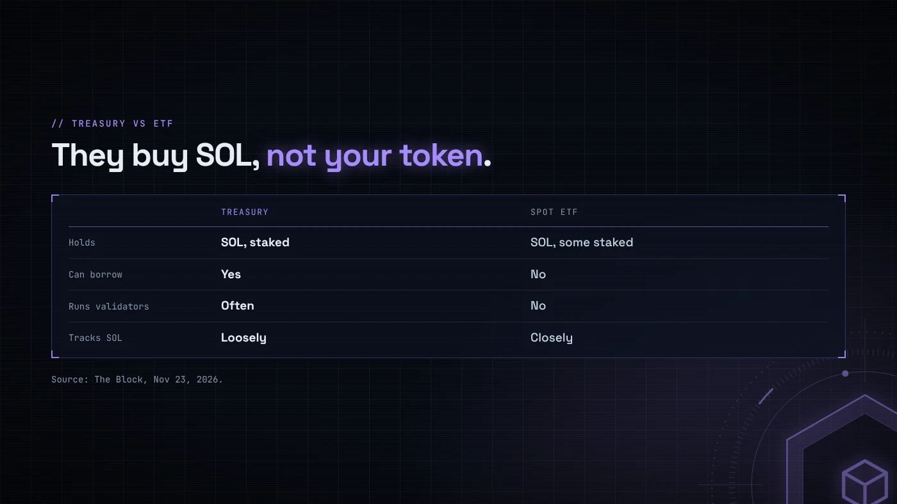

Solana treasury companies are public companies that buy and hold SOL as their main asset, then stake it to earn yield. The largest is Forward Industries with 8.73 million SOL. DeFi Development Corp (DFDV) is second with 2.62 million SOL after its 11th straight week of buying on November 23, 2026. Their goal is more SOL per share, but their shares can fall further than SOL itself.

:::note Key facts
- **Largest:** Forward Industries, **8,727,694 SOL** and equivalents on Nov 9, about 1.5% of supply (company update, The Block).
- **DFDV:** **2,624,491 SOL** and equivalents, **11** straight weeks of buying since Sept 14.
- **Latest buy:** about **5,180 SOL** (week to Nov 23), after 9,482 the week before.
- **Share performance:** DFDV down **54%** year to date, SOL down nearly **40%** in 2026.
:::

## How does a SOL treasury company work?

1. **Raise money** by selling shares, preferred stock or debt.
2. **Buy SOL** with it.
3. **Stake SOL,** often through its own validators, to earn rewards.
4. **Report "SOL per share",** the number investors watch.

It gives stock investors exposure to SOL through a normal brokerage account, much like an ETF, but run as an operating company that can borrow, stake and run validators. See [Solana ETFs explained](/blog/solana-etf-flows-explained/).

## What did DeFi Development do this week?

Per The Block, on November 23, 2026:

- Added about 5,180 SOL and equivalents.
- Reached 2,624,491 SOL.
- Extended its buying streak to 11 weeks.
- Said it aims to "increase SOL per share through continued accumulation", plus staking and validator operations.

Its preferred stock, CHAD, pays a variable 14% annual dividend, paid daily when declared. NAV per share more than quadrupled in Q3, the company said.

## How do treasuries compare with ETFs?

| | Treasury company | Spot ETF |
|---|---|---|
| Holds | SOL, often staked | SOL, some staked |
| Can borrow | Yes | No |
| Runs validators | Often | No |
| Price tracks SOL | Loosely, can trade above or below holdings | Closely |
| Example | Forward, DFDV | BSOL, VSOL |

Six U.S. spot Solana ETFs held about 13.4 million SOL on November 20. Forward and DFDV together hold about 11.35 million.

## Why do treasuries matter to the network?

- **Stake:** large staked holdings support validator economics.
- **Demand:** steady buying adds demand for SOL.
- **Visibility:** public companies bring Solana into stock-market coverage.

Forward Industries is also an initial offering on Formation Securities' planned tokenized stock venue on Solana. See [tokenized stocks on Solana](/blog/tokenized-stocks-on-solana/).

## What does this mean for token creators?

Little directly. Treasuries buy SOL, not new SPL tokens. Indirectly, more staked SOL supports the validators that process your token's trades, and SOL demand affects the dollar cost of launching and pooling. See [Solana fees and rent explained](/blog/solana-fees-and-rent-explained/).

## How can you follow treasury holdings?

- **Company releases:** DFDV publishes weekly treasury updates.
- **Quarterly reports:** NAV per share and SOL per share figures.
- **News trackers** such as The Block, which report buys and streaks.
- **On-chain staking data** for validators run by treasury companies.

Look at SOL per share over time rather than total SOL, because new share sales can raise total holdings while diluting existing shareholders. A rising total with a flat SOL-per-share figure means growth came mostly from issuing shares.

## What are the risks?

- **Leverage:** borrowing to buy SOL magnifies losses.
- **Share discounts:** shares can trade below the value of the SOL held. DFDV is down 54% this year.
- **Forced selling:** if funding dries up, treasuries may have to sell SOL.

You can lose money in crypto. This is not financial advice.

## FAQ

### What is the largest Solana treasury company?

Forward Industries, with about 8.73 million SOL and equivalents as of November 9, 2026, per its own update reported by The Block.

### How much SOL does DeFi Development hold?

2,624,491 SOL and equivalents as of November 23, 2026.

### Do Solana treasury companies stake?

Yes. DFDV stakes and runs validators to grow SOL per share.

## Sources

- [The Block: DeFi Development extends buying streak to 11 weeks](https://www.theblock.co/news/markets/2026-11-23-defi-development-dfdv-solana-treasury-11-consecutive-weeks-444950)
- [The Block: Forward Industries grows SOL treasury to 8.7 million](https://theblock.co/news/markets/2026-11-10-forward-industries-grows-sol-treasury-8-7-million-token-hits-three-month-low-437330)
- [CryptoTicker: Solana ETF holdings](https://cryptoticker.io/en/solana-price-etf-monthly-outflow/)
- [crypto.news: Solana tokenized equities](https://crypto.news/solana-tokenized-equities-reach-1-22-billion-as-stock-offerings-expand/)

Create an SPL token on Solana with the [DegenKit token generator](/launch/).
