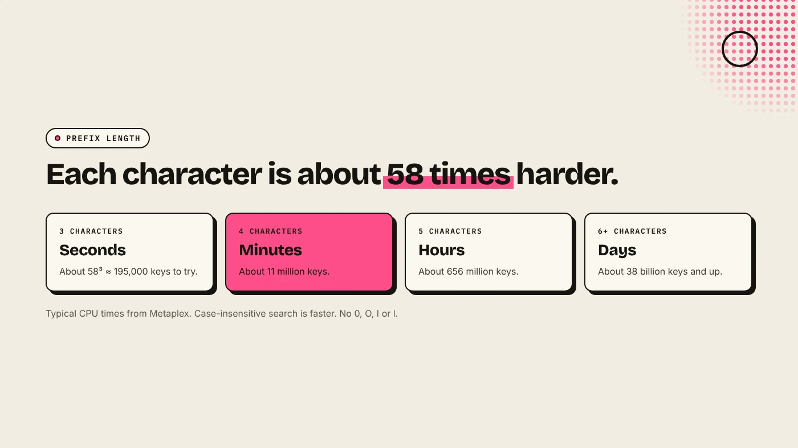
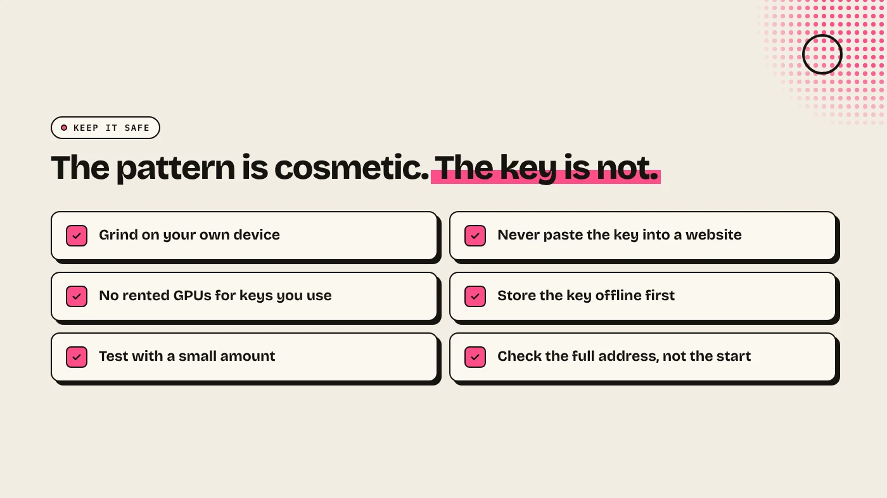

A Solana vanity address is a normal wallet or mint address that starts or ends with characters you choose, such as DEGEN at the front. It is found by generating random keypairs until one matches, so each extra character makes the search about 58 times longer. It is purely cosmetic. Generate it locally, and never in a tool that sends your key anywhere.

:::note Key facts
- **Cosmetic only.** A vanity address works like any other address (Metaplex).
- **About 58 times harder per character.** Base58 has 58 possible characters for each position.
- **Not allowed:** the digit 0, capital O and I, and lowercase l.
- **DegenKit's Vanity Address tool** runs entirely in your browser. The keypair is never sent anywhere.
:::

:::note Not affiliated
DegenKit is not affiliated with Solana Labs, Metaplex or QuickNode.
:::

## How does a vanity address work?

A Solana address is the public half of a keypair, written in **base58**. You cannot choose an address directly. You can only generate keypairs at random and check each one. A vanity generator does this as fast as it can until the address starts (or ends) with your pattern. Then it gives you the matching keypair: the public address and its private key.

Because the search is random, the result is as secure as any other keypair. Metaplex states that grinding does not weaken the key. The risk is not the maths. It is who else sees the private key.

## How long does it take?

Each position has 58 possible characters, so every extra character multiplies the average search by about 58. Metaplex gives rough CPU estimates:

| Prefix length | Typical time |
|---|---|
| 3 characters | Seconds |
| 4 characters | Minutes |
| 5 characters | Hours |
| 6 or more | Days or longer |

Turning off case sensitivity makes a match more likely, because "degen", "DEGEN" and "DeGeN" all count. On a phone or laptop browser, 3 to 4 characters is realistic.

## How do you make one with DegenKit?

1. Open the [Solana launcher](/launch/solana/) and choose **Vanity Address**.
2. Type a **Desired prefix**. Use only base58 characters: no 0, O, I or l.
3. Choose **Case sensitive: No** for a faster result, or **Yes** for an exact match.
4. Click **Start generating** and wait.
5. When it matches, copy the **Private key (base58)** or click **Download keypair file (.json)**. Store it before you close the page.

The keypair is generated locally in your browser. DegenKit cannot recover it if you lose it.

## Can a token mint address be a vanity address?

Yes. QuickNode points to MetaDAO's token, whose mint address both starts and ends with "meta". Metaplex's tools accept a vanity keypair as the mint keypair, so the token is created at that address.

DegenKit's [Solana token creator](/launch/solana/) generates a fresh mint address for you and does not take a custom mint keypair. Use the Vanity Address tool for a memorable **wallet** address, such as a treasury or airdrop wallet. For more on what the mint address does, see [Solana token metadata explained](/blog/solana-token-metadata-explained/).

## How do you keep a vanity key safe?

- **Grind locally.** Metaplex warns that online vanity generators can steal your private key. Only use a tool that runs on your own device, as DegenKit's does.
- **Do not rent a GPU for a key you will use.** Whoever runs the hardware can see the key.
- **Store the key offline** before you fund the address, and test with a small amount first.
- **Import it into a wallet** such as Phantom or Solflare using the private key.

Our guide to [wallet security for token creators](/blog/wallet-security-for-token-creators/) covers storage in more detail.

## What are the risks?

- **Lost key, lost funds.** Nobody can recover a vanity private key for you.
- **Malicious generators.** A website that generates keys on its server can keep a copy.
- **Look-alike scams.** Scammers also make vanity addresses that copy the first and last characters of a real one. Always check the full address.

You can lose money in crypto. This is not financial advice.

## FAQ

### Is a Solana vanity address safe?

The key is as secure as any random key, as long as it was generated on your device and nobody else saw the private key.

### How many characters can I choose?

Any number in theory. In practice, 3 to 4 characters take seconds to minutes, and 6 or more can take days.

### Why can't I use 0, O, I or l?

Base58 leaves them out because they are easy to confuse with each other.

### Does a vanity address cost extra network fees?

No. Once created, it behaves like any other Solana address.

## Sources

- [Metaplex: Grind a vanity public key](https://www.metaplex.com/docs/solana/grind-vanity-public-key)
- [QuickNode: Create a custom vanity wallet address with the Solana CLI](https://www.quicknode.com/guides/solana-development/getting-started/how-to-create-a-custom-vanity-wallet-address-using-solana-cli)

Generate one in your browser with the **Vanity Address** tool on the [DegenKit Solana launcher](/launch/solana/).
